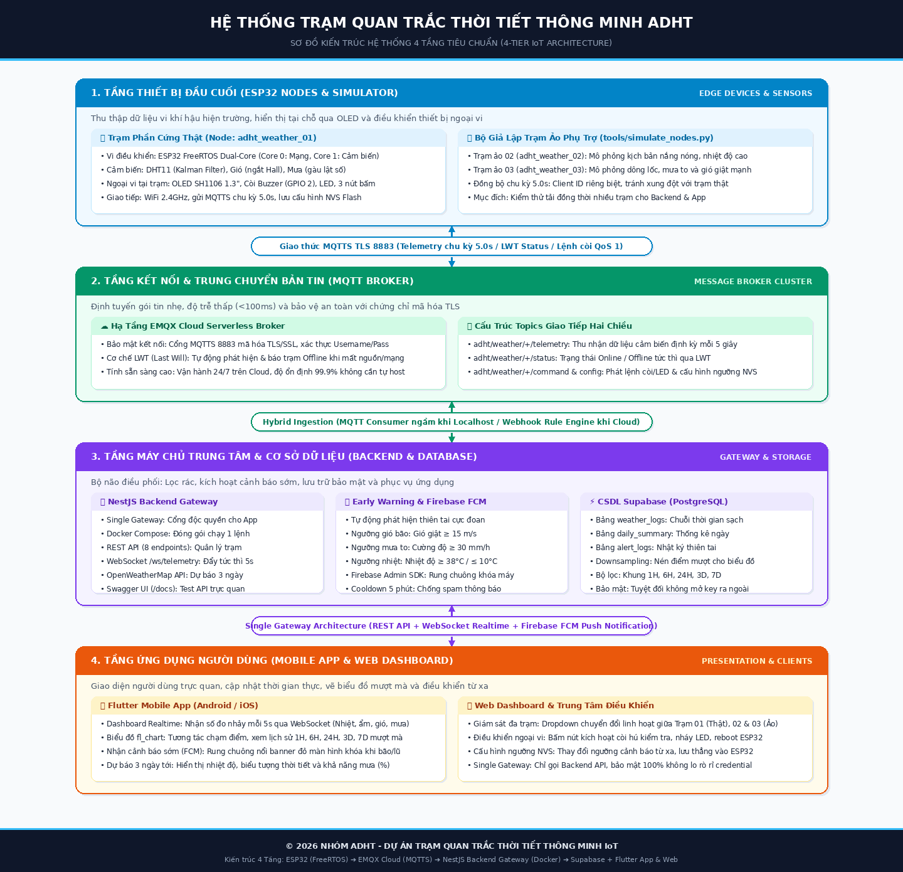

# 🌦️ ADHT Smart Weather Station & IoT Cloud Ecosystem

Hệ thống trạm quan trắc thời tiết thông minh phát triển bởi nhóm **ADHT**.

## 🚀 Sơ Đồ Kiến Trúc Hệ Thống (4 Tầng Chuẩn IoT)
```text
[1. ESP32 Node & Simulator] 
           │
           │ (MQTTS TLS: 8883 / 5s)
           ▼
[2. EMQX Cloud Broker] 
           │
           │ (Chuyển tiếp Webhook / MQTTS)
           ▼
[3. Backend Server (Docker Compose)] ──(Lưu trữ an toàn)──► [Supabase Database]
           │                                                       ▲
           ├────(Bắn thông báo đẩy khi bão/nhiệt cao)────► [Firebase FCM]
           │                                                       │
           ▼ (REST API + WebSocket Realtime)                       ▼ (Push Alert)
[4. Flutter Mobile App & Web Dashboard] ◄──────────────────────────┘
```



1. **Tầng 1 - Thiết bị (ESP32 & Simulator)**: Thu thập dữ liệu cảm biến DHT11 (bộ lọc Kalman), gàu lật mưa, chong chóng gió, hiển thị OLED SH1106 và publish gói tin MQTT mỗi **5 giây** lên **EMQX Cloud Serverless** qua cổng bảo mật TLS `8883`. Hỗ trợ trạm ảo đồng hành qua `tools/simulate_nodes.py`.
2. **Tầng 2 - Kết nối (MQTT Broker)**: **EMQX Cloud Serverless** quản lý phân phối tin nhắn và trạng thái Online/Offline qua cơ chế LWT (QoS 1).
3. **Tầng 3 - Máy chủ & CSDL (Backend & Database)**:
   - **Backend Application Gateway (Docker Compose)**: Lọc sạch dữ liệu cảm biến, làm mịn biểu đồ (Downsampling), cung cấp REST API & WebSocket, đồng bộ dự báo thời tiết OpenWeather, và gọi **Firebase Admin SDK** bắn thông báo đẩy FCM về điện thoại khi có dông lốc, mưa to.
   - **Supabase Cloud (PostgreSQL)**: Lưu trữ lịch sử quan trắc bền vững, chỉ cấp quyền truy xuất bảo mật cho Backend.
4. **Tầng 4 - Ứng dụng (Client Apps)**: **Flutter Mobile App & Web Dashboard** kết nối trực tiếp với Backend (qua REST API + WebSocket) và nhận thông báo rung chuông màn hình khóa (FCM) ngay cả khi đã tắt App.

## 📁 Cấu trúc Repository (Monorepo)
- **`adht-weather-firmware/`**: Mã nguồn nhúng cho vi điều khiển ESP32 (C++ trên PlatformIO, Dual-Core FreeRTOS, MQTTS TLS 8883, bảo mật `.env`).
- **`adht-weather-backend/`**: Máy chủ trung tâm viết bằng NestJS (TypeScript) đóng gói trong Docker Compose (REST API, WebSocket Gateway, Firebase FCM Alert, Supabase Manager).
- **`adht-weather-app/`**: Ứng dụng di động & Web Dashboard đa nền tảng viết bằng Flutter (Dart).
- **`tools/`**: Bộ công cụ kiểm thử & giả lập trạm ảo đồng hành (`simulate_nodes.py`).
- **`docs/`**: Thư mục tài liệu kỹ thuật dự án:
  - **[`PROJECT_PLAN.md`](file:///home/duongan/Documents/Code/IoT-project/docs/PROJECT_PLAN.md)**: Bản đặc tả kiến trúc kỹ thuật và kế hoạch chi tiết của dự án.
  - **[`FIRMWARE_REFINEMENT_PLAN.md`](file:///home/duongan/Documents/Code/IoT-project/docs/FIRMWARE_REFINEMENT_PLAN.md)**: Báo cáo phân tích chuyên sâu 11 vấn đề kỹ thuật và lộ trình tinh chỉnh firmware ESP32.
  - **[`architecture_4_tiers.png`](file:///home/duongan/Documents/Code/IoT-project/docs/architecture_4_tiers.png)**: Ảnh sơ đồ kiến trúc hệ thống 4 tầng độ phân giải cao.
  - **[`architecture_4_tiers.svg`](file:///home/duongan/Documents/Code/IoT-project/docs/architecture_4_tiers.svg)**: Ảnh sơ đồ kiến trúc định dạng Vector.
