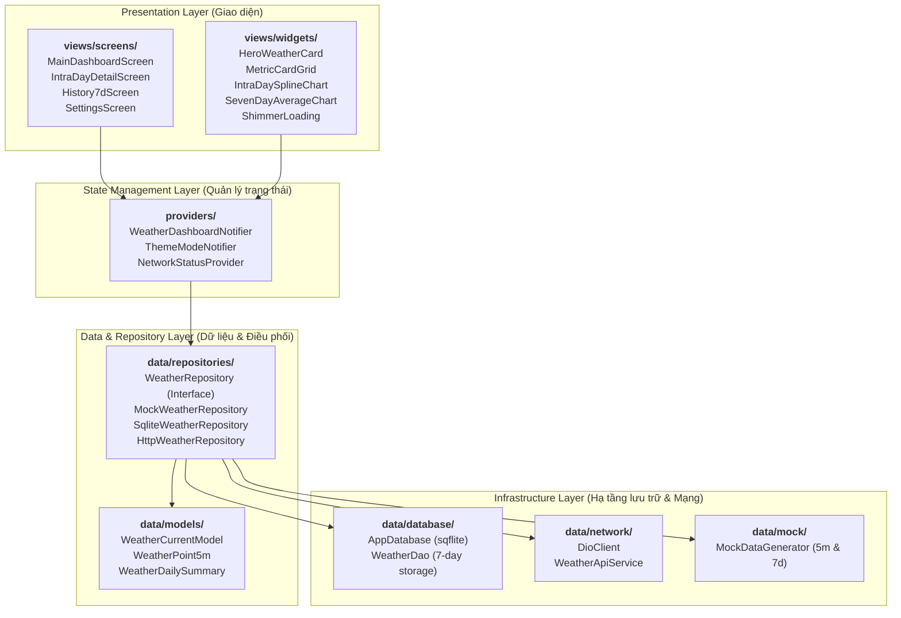
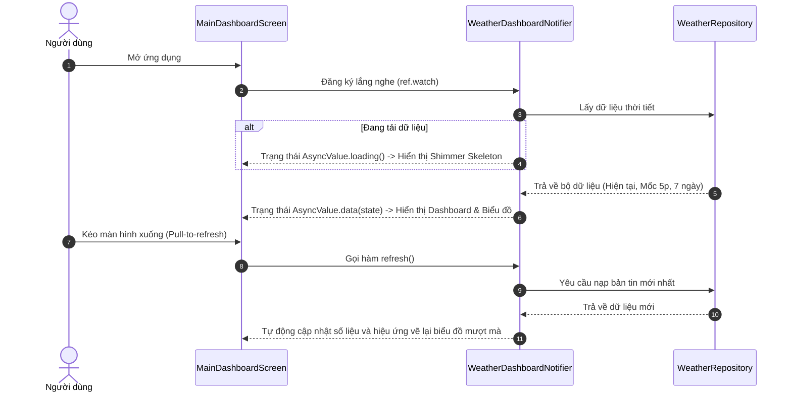

# Kiến Trúc Hệ Thống & Cấu Trúc Mã Nguồn (System Architecture)

> **Dự án**: Weather Monitoring Mobile App  
> **Mô hình kiến trúc**: Layered Clean Architecture kết hợp Repository Pattern & Riverpod State Management.  
> **Tiêu chí cốt lõi**: Phân tách triệt để giữa Giao diện (Presentation) và Dữ liệu (Data), hỗ trợ phát triển UI-First với Mock Data và sẵn sàng tích hợp SQLite & HTTP API.

---

## 1. Mô Hình Phân Tầng Kiến Trúc (Architectural Layers)

Hệ thống được thiết kế theo mô hình phân lớp rõ ràng, đảm bảo nguyên tắc trách nhiệm đơn lẻ (Single Responsibility Principle) và dễ dàng bảo trì, kiểm thử:



### 1.1. Tầng Presentation (`lib/views/`)
- **Nhiệm vụ**: Chịu trách nhiệm hoàn toàn về hiển thị và ghi nhận cử chỉ người dùng (chạm, vuốt, cuộn).
- **Quy tắc vàng**:
  - Không chứa bất kỳ logic nghiệp vụ (Business logic) hay logic gọi HTTP/Database trực tiếp.
  - Được chia tách thành 2 thư mục con rõ ràng:
    - `views/screens/`: Các trang màn hình hoàn chỉnh, điều phối bố cục tổng thể.
    - `views/widgets/`: Các thành phần giao diện con tái sử dụng (thẻ chỉ số, biểu đồ, khung xương shimmer, thanh điều hướng).

### 1.2. Tầng Quản lý Trạng thái (`lib/providers/`)
- **Nhiệm vụ**: Sử dụng **`flutter_riverpod`** để quản lý trạng thái của ứng dụng theo cơ chế bất biến (Immutable State).
- Cung cấp dữ liệu dưới dạng `AsyncValue<T>` cho màn hình, tự động bao quát 3 trạng thái:
  - `AsyncValue.loading()`: Kích hoạt hiển thị khung xương Shimmer hoặc con quay quay khi vuốt làm mới.
  - `AsyncValue.data(data)`: Cung cấp tập dữ liệu thời tiết và biểu đồ mượt mà cho UI.
  - `AsyncValue.error(error, stackTrace)`: Xử lý lỗi mà không làm ứng dụng bị dừng đột ngột.

### 1.3. Tầng Dữ liệu & Điều phối (`lib/data/repositories/`)
- **Nhiệm vụ**: Đóng vai trò là cầu nối độc lập (Single Source of Truth) giữa ứng dụng và các nguồn dữ liệu.
- Sử dụng **Repository Pattern**:
  ```dart
  abstract class WeatherRepository {
    Future<WeatherCurrentModel> getCurrentWeather();
    Future<List<WeatherPoint5m>> getIntraDayData5m();
    Future<List<WeatherDailySummary>> get7DaysSummary();
    Future<void> refreshAllData();
  }
  ```
- **Lợi ích chiến lược**:
  - Ở giai đoạn hiện tại (UI-First): Triển khai `MockWeatherRepository` để cung cấp dữ liệu giả lập chuẩn xác cho UI và biểu đồ 5 phút/7 ngày.
  - Khi có tài liệu API và hạ tầng database: Chỉ cần thay thế bằng `WeatherRepositoryImpl` kết nối `WeatherApiService` (HTTP) và `WeatherDao` (SQLite) mà **không làm thay đổi bất kỳ dòng mã nào ở tầng Views và Providers**.

### 1.4. Tầng Hạ tầng (`lib/data/database/` & `lib/data/network/`)
- **SQLite Database (`sqflite`)**: Quản lý tệp CSDL SQLite cục bộ trên máy, lưu trữ dữ liệu đo trong 7 ngày gần nhất, thực hiện truy vấn tổng hợp giá trị trung bình ngày và tự động dọn dẹp các mốc thời gian cũ hơn 7 ngày.
- **Dio HTTP Client (`dio`)**: Cấu hình kết nối HTTP REST API, quản lý timeout (kết nối tối đa 10s), tự động gắn header và chuyển đổi mã lỗi mạng.

---

## 2. Cấu Trúc Thư Mục Mã Nguồn Chuẩn Mực (`lib/`)

```
lib/
├── core/                                 # Tài nguyên dùng chung cốt lõi
│   ├── constants/
│   │   ├── api_constants.dart            # Cấu hình URL, cổng, đường dẫn API
│   │   ├── app_colors.dart               # Bảng màu thời tiết Material 3
│   │   ├── app_typography.dart           # Cấu hình phông chữ GoogleFonts
│   │   └── app_dimensions.dart           # Bảng kích thước lề 8-pt grid
│   ├── theme/
│   │   ├── app_theme.dart                # Cấu hình Light Theme & Dark Theme
│   │   └── color_schemes.dart            # Bảng màu ColorScheme thích ứng
│   └── utils/
│       ├── date_time_formatter.dart       # Định dạng mốc 5 phút (HH:mm), ngày (dd/MM)
│       └── weather_unit_helper.dart       # Định dạng đơn vị đo (°C, %, mm, km/h)
│
├── data/                                 # Tầng dữ liệu & Lưu trữ
│   ├── database/                         # Cơ sở dữ liệu SQLite cục bộ
│   │   ├── app_database.dart             # Khởi tạo SQLite, tạo bảng và chỉ mục (Index)
│   │   └── weather_dao.dart              # Các hàm CRUD và dọn dẹp tự động 7 ngày
│   ├── mock/                             # Dữ liệu giả lập chân thực phục vụ UI-First
│   │   └── mock_weather_data.dart        # Thuật toán sinh mốc 5 phút và trung bình 7 ngày
│   ├── models/                           # Các thực thể dữ liệu (Data Entities)
│   │   ├── weather_current_model.dart    # Model dữ liệu tức thời
│   │   ├── weather_point_5m.dart         # Model điểm đo 5 phút (timestamp + 4 thông số)
│   │   └── weather_daily_summary.dart    # Model tóm tắt ngày (Nhiệt độ TB, Độ ẩm TB, v.v.)
│   ├── network/                          # Giao thức HTTP REST
│   │   ├── dio_client.dart               # Cấu hình Dio client và interceptors
│   │   └── weather_api_service.dart      # Interface gọi các endpoint backend
│   └── repositories/                     # Tầng điều phối dữ liệu
│       ├── weather_repository.dart       # Interface chuẩn cho toàn bộ app
│       └── mock_weather_repository.dart  # Triển khai Mock ban đầu
│
├── providers/                            # Tầng Quản lý trạng thái (State Management)
│   ├── weather_dashboard_provider.dart   # Quản lý dữ liệu màn hình chính và làm mới
│   ├── intra_day_provider.dart           # Quản lý danh sách mốc 5 phút trong ngày
│   ├── history_7d_provider.dart          # Quản lý danh sách trung bình 7 ngày
│   ├── theme_mode_provider.dart          # Quản lý chuyển đổi Light/Dark Mode
│   └── weather_dashboard_state.dart      # Lớp trạng thái giao diện bất biến
│
├── views/                                # Tầng Giao diện người dùng (Presentation)
│   ├── screens/                          # Màn hình chính
│   │   ├── main_dashboard_screen.dart    # Màn hình Dashboard trung tâm
│   │   ├── intra_day_detail_screen.dart  # Màn hình biểu đồ chi tiết trong ngày
│   │   ├── history_7d_screen.dart        # Màn hình biểu đồ phân tích 7 ngày
│   │   └── settings_screen.dart          # Màn hình cài đặt trạm và giao diện
│   └── widgets/                          # Thành phần giao diện con tái sử dụng
│       ├── common/
│       │   ├── app_header_bar.dart       # Header thông tin trạm đo và trạng thái
│       │   ├── custom_pull_refresh.dart  # Thành phần vuốt để làm mới
│       │   ├── offline_indicator.dart    # Banner cảnh báo dữ liệu ngoại tuyến
│       │   └── shimmer_card_skeleton.dart# Khung xương tải trang mượt mà
│       ├── current/
│       │   ├── hero_weather_card.dart    # Thẻ lớn tổng quan thời tiết
│       │   ├── metric_card_grid.dart     # Lưới 4 ô cảm biến (2x2)
│       │   └── single_metric_tile.dart   # Thẻ con chi tiết từng thông số
│       └── charts/
│           ├── intra_day_spline_chart.dart # Biểu đồ đường cong mốc 5 phút
│           ├── rainfall_bar_chart.dart   # Biểu đồ cột lượng mưa
│           ├── seven_day_average_chart.dart# Biểu đồ cột/đường trung bình 7 ngày
│           └── interactive_touch_tooltip.dart # Tooltip chi tiết khi chạm tay
│
└── main.dart                             # Điểm khởi chạy ứng dụng (Entrypoint)
```

---

## 3. Quản Lý Trạng Thái Giao Diện Với Riverpod (State Management Workflow)

Ứng dụng sử dụng cấu trúc `AsyncNotifier` để theo dõi và cập nhật trạng thái dữ liệu:



---

## 4. Thiết Kế Cơ Sở Dữ Liệu SQLite Cục Bộ (`weather_readings`)

Để đảm bảo khả năng hiển thị ngoại tuyến trong 7 ngày, cấu trúc bảng CSDL SQLite được chuẩn hóa:

```sql
CREATE TABLE weather_readings (
    id INTEGER PRIMARY KEY AUTOINCREMENT,
    timestamp INTEGER NOT NULL,          -- Unix epoch time (mili-giây)
    temperature REAL NOT NULL,           -- Nhiệt độ (°C)
    humidity REAL NOT NULL,              -- Độ ẩm (%)
    rainfall REAL NOT NULL,              -- Lượng mưa (mm)
    wind_speed REAL NOT NULL,            -- Tốc độ gió (km/h)
    created_at INTEGER NOT NULL          -- Thời điểm ghi nhận vào máy
);

-- Chỉ mục tối ưu hóa tốc độ truy vấn theo mốc thời gian
CREATE INDEX idx_weather_timestamp ON weather_readings(timestamp ASC);
```

### Các câu truy vấn tối ưu sẵn sàng trong `WeatherDao`:
1. **Lấy bản ghi mới nhất**:
   ```sql
   SELECT * FROM weather_readings ORDER BY timestamp DESC LIMIT 1;
   ```
2. **Lấy chuỗi mốc 5 phút của ngày hôm nay**:
   ```sql
   SELECT * FROM weather_readings 
   WHERE timestamp >= ? AND timestamp <= ? 
   ORDER BY timestamp ASC;
   ```
3. **Tính giá trị trung bình theo từng ngày trong 7 ngày gần nhất**:
   ```sql
   SELECT 
       date(timestamp / 1000, 'unixepoch', 'localtime') as day,
       AVG(temperature) as avg_temp,
       AVG(humidity) as avg_humidity,
       SUM(rainfall) as total_rain,
       AVG(wind_speed) as avg_wind
   FROM weather_readings
   WHERE timestamp >= ?
   GROUP BY day
   ORDER BY day ASC;
   ```
4. **Tự động dọn dẹp bản ghi cũ hơn 7 ngày**:
   ```sql
   DELETE FROM weather_readings WHERE timestamp < ?;
   ```
