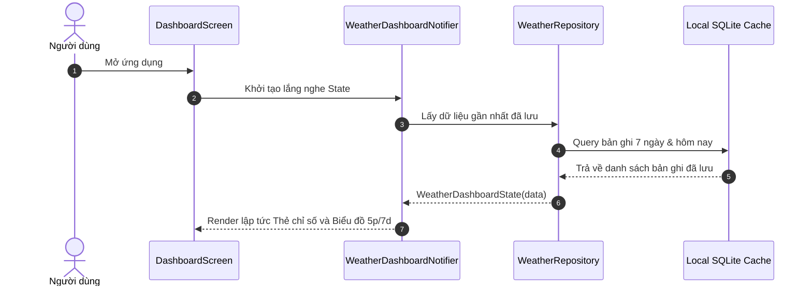
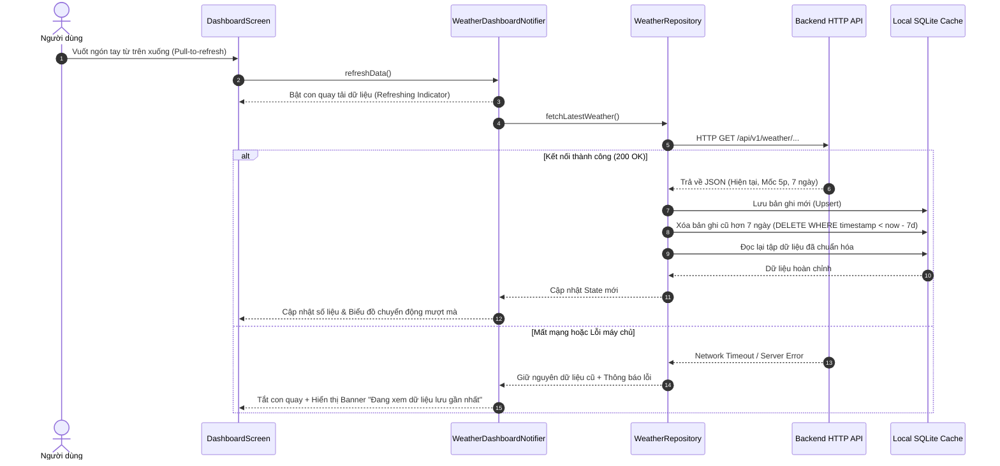

# Luồng Dữ Liệu & Quy Chuẩn Giao Tiếp (Data Flow & API Contracts)

> **Dự án**: Weather Monitoring Mobile App  
> **Tài liệu**: Chi tiết luồng luân chuyển dữ liệu từ Cảm biến -> HTTP Backend -> SQLite Local Cache -> State Management -> Biểu đồ giao diện `fl_chart`.

---

## 1. Sơ Đồ Luồng Dữ Liệu Tổng Thể (End-to-End Data Pipeline)

Hệ thống hoạt động theo mô hình **Cache-Then-Network** (Đọc bộ nhớ đệm trước - Cập nhật mạng sau):

```mermaid
flowchart LR
    subgraph Remote["Máy chủ Backend & Cảm biến"]
        Sensor["Cảm biến IoT (Nhiệt, Ẩm, Mưa, Gió)"] --> DB[("Database Máy chủ")]
        DB --> API["HTTP REST API"]
    end

    subgraph AppData["Tầng Dữ liệu Ứng dụng (App Data Layer)"]
        API -->|HTTP GET (Pull-to-refresh)| Dio["Dio HTTP Client"]
        Dio -->|JSON DTO| Repo["WeatherRepository"]
        Repo -->|Lưu trữ 7 ngày| SQLite[("SQLite Local DB")]
        SQLite -->|Đọc tức thì khi mở app| Repo
        Mock["MockDataGenerator"] -.->|Dữ liệu giả lập UI-First| Repo
    end

    subgraph AppUI["Tầng Giao diện Người dùng (Presentation)"]
        Repo -->|Entities / Models| Provider["Riverpod Notifier"]
        Provider -->|Transform to FlSpot| Charts["Biểu đồ fl_chart (5p & 7d)"]
        Provider -->|Trạng thái hiển thị| Dashboard["Dashboard & Thẻ chỉ số"]
    end
```

---

## 2. Các Kịch Bản Luồng Dữ Liệu Chi Tiết (Detailed Sequences)

### 2.1. Kịch bản 1: Mở Ứng Dụng (Instant Launch Flow)
Mục tiêu: Đạt tốc độ hiển thị tức thì (< 0.2 giây), không để người dùng nhìn màn hình trắng.



---

### 2.2. Kịch bản 2: Vuốt Làm Mới (Pull-to-Refresh Flow)
Mục tiêu: Lấy dữ liệu mới nhất từ máy chủ, đồng bộ vào SQLite và vẽ lại biểu đồ.



---

## 3. Quy Chuẩn Định Dạng Dữ Liệu (API Contracts & DTOs)

Dưới đây là đặc tả cấu trúc JSON chuẩn hóa được sử dụng xuyên suốt trong tầng DTO (Data Transfer Object):

### 3.1. Dữ liệu Thời tiết Hiện tại (`CurrentWeatherDTO`)
```json
{
  "station_id": "STATION_001",
  "station_name": "Trạm Quan Trắc IoT Trung Tâm",
  "timestamp": 1793769600000,
  "temperature": 28.6,
  "humidity": 68.5,
  "rainfall": 0.0,
  "wind_speed": 12.4,
  "status": "online"
}
```

### 3.2. Dữ liệu Diễn biến Trong ngày mốc 5 phút (`IntraDaySeriesDTO`)
Danh sách các điểm đo ghi nhận từ `00:00` sáng đến thời điểm hiện tại:
```json
{
  "date": "2026-11-04",
  "interval_minutes": 5,
  "readings": [
    {
      "time": "00:00",
      "timestamp": 1793721600000,
      "temperature": 24.2,
      "humidity": 85.0,
      "rainfall": 0.0,
      "wind_speed": 6.5
    },
    {
      "time": "00:05",
      "timestamp": 1793721900000,
      "temperature": 24.1,
      "humidity": 85.2,
      "rainfall": 0.0,
      "wind_speed": 7.0
    },
    {
      "time": "12:15",
      "timestamp": 1793765700000,
      "temperature": 32.8,
      "humidity": 55.4,
      "rainfall": 0.2,
      "wind_speed": 15.8
    }
  ]
}
```

### 3.3. Dữ liệu Xu hướng 7 Ngày Gần nhất (`SevenDaySummaryDTO`)
Mỗi phần tử đại diện cho giá trị trung bình ngày và tổng lượng mưa tích lũy:
```json
{
  "days": [
    {
      "date": "2026-10-29",
      "day_of_week": "Thứ Năm",
      "avg_temperature": 27.4,
      "min_temperature": 23.1,
      "max_temperature": 31.8,
      "avg_humidity": 74.2,
      "total_rainfall": 12.5,
      "avg_wind_speed": 11.2
    },
    {
      "date": "2026-11-04",
      "day_of_week": "Hôm nay",
      "avg_temperature": 28.5,
      "min_temperature": 24.0,
      "max_temperature": 33.2,
      "avg_humidity": 66.8,
      "total_rainfall": 0.5,
      "avg_wind_speed": 13.0
    }
  ]
}
```

---

## 4. Pipeline Chuyển Đổi Dữ Liệu Lên Đồ Thị `fl_chart` (Data Transformation Pipeline)

Để thư viện `fl_chart` hiển thị mượt mà các mốc 5 phút và trung bình 7 ngày mà không gây drop frame, dữ liệu thô được chuẩn hóa theo quy trình sau:

### 4.1. Chuẩn hóa Trục Tọa độ Biểu đồ 5 Phút Trong Ngày
1. **Ánh xạ trục X**:
   - Sử dụng số phút tính từ đầu ngày (`minutes_from_midnight = hour * 60 + minute`).
   - Mốc `00:00` tương ứng $X = 0$.
   - Mốc `12:00` tương ứng $X = 720$.
   - Mốc hiện tại (ví dụ `14:30`) tương ứng $X = 870$.
   - Điểm vẽ tọa độ: `FlSpot(x: minutes_from_midnight.toDouble(), y: temperature)`.
2. **Xử lý nhãn Trục X (Bottom Titles)**:
   - Chỉ in nhãn giờ tại các điểm chia hết cho 180 phút (mỗi 3 giờ: `00:00`, `03:00`, `06:00`, `09:00`, `12:00`, `15:00`, `18:00`, `21:00`).
   - Các điểm 5 phút còn lại không in nhãn trục để tránh đè chữ.
3. **Hiển thị Tooltip cảm ứng (Touch Tooltip)**:
   - Khi ngón tay chạm vào $X = 870$, Tooltip tự động chuyển đổi ngược lại thành chuỗi thời gian:
     $$\text{hour} = \lfloor 870 / 60 \rfloor = 14, \quad \text{min} = 870 \pmod{60} = 30 \implies \text{"14:30"}$$
   - Hiển thị giá trị chính xác tại mốc đó: `"Nhiệt độ: 30.5°C"`.

### 4.2. Chuẩn hóa Trục Tọa độ Biểu đồ 7 Ngày
1. **Ánh xạ trục X**: $X \in [0, 1, 2, 3, 4, 5, 6]$ tương ứng 7 ngày liên tiếp từ cũ nhất đến hôm nay.
2. **Cột BarChart**: Mỗi cột có chiều cao $Y = \text{avg\_value}$ (hoặc $\text{total\_rainfall}$).
3. **Phân biệt ngày hôm nay**: Cột $X = 6$ (Hôm nay) được tô màu gradient nổi bật hơn các ngày trước đó để người dùng nhận diện tức thì.
