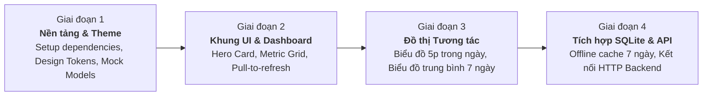

# Dự Án Weather Monitoring Mobile App: Tổng Quan & Kế Hoạch Triển Khai (Project Overview)

> **Trạng thái**: Đã phê duyệt kế hoạch (Approved Plan)  
> **Phiên bản tài liệu**: 1.0.0  
> **Nền tảng mục tiêu**: Mobile (Android & iOS)  
> **Công nghệ chủ đạo**: Flutter 3.x & Dart 3.x  
> **Chiến lược phát triển**: UI-First & Mock-Driven, sẵn sàng mở rộng Offline SQLite & HTTP REST API.

---

## 1. Bối Cảnh & Mục Tiêu Dự Án (Context & Objectives)

### 1.1. Bối cảnh (Context)
Hệ thống giám sát thời tiết (Weather Monitoring System) của dự án đã hoàn thành toàn bộ phần cứng cảm biến IoT và hạ tầng cơ sở dữ liệu (Database). Hệ thống chuyên thu thập và ghi nhận 4 thông số môi trường quan trọng:
1. **Nhiệt độ (Temperature)** - Đơn vị: Độ C (°C).
2. **Độ ẩm không khí (Humidity)** - Đơn vị: Phần trăm (%).
3. **Lượng mưa (Rainfall)** - Đơn vị: Milimét (mm).
4. **Tốc độ gió (Wind Speed)** - Đơn vị: Kilômét trên giờ (km/h).

Để người dùng có thể theo dõi và phân tích dữ liệu trực quan mọi lúc mọi nơi, dự án cần một **ứng dụng di động đa nền tảng (Android & iOS)** hoạt động mượt mà, trực quan hóa số liệu đo đạc dưới dạng các thẻ chỉ số (Metric Cards) và biểu đồ tương tác cao (Interactive Charts).

### 1.2. Mục tiêu cốt lõi (Core Objectives)
- **Tập trung cao độ vào UI/UX**: Giao diện người dùng hiện đại, sắc nét, áp dụng ngôn ngữ thiết kế **Material 3 Clean**, bố cục thẻ thông tin (Card-based layout) khoa học và trực quan.
- **Trực quan hóa đa chiều (3 Khung nhìn thời gian)**:
  - **Thời tiết hiện tại**: Hiển thị tức thời 4 thông số mới nhất cùng đánh giá nhanh.
  - **Diễn biến trong ngày (00:00 đến thời điểm hiện tại)**: Biểu đồ đường cong mượt mà (Spline/Line Chart) và biểu đồ cột với độ phân giải chi tiết lên tới **5 phút/mốc đo**.
  - **Xu hướng 7 ngày gần nhất**: Biểu đồ so sánh giá trị **trung bình ngày** (Avg Temp, Avg Humidity, Avg Wind Speed) và tổng lượng mưa tích lũy của 7 ngày qua.
- **Tối ưu trải nghiệm thao tác**:
  - Cơ chế **Vuốt để làm mới (Pull-to-refresh)** trực quan, không dùng polling ngầm nhằm tiết kiệm pin tối đa cho thiết bị.
  - Khả năng tương tác trên biểu đồ (Chạm/Lướt ngón tay để hiển thị Tooltip thông số tại từng thời điểm).
- **Chiến lược Thực thi UI-First**: Ưu tiên xây dựng khung giao diện hoàn chỉnh, sử dụng bộ dữ liệu giả lập chân thực (Realistic Mock Generator) để đánh giá UX trước, sẵn sàng ghép nối với Backend HTTP REST API và cơ sở dữ liệu SQLite cục bộ lưu trữ 7 ngày khi nhận được tài liệu backend.

---

## 2. Phạm Vi Dự Án (Project Scope)

### 2.1. Trong phạm vi (In-Scope)
- Phát triển ứng dụng Flutter chạy trên cả 2 nền tảng: **Android (API 21+)** và **iOS (iOS 12+)**.
- Thiết kế hệ thống giao diện:
  - Màn hình chính Dashboard: Thẻ Hero Weather Card, Lưới 4 ô cảm biến, Biểu đồ nhanh trong ngày.
  - Màn hình phân tích chi tiết trong ngày (Intra-day 5m Detail Screen).
  - Màn hình phân tích xu hướng 7 ngày (7-Day Average Analysis Screen).
  - Màn hình cài đặt kết nối và tùy biến giao diện (Settings Screen).
- Tích hợp biểu đồ bằng thư viện `fl_chart` với hiệu ứng chuyển động mượt mà.
- Thiết kế kiến trúc phân lớp sạch (Clean/Layered Architecture) với `flutter_riverpod` để phân tách rạch ròi giữa Giao diện (Views) và Dữ liệu (Data).
- Thiết kế sẵn sàng tầng lưu trữ ngoại tuyến bằng **SQLite (`sqflite`)** cho bộ nhớ đệm 7 ngày và cơ chế tự động dọn dẹp (Auto-purge).

### 2.2. Ngoài phạm vi hiện tại (Out-of-Scope)
- Không can thiệp sửa đổi firmware phần cứng cảm biến hoặc cấu hình database server phía backend.
- Chưa kết nối trực tiếp vào mạng nội bộ/production server cho đến khi nhận được tài liệu đặc tả API chính thức từ đội ngũ backend.
- Không xây dựng các tính năng ngoài 4 cảm biến đã nêu (ví dụ: áp suất khí quyển, UV, chất lượng không khí AQI).

---

## 3. Lộ Trình Phát Triển & Các Cột Mốc (Roadmap & Milestones)

Dự án được chia làm 4 giai đoạn rõ ràng nhằm đảm bảo bàn giao nhanh chóng sản phẩm giao diện có thể chạy thử trực tiếp trên điện thoại:

| Cột mốc (Milestone) | Nội dung công việc chính | Kết quả đầu ra (Deliverable) |
|---|---|---|
| **Giai đoạn 1: Foundation & Theme Setup** | - Cấu hình `pubspec.yaml` (`fl_chart`, `flutter_riverpod`, `google_fonts`, `intl`, `shimmer`). - Xây dựng hệ thống bảng màu (Weather Color Palette), Typography (Inter/Outfit), Theme Material 3. - Xây dựng bộ `MockWeatherService` sinh dữ liệu 5 phút và 7 ngày thực tế. | Nền tảng project sạch, chạy thử được khung app cơ bản với Theme chuẩn. |
| **Giai đoạn 2: UI Dashboard & Metric Cards** | - Phát triển `MainDashboardScreen` với bố cục cuộn mượt mà. - Xây dựng `HeroWeatherCard` tổng quan và `MetricCardGrid` cho 4 thông số. - Tích hợp `CustomPullRefresh` kích hoạt làm mới giao diện. | Giao diện Dashboard hoàn chỉnh, xem được thông số hiện tại tức thì. |
| **Giai đoạn 3: Interactive Charts Implementation** | - Xây dựng `IntraDaySplineChart` với độ phân giải mốc 5 phút từ 00:00 đến hiện tại. - Xây dựng `SevenDayAverageChart` thể hiện giá trị trung bình 7 ngày. - Xây dựng `RainfallBarChart` dạng cột và `InteractiveTouchTooltip` khi chạm tay vào đồ thị. | Toàn bộ 2 màn hình biểu đồ và widget trực quan hóa hoạt động 60fps mượt mà. |
| **Giai đoạn 4: Offline Caching & Backend Hook** | - Thiết lập SQLite (`sqflite`) lưu giữ bản ghi 7 ngày gần nhất. - Viết câu lệnh tự động xóa bản ghi cũ hơn 7 ngày. - Khi có tài liệu API từ backend: Viết DTO Parser và chuyển nguồn dữ liệu từ Mock sang HTTP REST API thật. | Ứng dụng production sẵn sàng phát hành trên Google Play Store và Apple App Store. |

---

## 4. Nguyên Tắc Thiết Kế UI/UX (Design Principles)

Dự án áp dụng chặt chẽ các quy chuẩn thiết kế từ bộ công cụ `flutter-ai-ui-skill`:
1. **Material 3 Clean Style**: Sử dụng hệ thống màu sắc dựa trên ngữ cảnh thời tiết (Sky Blue, Amber Sun, Rain Slate, Emerald Wind).
2. **8-Point Spacing Grid**: Mọi khoảng cách lề (padding/margin) tuân thủ bội số của 8dp (8, 16, 24, 32dp) tạo sự cân đối thị giác cao cấp.
3. **Thao tác 1 tay (One-Hand Ergonomics)**: Các nút bấm, vùng vuốt làm mới và bộ chọn thời gian nằm trong tầm với thuận tiện của ngón cái.
4. **Hiển thị thông tin phân cấp (Visual Hierarchy)**: Chỉ số quan trọng nhất (Nhiệt độ hiện tại) nổi bật nhất; các chỉ số thứ cấp (Độ ẩm, Lượng mưa, Gió) được phân nhóm khoa học trong các thẻ bo tròn mềm mại.
5. **Trạng thái trực quan (Visual States)**: Mọi thao tác tải trang đều có hiệu ứng khung xương (Shimmer Loading); mọi lỗi mất kết nối đều có banner thông báo trạng thái ngoại tuyến mà không làm gián đoạn trải nghiệm của người dùng.
