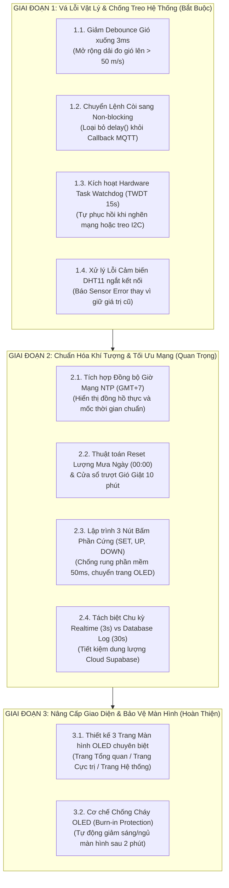

# 🛠️ PHÂN TÍCH KỸ THUẬT & KẾ HOẠCH TINH CHỈNH FIRMWARE ESP32

> **Dự án**: Trạm Quan trắc Thời tiết Thông minh ADHT  
> **Phân hệ**: Phần mềm nhúng ESP32 (`adht-weather-firmware`)  
> **Tiêu chuẩn đối chiếu**: Tổ chức Khí tượng Thế giới (WMO), Trạm thời tiết Davis Vantage Pro2, SparkFun Weather Station, Chuẩn kiến trúc FreeRTOS 24/7.  
> **Trạng thái**: Bản kế hoạch phân tích & lộ trình triển khai kỹ thuật (Chưa áp dụng vào mã nguồn).

---

## MỤC LỤC
1. [Đánh giá Tổng quan Hiện trạng](#1-đánh-giá-tổng-quan-hiện-trạng)
2. [Phân tích Chi tiết 11 Vấn đề Kỹ thuật Cần Tinh Chỉnh](#2-phân-tích-chi-tiết-11-vấn-đề-kỹ-thuật-cần-tinh-chỉnh)
   - [2.1. Nghẽn đo tốc độ gió do Debounce 50ms](#21-nghẽn-đo-tốc-độ-gió-do-debounce-50ms)
   - [2.2. Gió giật (Wind Gust) không có chu kỳ làm mới](#22-gió-giật-wind-gust-không-có-chu-kỳ-làm-mới)
   - [2.3. Lượng mưa tích lũy và Cường độ mưa tức thời](#23-lượng-mưa-tích-lũy-và-cường-độ-mưa-tức-thời)
   - [2.4. Độ trễ Kalman Filter và Giám sát lỗi cảm biến DHT11](#24-độ-trễ-kalman-filter-và-giám-sát-lỗi-cảm-biến-dht11)
   - [2.5. Lệnh delay() trong Callback MQTT làm nghẽn Core 0](#25-lệnh-delay-trong-callback-mqtt-làm-nghẽn-core-0)
   - [2.6. Tranh chấp tài nguyên điều khiển Còi (Race Condition)](#26-tranh-chấp-tài-nguyên-điều-khiển-còi-race-condition)
   - [2.7. Chưa lập trình 3 nút nhấn phần cứng (SET, UP, DOWN)](#27-chưa-lập-trình-3-nút-nhấn-phần-cứng-set-up-down)
   - [2.8. Thiếu Task Watchdog Timer (TWDT) chống treo ngoài trời](#28-thiếu-task-watchdog-timer-twdt-chống-treo-ngoài-trời)
   - [2.9. Tần suất ghi dữ liệu 3s/lần làm phình Database Supabase](#29-tần-suất-ghi-dữ-liệu-3slần-làm-phình-database-supabase)
   - [2.10. Thiếu đồng bộ thời gian thực qua NTP](#210-thiếu-đồng-bộ-thời-gian-thực-qua-ntp)
   - [2.11. Nguy cơ lưu ảnh vĩnh viễn trên màn hình OLED (Burn-in)](#211-nguy-cơ-lưu-ảnh-vĩnh-viễn-trên-màn-hình-oled-burn-in)
3. [Lộ trình Tinh chỉnh Firmware (3 Giai đoạn Ưu tiên)](#3-lộ-trình-tinh-chỉnh-firmware-3-giai-đoạn-ưu-tiên)
4. [Bảng Tiêu chí Nghiệm thu Kỹ thuật (Acceptance Criteria)](#4-bảng-tiêu-chí-nghiệm-thu-kỹ-thuật-acceptance-criteria)

---

## 1. ĐÁNH GIÁ TỔNG QUAN HIỆN TRẠNG

### 1.1. Ưu điểm nổi bật đã đạt được
* **Tận dụng Dual-Core FreeRTOS**: Phân bổ Core 0 cho Network/MQTT và Core 1 cho Sensors/OLED/Alert, giúp việc lấy mẫu ngắt không bị khựng khi mạng xử lý mã hóa TLS.
* **Ngắt cạnh xuống có vùng bảo vệ (`portENTER_CRITICAL_ISR`)**: Biến đếm xung cảm biến mưa và gió được cập nhật an toàn trong ngữ cảnh ISR.
* **Tối ưu bộ nhớ**: Loại bỏ hoàn toàn HTTP Client Supabase trên vi điều khiển, giúp giảm tải mbedTLS và tiết kiệm hơn 40KB RAM Heap.
* **Lưu trữ NVS (`Preferences`)**: Lưu ngưỡng nhiệt độ, độ ẩm, gió và còi báo vào Flash không bay màu khi mất điện.

### 1.2. Nhận định tổng thể
Mã nguồn hiện tại đã hoàn thiện khung sườn kết nối và truyền tin cơ bản. Tuy nhiên, để hệ thống đạt chuẩn một **trạm quan trắc khí tượng tin cậy, hoạt động ổn định 24/7 ngoài trời và phản ánh chính xác các hiện tượng thời tiết cực đoan**, firmware cần được tinh chỉnh ở tầng thuật toán vật lý, đồng bộ bất đồng bộ và cơ chế bảo vệ phần cứng.

---

## 2. PHÂN TÍCH CHI TIẾT 11 VẤN ĐỀ KỸ THUẬT CẦN TINH CHỈNH

### 2.1. Nghẽn đo tốc độ gió do Debounce 50ms
* **Hiện trạng trong mã nguồn (`sensor_manager.cpp`)**:
  ```cpp
  void SensorManager::handleWindInterrupt() {
      uint32_t now = millis();
      if (now - lastWindDebounce > 50) { // 50ms debounce
          portENTER_CRITICAL_ISR(&isrMux);
          windPulseCount++;
          portEXIT_CRITICAL_ISR(&isrMux);
          lastWindDebounce = now;
      }
  }
  ```
* **Phân tích cơ học & giới hạn vật lý**:
  * Chu vi vòng quay của chong chóng gió:
    $$C = \pi \times D = \pi \times 0.208\text{ m} \approx 0.6535\text{ m}$$
  * Với thời gian chống rung $\Delta t = 50\text{ ms}$, tần số ngắt tối đa mà hệ thống có thể ghi nhận là:
    $$f_{\max} = \frac{1000\text{ ms}}{50\text{ ms}} = 20\text{ xung/giây (Hz)}$$
  * Tốc độ gió trần tối đa đo được:
    $$v_{\max} = f_{\max} \times C = 20 \times 0.6535 \approx \mathbf{13.07\text{ m/s}} \quad (\approx 47\text{ km/h})$$
* **Hậu quả**:
  Theo thang bão Beaufort, cấp 6 tương ứng từ $10.8 - 13.8\text{ m/s}$. Bất kỳ cơn gió nào từ **cấp 7 trở lên (gió mạnh, giông lốc, bão nhiệt đới > 50 km/h)** đều sẽ bị trạm cắt cụt và chỉ đo được tối đa $13\text{ m/s}$.
* **Giải pháp chuẩn**:
  Công tắc từ (Reed Switch) hoặc cảm biến Hall của chong chóng gió chỉ có thời gian nảy tiếp điểm cơ học khoảng $1 - 2\text{ ms}$. Giá trị debounce chuẩn cần hạ xuống **$2\text{ ms} - 4\text{ ms}$** (cho phép đo tốc độ gió lên tới trên $65\text{ m/s} \approx 234\text{ km/h}$).

---

### 2.2. Gió giật (Wind Gust) không có chu kỳ làm mới
* **Hiện trạng trong mã nguồn (`sensor_manager.cpp`)**:
  ```cpp
  if (speed > currentData.wind_max) {
      currentData.wind_max = speed;
  }
  ```
* **Hậu quả**:
  Biến `wind_max` không bao giờ được thiết lập lại (reset). Nếu vào ngày thứ 1 có một cơn gió giật $12\text{ m/s}$, thì suốt 30 ngày tiếp theo số đo `wind_max` vẫn mãi hiển thị $12\text{ m/s}$ dù những ngày sau đó trời lặng gió.
* **Chuẩn khí tượng WMO**:
  Gió giật (Wind Gust) phải được định nghĩa theo một cửa sổ trượt (thường là **10 phút** hoặc **trong ngày hiện tại**). Cần có bộ đếm thời gian tự động reset hoặc lưu giữ giá trị max trong cửa sổ quan sát gần nhất.

---

### 2.3. Lượng mưa tích lũy và Cường độ mưa tức thời
* **Hiện trạng**:
  * `RAIN_SAMPLE_PERIOD_SEC = 60` giây: Cường độ mưa (`rain_rate`) chỉ được tính toán 1 lần mỗi phút. Vì MQTT gửi dữ liệu mỗi 3 giây, nên nếu trời vừa dứt mưa, trên App và OLED vẫn hiển thị số đo mưa cũ suốt gần 60 giây tiếp theo.
  * `rain_total` cộng dồn vô hạn từ lúc khởi động trạm, không thể phân biệt được lượng mưa của ngày hôm nay so với ngày hôm qua.
* **Chuẩn khí tượng**:
  * Người dùng cần biết **Lượng mưa trong ngày (Daily Rainfall)**. Biến này cần được reset về `0.0 mm` vào thời điểm nửa đêm `00:00:00`.
  * Cường độ mưa tức thời (`rain_rate` mm/h) nên được tính toán dựa trên khoảng cách thời gian giữa 2 lần lật gàu liên tiếp ($\Delta t$), giúp phản ánh ngay khi trời bắt đầu mưa to hoặc tạnh mưa.

---

### 2.4. Độ trễ Kalman Filter và Giám sát lỗi cảm biến DHT11
* **Hiện trạng**:
  * Bộ lọc Kalman khởi tạo với tham số: `SimpleKalmanFilter(2, 2, 0.001)`.
  * Độ phân giải của DHT11 chỉ là số nguyên (1°C và 1%). Tham số quá trình $q = 0.001$ là quá nhỏ, khiến bộ lọc có quán tính cực lớn. Khi nhiệt độ môi trường thay đổi đột ngột (ví dụ trời hửng nắng hoặc mưa rào), bộ lọc phải mất hàng chục lần lấy mẫu mới đuổi kịp giá trị thực tế.
  * Nếu cảm biến DHT11 bị lỏng dây, đứt cáp tín hiệu: hàm `dht.readTemperature()` trả về `NaN`. Code hiện tại bỏ qua nhánh `isnan`, dẫn tới `currentData.temperature` giữ nguyên giá trị cũ mãi mãi.
* **Giải pháp**:
  * Điều chỉnh tham số quá trình $q$ lên khoảng $0.02 - 0.05$ để cân bằng giữa việc làm mịn số nguyên của DHT11 và độ nhạy thời gian thực.
  * Bổ sung cờ trạng thái lỗi cảm biến: Nếu sau 15 giây liên tục không đọc được dữ liệu DHT11 hợp lệ, trạm chuyển sang trạng thái cảnh báo `SENSOR_ERROR`, hiển thị lên OLED và gửi mã lỗi lên MQTT.

---

### 2.5. Lệnh delay() trong Callback MQTT làm nghẽn Core 0
* **Hiện trạng trong mã nguồn (`main.cpp`)**:
  ```cpp
  void handleMqttCommand(const String &cmd, const String &arg) {
      if (cmd == "buzzer") {
          digitalWrite(PIN_BUZZER, HIGH);
          delay(arg.toInt() > 0 ? arg.toInt() : 300);
          digitalWrite(PIN_BUZZER, LOW);
      }
      // ...
  }
  ```
* **Hậu quả nghiêm trọng**:
  Hàm callback này được gọi trực tiếp bên trong `mqttClient.loop()` của `taskNetwork` (Core 0). Việc gọi lệnh chặn `delay(500)` sẽ làm đứng hình toàn bộ Task Mạng trong nửa giây, dễ gây nghẽn hàng đợi TCP, rớt gói tin hoặc timeout kết nối MQTT với Broker.
* **Giải pháp**:
  Áp dụng mô hình **Non-blocking Event-driven**: Task mạng chỉ lưu biến mốc thời gian hết hạn (`buzzerOffTime = millis() + duration`) hoặc đẩy tin hiệu qua FreeRTOS Queue để `taskAlert` (Core 1) tự xử lý việc tắt mở còi.

---

### 2.6. Tranh chấp tài nguyên điều khiển Còi (Race Condition)
* **Hiện trạng**:
  * `taskAlert` (Core 1) tự động kiểm tra ngưỡng nguy hiểm và bật/tắt `PIN_BUZZER` mỗi chu kỳ 500ms.
  * `handleMqttCommand` (Core 0) cũng trực tiếp can thiệp vào `PIN_BUZZER` khi nhận lệnh từ App.
* **Hậu quả**:
  Không có Mutex đồng bộ giữa 2 Core. Ví dụ người dùng vừa bấm test còi trên App, thì ngay lập tức `taskAlert` ở Core 1 nhảy vào tắt còi do không có cảnh báo nhiệt/gió nào xảy ra.
* **Giải pháp**:
  Gom quyền điều khiển duy nhất chân GPIO Còi về cho `taskAlert`. Mọi yêu cầu từ ngoài (lệnh MQTT, nút bấm) chỉ cập nhật cờ trạng thái `manualBuzzerActive`.

---

### 2.7. Chưa lập trình 3 nút nhấn phần cứng (SET, UP, DOWN)
* **Hiện trạng**:
  Mạch phần cứng đã hàn sẵn và khai báo trong `config.h`:
  ```cpp
  #define PIN_BTN_SET       32
  #define PIN_BTN_UP        35
  #define PIN_BTN_DOWN      34
  ```
  Tuy nhiên, trong `main.cpp` hoàn toàn chưa khởi tạo `pinMode` và chưa có tác vụ đọc trạng thái nút nhấn.
* **Ảnh hưởng**:
  Người dùng khi kiểm tra ngoài thực địa không có cách nào thao tác trực tiếp trên trạm (không đổi được trang màn hình, không test còi tại chỗ, không tắt được cảnh báo).
* **Giải pháp**:
  Thêm module đọc nút nhấn (có chống rung phần mềm 50ms) để:
  * Nút **SET**: Chuyển đổi giữa các trang hiển thị OLED (Trang Tổng quan, Trang Cực trị, Trang Trạng thái Mạng).
  * Nút **UP / DOWN**: Tắt tiếng còi khẩn cấp (Snooze Alarm) hoặc kiểm tra nhanh hệ thống.

---

### 2.8. Thiếu Task Watchdog Timer (TWDT) chống treo ngoài trời
* **Hiện trạng**:
  Trạm hiện chưa kích hoạt Watchdog Timer của ESP-IDF.
* **Rủi ro**:
  Trạm thời tiết lắp đặt ngoài trời phải chạy liên tục 24/7 trong môi trường ẩm ướt, sấm sét và nhiễu sóng. Nếu bus I2C của màn hình OLED bị treo (kẹt đường SDA/SCL) hoặc thư viện mbedTLS bị deadlock khi mạng chập chờn, ESP32 sẽ bị "đơ" vĩnh viễn và không thể tự phục hồi trừ khi có người ra rút nguồn.
* **Giải pháp**:
  Đăng ký `esp_task_wdt_add(NULL)` cho các tác vụ quan trọng (`taskSensors`, `taskNetwork`). Nếu bất kỳ task nào bị kẹt quá 15 giây không thể "nuôi chó" (feed watchdog), phần cứng sẽ tự động khởi động lại an toàn.

---

### 2.9. Tần suất ghi dữ liệu 3s/lần làm phình Database Supabase
* **Hiện trạng**:
  * Tần suất phát MQTT hiện tại: `MQTT_PUBLISH_INTERVAL_MS = 3000` (3 giây/lần).
  * EMQX Rule Engine đang đẩy toàn bộ các bản tin này vào bảng `weather_logs` của Supabase.
* **Tính toán chi phí tài nguyên Cloud**:
  * 1 phút = 20 bản ghi.
  * 1 ngày = $20 \times 60 \times 24 = \mathbf{28.800\text{ bản ghi/ngày}}$.
  * 1 tháng = $\mathbf{864.000\text{ bản ghi/tháng}}$.
* **Hậu quả**:
  Gói Free của Supabase (giới hạn 500MB Database và số lượt request hàng tháng) sẽ cạn kiệt rất nhanh. Hơn nữa, thông số vi khí hậu (nhiệt độ, độ ẩm) không thể biến thiên sau mỗi 3 giây, gây lãng phí dung lượng lưu trữ các bản ghi trùng lặp.
* **Giải pháp chuẩn ngành**:
  * **Màn hình Realtime (App)**: Giữ nguyên chu kỳ phát MQTT **3 giây/lần** (Topic: `adht/weather/telemetry/live`) để kim đồng hồ nhảy số tức thời.
  * **Lưu trữ Lịch sử (Supabase)**: Phát định kỳ **30 giây hoặc 60 giây/lần** (Topic: `adht/weather/telemetry/log`) để EMQX ghi vào Supabase, giúp trạm có thể chạy liên tục cả năm mà không chạm trần dung lượng.

---

### 2.10. Thiếu đồng bộ thời gian thực qua NTP
* **Hiện trạng**:
  ESP32 hiện chỉ tính thời gian bằng `millis()` và `uptime`.
* **Hạn chế**:
  * Không thể hiển thị đồng hồ giờ thực trên màn hình OLED.
  * Không thể tự động reset tổng lượng mưa trong ngày vào đúng `00:00:00`.
* **Giải pháp**:
  Khi WiFi kết nối thành công, kích hoạt hàm chuẩn của ESP32:
  ```cpp
  configTime(7 * 3600, 0, "pool.ntp.org", "time.google.com");
  ```
  Hệ thống sẽ tự động đồng bộ giờ GMT+7 của Việt Nam chạy ngầm trong phần cứng.

---

### 2.11. Nguy cơ lưu ảnh vĩnh viễn trên màn hình OLED (Burn-in)
* **Hiện trạng**:
  Màn hình OLED SH1106 hiển thị cố định các chữ `ADHT`, `T:`, `H:`, các đường line ngang 24/7 ở cùng một vị trí với độ sáng tối đa.
* **Hậu quả**:
  Công nghệ diode phát quang hữu cơ OLED sẽ bị suy giảm vật liệu tại các điểm ảnh sáng liên tục, tạo ra hiện tượng **"bóng ma" (burn-in)** làm hỏng màn hình sau vài tháng lắp đặt ngoài trời.
* **Giải pháp**:
  * Tích hợp chế độ **Screen Saver**: Sau 2 phút không có thao tác nút bấm, màn hình tự động giảm độ sáng xuống mức thấp nhất hoặc tắt hiển thị.
  * Khi người dùng bấm bất kỳ nút nào hoặc khi trạm có cảnh báo nguy hiểm (nhiệt độ cao, gió bão), màn hình lập tức sáng trở lại.

---

## 3. LỘ TRÌNH TINH CHỈNH FIRMWARE (3 GIAI ĐOẠN ƯU TIÊN)



---

## 4. BẢNG TIÊU CHÍ NGHIỆM THU KỸ THUẬT (ACCEPTANCE CRITERIA)

| Hạng mục | Hiện trạng | Tiêu chuẩn sau Tinh chỉnh | Cách thức Đo kiểm / Nghiệm thu |
|---|---|---|---|
| **Giới hạn tốc độ gió** | $\le 13.0\text{ m/s}$ (cắt cụt) | $\ge 50.0\text{ m/s}$ ($> 180\text{ km/h}$) | Phát xung máy phát sóng $100\text{ Hz}$ vào GPIO 13, kiểm tra số đo $\approx 65\text{ m/s}$. |
| **Độ trễ Callback MQTT** | Bị block tới $500\text{ ms}$ | $0\text{ ms}$ (Non-blocking) | Bắn liên tục lệnh còi từ App, kiểm tra nhịp loop MQTT không bị trễ. |
| **Phục hồi khi treo (WDT)** | Treo vô hạn đến khi rút nguồn | Tự reset sau tối đa $15\text{ giây}$ | Cố tình tạo vòng lặp vô hạn `while(1)` trong Task, kiểm tra chip tự Reboot. |
| **Lỗi cảm biến DHT11** | Bị đóng băng số liệu cũ | Báo lỗi `ERR` sau $15\text{ giây}$ | Rút dây tín hiệu GPIO 26, kiểm tra màn hình OLED và MQTT báo cờ lỗi. |
| **Chu kỳ Gió giật (Gust)** | Tích lũy vô hạn không reset | Tính toán theo cửa sổ trượt $10\text{ phút}$ | Kiểm tra số đo gió giật tự hạ xuống sau khi hết đợt gió mạnh. |
| **Lượng mưa ngày** | Cộng dồn vô hạn từ lúc bật | Reset về $0.0\text{ mm}$ lúc $00:00$ | Kiểm tra qua mốc nửa đêm có kết nối NTP. |
| **Thao tác nút bấm cứng** | Chưa có code xử lý | Chuyển 3 trang OLED mượt mà | Bấm nút SET chuyển trang, bấm UP/DOWN để tắt còi khẩn cấp. |
| **Dung lượng Supabase** | $28.800$ dòng/ngày (quá tải) | $\approx 2.880$ dòng/ngày ($30\text{s}$/lần) | Kiểm tra số bản ghi phát sinh trong 1 giờ trên Supabase Table Editor. |
| **Bảo vệ màn hình OLED** | Sáng cố định $100\%$ 24/7 | Ngủ sau $2\text{ phút}$, thức khi bấm nút | Để trạm không chạm sau 2 phút, màn hình tự tắt/mờ dịu. |

---
*Tài liệu này là bản đặc tả phân tích kỹ thuật chính thức làm căn cứ triển khai cho các bản cập nhật Firmware tiếp theo của nhóm ADHT.*

