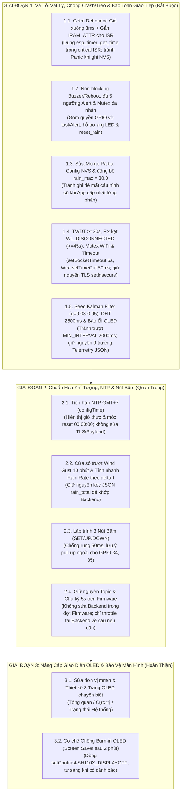

# 🛠️ PHÂN TÍCH KỸ THUẬT & KẾ HOẠCH TINH CHỈNH FIRMWARE ESP32 (CẬP NHẬT)

> **Dự án**: Trạm Quan trắc Thời tiết Thông minh ADHT  
> **Phân hệ trọng tâm**: Phần mềm nhúng ESP32 (`adht-weather-firmware`) & Đồng bộ hợp đồng với Backend / Flutter App  
> **Tiêu chuẩn đối chiếu**: Tổ chức Khí tượng Thế giới (WMO), Trạm thời tiết Davis Vantage Pro2, Chuẩn kiến trúc FreeRTOS 24/7  
> **Cập nhật lần cuối**: 11/11/2026 (Đối chiếu trực tiếp với mã nguồn `master` sau PR Backend Render Deploy `#9`, Flutter Settings `#7`, `DEVICE_CONTROL_AND_CONFIG_SPEC.md`, `PLAN_A` & `PLAN_B`)  
> **Trạng thái**: Bản kế hoạch đã hiệu chỉnh theo hiện trạng thực tế (Sẵn sàng triển khai tinh chỉnh trên `adht-weather-firmware`)

> [!CAUTION]
> **NGUYÊN TẮC BẤT BIẾN — BẢO TOÀN LUỒNG GIAO TIẾP ĐANG THÔNG (`ESP32 ➔ EMQX ➔ Backend Render ➔ Supabase ➔ Flutter App`)**  
> Mọi chỉnh sửa trên `adht-weather-firmware` **KHÔNG ĐƯỢC LÀM THAY ĐỔI HOẶC GIÁN ĐOẠN** hợp đồng giao tiếp đang vận hành:
> 1. **Giữ nguyên 100% 4 MQTT Topics**: `adht/weather/{DEVICE_ID}/telemetry`, `adht/weather/status` (LWT), `adht/weather/{DEVICE_ID}/command`, `adht/weather/{DEVICE_ID}/config`. Tuyệt đối không tự ý đổi `TOPIC_STATUS` sang `{DEVICE_ID}/status` hay tách `/live`, `/log` khi Backend chưa đổi.
> 2. **Giữ nguyên 9 trường Telemetry JSON & chu kỳ `5000 ms`**: `device_id`, `temp`, `humi`, `rain_rate`, `rain_total`, `wind_speed`, `wind_max`, `rssi`, `uptime`. Không đổi `rain_total` thành `rain_daily`, không gửi `NaN` hay `-999` (vi phạm `CreateTelemetryDto`), không sửa `adht-weather-backend` trong đợt tinh chỉnh Firmware.
> 3. **Giữ nguyên cấu hình TLS đang thông (`secureClient.setInsecure()`)**: Không bật `setCACert()` trong đợt này để tránh rủi ro đứt kết nối EMQX Cloud do lệch chứng chỉ/CA rotation.
> 4. **Bảo vệ luồng `taskNetwork` (Core 0)**: Mọi hàm callback MQTT (`handleMqttCommand`, `handleMqttConfig`) đều xử lý tức thì (Non-blocking); `TWDT` cho `taskNetwork` phải $\ge 30\text{s}$ (reset trước/sau `reconnect()`), và `WifiManager` chỉ ép `WiFi.disconnect()` sau $\ge 45\text{–}60\text{s}$ mất mạng liên tục.
> 5. **Tương thích ngược lệnh `command` & `config`**: `led` hỗ trợ cả `arg: "1"/"0"` lẫn toggle khi `arg` rỗng; `config` hỗ trợ partial update trên nền `sysConfig` hiện tại.

---

## MỤC LỤC
1. [Đánh giá Tổng quan Hiện trạng & Mức độ Đồng bộ Hệ thống](#1-đánh-giá-tổng-quan-hiện-trạng--mức-độ-đồng-bộ-hệ-thống)
   - [1.1. Những hạng mục đã đạt được & Đã cập nhật gần đây](#11-những-hạng-mục-đã-đạt-được--đã-cập-nhật-gần-đây)
   - [1.2. Bảng đối chiếu trạng thái các vấn đề kỹ thuật](#12-bảng-đối-chiếu-trạng-thái-các-vấn-đề-kỹ-thuật)
2. [Phân tích Chi tiết Các Vấn đề Cần Tinh chỉnh](#2-phân-tích-chi-tiết-các-vấn-đề-cần-tinh-chỉnh)
   - [2.1. Nghẽn đo tốc độ gió do Debounce 50ms & Lỗi thiếu `IRAM_ATTR` trong ISR](#21-nghẽn-đo-tốc-độ-gió-do-debounce-50ms--lỗi-thiếu-iram_attr-trong-isr)
   - [2.2. Gió giật (Wind Gust) không có chu kỳ làm mới](#22-gió-giật-wind-gust-không-có-chu-kỳ-làm-mới)
   - [2.3. Lượng mưa tích lũy, Cường độ mưa và Ràng buộc Hợp đồng Backend](#23-lượng-mưa-tích-lũy-cường-độ-mưa-và-ràng-buộc-hợp-đồng-backend)
   - [2.4. Độ trễ Kalman Filter, Bẫy API `SimpleKalmanFilter`, Nhịp đọc DHT11 & Báo lỗi](#24-độ-trễ-kalman-filter-bẫy-api-simplekalmanfilter-nhịp-đọc-dht11--báo-lỗi)
   - [2.5. Lệnh delay() trong Callback MQTT làm nghẽn Core 0 & Sai lệch lệnh LED/Reset Rain](#25-lệnh-delay-trong-callback-mqtt-làm-nghẽn-core-0--sai-lệch-lệnh-ledreset-rain)
   - [2.6. Tranh chấp Còi/LED, Bỏ sót ngưỡng `temp_min`/`humi_max` & Lỗi đa nhân](#26-tranh-chấp-còiled-bỏ-sót-ngưỡng-temp_minhumi_max--lỗi-đa-nhân)
   - [2.7. Lỗi ghi đè mất cấu hình NVS khi nhận Partial Config Update (Mới phát hiện)](#27-lỗi-ghi-đè-mất-cấu-hình-nvs-khi-nhận-partial-config-update-mới-phát-hiện)
   - [2.8. Chưa lập trình 3 nút nhấn phần cứng & Lưu ý điện trở kéo GPIO 34/35](#28-chưa-lập-trình-3-nút-nhấn-phần-cứng--lưu-ý-điện-trở-kéo-gpio-3435)
   - [2.9. Watchdog TWDT, Bẫy `WL_DISCONNECTED`, Data Race WiFi, TLS/I2C & Heap MQTT](#29-watchdog-twdt-bẫy-wl_disconnected-data-race-wifi-tlsi2c--heap-mqtt)
   - [2.10. Tần suất 5s/lần, Kiến trúc Cloud Backend Render & Bẫy LWT đa trạm](#210-tần-suất-5slần-kiến-trúc-cloud-backend-render--bẫy-lwt-đa-trạm)
   - [2.11. Thiếu đồng bộ thời gian thực qua NTP](#211-thiếu-đồng-bộ-thời-gian-thực-qua-ntp)
   - [2.12. Nâng cấp Giao diện OLED, Sửa đơn vị mưa & Chống Burn-in](#212-nâng-cấp-giao-diện-oled-sửa-đơn-vị-mưa--chống-burn-in)
3. [Lộ trình Tinh chỉnh Firmware (3 Giai đoạn Ưu tiên)](#3-lộ-trình-tinh-chỉnh-firmware-3-giai-đoạn-ưu-tiên)
4. [Bảng Tiêu chí Nghiệm thu Kỹ thuật (Acceptance Criteria)](#4-bảng-tiêu-chí-nghiệm-thu-kỹ-thuật-acceptance-criteria)

---

## 1. ĐÁNH GIÁ TỔNG QUAN HIỆN TRẠNG & MỨC ĐỘ ĐỒNG BỘ HỆ THỐNG

### 1.1. Những hạng mục đã đạt được & Đã cập nhật gần đây
So với thời điểm lập bản kế hoạch ban đầu, toàn hệ thống đã có những thay đổi lớn về kiến trúc và mã nguồn cần làm căn cứ:

* **Chuẩn hóa kiến trúc 4 tầng thực tế (ESP32 ➔ EMQX Cloud ➔ NestJS Backend Cloud ➔ Flutter App)**:
  * Backend NestJS (`adht-weather-backend`) đã hoàn thiện các module lõi (`MqttService`, `SupabaseService`, `NotificationsService`, `TelemetryGateway`, `HealthController`) và đã có cấu hình triển khai lên **Render Cloud** (`render.yaml`, `DEPLOY_RENDER.md`).
  * Hệ thống **không dùng EMQX Rule Engine đẩy thẳng vào Supabase**, mà Backend NestJS tự kết nối MQTTS tới EMQX Cloud, subscribe `adht/weather/+/telemetry` & `adht/weather/status`, sau đó mới ghi Supabase `weather_logs`, phát Socket.IO `/ws/telemetry` và kích hoạt cảnh báo đẩy Firebase FCM.
* **Firmware đã cập nhật đồng bộ Topic & Chu kỳ ở các commit gần đây (`c0b14b1`, `dd8333a`)**:
  * Chu kỳ gửi telemetry (`MQTT_PUBLISH_INTERVAL_MS` trong `config.h`) đã nâng từ `3000 ms` lên **`5000 ms` (5 giây/lần)**.
  * Các topic MQTT đã được gắn định danh theo từng trạm (`adht/weather/{DEVICE_ID}/telemetry`, `command`, `config`), khớp hoàn toàn với `MqttService` trên Backend.
  * Hàm `handleMqttCommand` trong `main.cpp` đã bổ sung xử lý `cmd == "reboot"` khớp với nút Reset trên màn hình Cài đặt của Flutter App (`settings_screen.dart`).
* **Kiến trúc nền tảng của Firmware đã vững**:
  * Tận dụng Dual-Core FreeRTOS (Core 0: Network/MQTT; Core 1: Sensors/OLED/Alert).
  * Đếm xung mưa/gió bằng ngắt ngoài kèm vùng bảo vệ `portENTER_CRITICAL_ISR`.
  * Lưu ngưỡng vào NVS (`Preferences`) và nạp biến môi trường qua `load_env.py`.
  * Đã loại bỏ HTTP Client Supabase trực tiếp khỏi ESP32, tiết kiệm hơn 40KB RAM Heap.

### 1.2. Bảng đối chiếu trạng thái các vấn đề kỹ thuật

| Mục | Nội dung kỹ thuật | Hiện trạng trong code (`11/11/2026`) | Ghi chú điều chỉnh theo dự án |
| :--- | :--- | :---: | :--- |
| **2.1** | Debounce gió `50ms` & lỗi thiếu `IRAM_ATTR` trong ISR | 🔴 **Chưa sửa** | `sensor_manager.cpp:51-69` vẫn debounce `50ms` và handler không có `IRAM_ATTR` (dễ panic khi ghi NVS). |
| **2.2** | Gió giật `wind_max` không có chu kỳ reset | 🔴 **Chưa sửa** | `sensor_manager.cpp:108-110` tích lũy vô hạn từ lúc bật nguồn. |
| **2.3** | Chu kỳ tính `rain_rate` (60s) & cộng dồn `rain_total` | 🟡 **Chưa sửa + Ràng buộc mới** | Phải **giữ nguyên key JSON `rain_total`** để không gãy validation của Backend (`CreateTelemetryDto`). |
| **2.4** | Kalman Filter `q = 0.001`, API thiếu `seed()`, nhịp `DHT::read()` & lỗi `NaN` | 🔴 **Chưa sửa** | `SimpleKalmanFilter.h` không có `setEstimate()`; `SENSOR_READ_INTERVAL_MS=2000` dễ trượt nhịp `MIN_INTERVAL=2000` của `DHT.cpp`. |
| **2.5** | `delay()` trong `handleMqttCommand` chặn Core 0 | 🟡 **Đã thêm `reboot`, vẫn `delay()`** | `main.cpp:28, 37` vẫn blocking. Bổ sung đồng bộ `led` (`arg`) và `reset_rain`. |
| **2.6** | Xung đột Còi/LED, bỏ sót `temp_min`/`humi_max` & Race `sysConfig` | 🔴 **Chưa sửa** | `manualBuzzer` chưa dùng; `taskAlert` thiếu 2 ngưỡng; `sysConfig` & `currentAlertMsg` thiếu đồng bộ giữa 2 Core. |
| **2.7** | Ghi đè mất NVS khi nhận Partial Config Update | 🆕 **Mới phát hiện** | `mqtt_manager.cpp:148-156` reset các field không có trong JSON về mặc định. |
| **2.8** | Chưa lập trình 3 nút nhấn `SET`, `UP`, `DOWN` | 🔴 **Chưa sửa** | Bổ sung lưu ý phần cứng: `GPIO 34, 35` trên ESP32 **không có `INPUT_PULLUP` nội**. |
| **2.9** | Thiếu TWDT, kẹt `WL_DISCONNECTED`, Data Race `String ip_address`, TLS/I2C | 🔴 **Chưa sửa** | `wifi_manager.cpp:34` kẹt khi mất router; `NetworkStatus` copy `String` qua 2 Core; cần `setSocketTimeout(5)` & `Wire.setTimeOut(50)`. |
| **2.10** | Tần suất ghi DB & Kiến trúc Topic | 🟢 **Đã ổn / Giữ nguyên hợp đồng** | Đã là `5s` (`5000ms`), dùng `adht/weather/{DEVICE_ID}/telemetry` & `adht/weather/status`. **Không sửa topic hay Backend** trong đợt tinh chỉnh Firmware. |
| **2.11** | Thiếu đồng bộ giờ thực NTP | 🔴 **Chưa sửa** | Phục vụ reset mưa ngày `00:00` & hiển thị giờ OLED; **giữ nguyên TLS `setInsecure()` & Telemetry JSON**. |
| **2.12** | Giao diện OLED đơn giản, nhầm đơn vị `mm` & Burn-in | 🔴 **Chưa sửa** | `oled_manager.cpp:79` in `mm` cho `rain_rate` thay vì `mm/h`. |

---

## 2. PHÂN TÍCH CHI TIẾT CÁC VẤN ĐỀ CẦN TINH CHỈNH

### 2.1. Nghẽn đo tốc độ gió do Debounce 50ms & Lỗi thiếu `IRAM_ATTR` trong ISR
* **Hiện trạng trong mã nguồn (`adht-weather-firmware/src/sensors/sensor_manager.cpp`, dòng 6–12 và 51–69)**:
  ```cpp
  void IRAM_ATTR isrWindPulse() { sensorMgr.handleWindInterrupt(); }

  void SensorManager::handleWindInterrupt() { // ❌ Thiếu IRAM_ATTR!
      uint32_t now = millis();
      if (now - lastWindDebounce > 50) { // ❌ 50ms debounce + ngoài vùng critical
          portENTER_CRITICAL_ISR(&isrMux);
          windPulseCount++;
          portEXIT_CRITICAL_ISR(&isrMux);
          lastWindDebounce = now;
      }
  }
  ```
* **Phân tích cơ học & rủi ro Crash hệ thống**:
  * Chu vi vòng quay của chong chóng gió ($D = 208\text{ mm}$):
    $$C = \pi \times 0.208\text{ m} \approx 0.6535\text{ m}$$
  * Với thời gian chống rung $\Delta t = 50\text{ ms}$, tần số ngắt tối đa ghi nhận được là $f_{\max} = \frac{1000}{50} = 20\text{ Hz}$, tương ứng tốc độ gió trần:
    $$v_{\max} = 20 \times 0.6535 \approx \mathbf{13.07\text{ m/s}} \quad (\approx 47\text{ km/h})$$
  * **Lỗi ngắt nguy hiểm khi ghi NVS Flash**: Mặc dù `isrRainPulse`/`isrWindPulse` có `IRAM_ATTR`, cả `handleRainInterrupt()` và `handleWindInterrupt()` lại **nằm trong bộ nhớ Flash** (không có `IRAM_ATTR`) và gọi `millis()` bên ngoài `portENTER_CRITICAL_ISR`. Khi ESP32 ghi NVS Flash (lúc nhận `config` mới qua MQTT hoặc lưu `rain_total` định kỳ), Flash cache bị vô hiệu hóa tạm thời — nếu có xung mưa/gió kích hoạt ngắt ngay thời điểm này, chip sẽ **Panic (`Cache disabled but cached memory region accessed`)** và reboot đột ngột.
* **Hậu quả**:
  * Ngưỡng cảnh báo gió mạnh mặc định trên toàn hệ thống (Firmware, Backend `ALERT_WIND_MAX`, Flutter App) đang là **$15.0\text{ m/s}$**. Do bị nghẽn trần ở $13.07\text{ m/s}$, trạm thật **không bao giờ chạm được ngưỡng cảnh báo gió bão $15.0\text{ m/s}$**, đồng thời tiềm ẩn treo/reboot khi lưu NVS lúc trời có gió hoặc mưa.
* **Giải pháp**:
  * Hạ thời gian chống rung gió xuống **$3\text{ ms}$** (trong khoảng $2 - 4\text{ ms}$, phù hợp công tắc từ Reed Switch / cảm biến Hall), mở rộng dải đo lý thuyết vượt $65\text{ m/s}$ ($> 230\text{ km/h}$).
  * Gắn `IRAM_ATTR` cho cả `handleRainInterrupt()` và `handleWindInterrupt()`, thay `millis()` trong ISR bằng `esp_timer_get_time() / 1000ULL` (an toàn trong IRAM) và bọc toàn bộ phần đọc/ghi `lastWindDebounce` / `lastRainDebounce` vào trong `portENTER_CRITICAL_ISR(&isrMux)`.

---

### 2.2. Gió giật (Wind Gust) không có chu kỳ làm mới
* **Hiện trạng trong mã nguồn (`sensor_manager.cpp`, dòng 108–110)**:
  ```cpp
  if (speed > currentData.wind_max) {
      currentData.wind_max = speed;
  }
  ```
* **Hậu quả**:
  * Biến `wind_max` tích lũy từ lúc khởi động trạm và không bao giờ reset nếu không rút nguồn. Sau một cơn gió lớn, chỉ số này giữ nguyên vĩnh viễn dù trời lặng gió nhiều ngày sau đó.
* **Giải pháp chuẩn khí tượng WMO (giữ nguyên hợp đồng Backend)**:
  * Áp dụng cửa sổ trượt **10 phút** (hoặc ring buffer gồm 120 mẫu mỗi 5 giây) để `wind_max` phản ánh **gió giật cực đại trong 10 phút gần nhất**, kết hợp lưu riêng biến `daily_wind_max` (reset lúc `00:00`) để hiển thị trang Cực trị trên OLED.
  * Giữ nguyên tên trường `"wind_max"` trong payload MQTT gửi lên Backend (`CreateTelemetryDto` đã hỗ trợ trường này ở dạng optional).

---

### 2.3. Lượng mưa tích lũy, Cường độ mưa và Ràng buộc Hợp đồng Backend
* **Hiện trạng trong mã nguồn (`config.h` dòng 30, `sensor_manager.cpp` dòng 115–133)**:
  * `RAIN_SAMPLE_PERIOD_SEC = 60`: Cường độ mưa (`rain_rate`) chỉ tính lại mỗi 60 giây một lần, khiến khi trời vừa mưa to hoặc vừa tạnh, số liệu gửi mỗi 5 giây bị trễ tối đa 1 phút.
  * `rain_total` cộng dồn liên tục từ khi khởi động (`millis() = 0`) và bị mất sạch về `0.0` mỗi khi ESP32 reboot.
* **⚠️ Ràng buộc bắt buộc với Backend (`DEVELOPMENT_GUIDE.md` & `CreateTelemetryDto`)**:
  * DTO của Backend (`adht-weather-backend/src/modules/telemetry/dto/create-telemetry.dto.ts`, dòng 37–40) **bắt buộc trường `rain_total`** (`@IsNumber()`, `@Min(0)`). Trước đây đã có sự cố lệch tên `rain_daily` làm Backend từ chối toàn bộ gói telemetry.
  * Hiện tại `SupabaseService` chỉ lưu 4 cột (`temperature`, `humidity`, `rain_rate`, `wind_speed`) vào bảng `weather_logs`, nhưng WebSocket `/ws/telemetry` vẫn truyền nguyên vẹn `rain_total`.
* **Giải pháp hiệu chỉnh**:
  1. **Giữ nguyên tên trường JSON `rain_total`** trong `mqtt_manager.cpp` để không phá vỡ validation Backend.
  2. **Cải thiện độ nhạy `rain_rate`**: Đo khoảng thời gian $\Delta t$ giữa 2 lần lật gàu liên tiếp (hoặc đếm xung trên cửa sổ trượt 60s cập nhật mỗi 5s) kèm cơ chế tự giảm/reset về `0.0 mm/h` khi quá ngưỡng timeout (ví dụ 3–5 phút không có xung mới).
  3. **Bền vững hóa `rain_total` & Reset ngày (khi có NTP)**: Lưu `rain_total` định kỳ (hoặc mỗi lần tăng có kiểm soát tần suất ghi Flash để tránh mòn NVS, ví dụ mỗi 60s nếu có thay đổi) và reset về `0.0` lúc `00:00:00`, hoặc hỗ trợ lệnh `cmd == "reset_rain"` từ App/Backend.

---

### 2.4. Độ trễ Kalman Filter, Bẫy API `SimpleKalmanFilter`, Nhịp đọc DHT11 & Giám sát lỗi
* **Hiện trạng trong mã nguồn & thư viện (`sensor_manager.cpp:16-17, 75-90`, `SimpleKalmanFilter.h`, `DHT.cpp:28, 235`, `config.h:79`)**:
  * Bộ lọc khởi tạo: `SimpleKalmanFilter(2, 2, 0.001)`.
  * **Vấn đề Cold-start & giới hạn API thư viện**: Giá trị `_current_estimate` và `_last_estimate` trong `lib/SimpleKalmanFilter-master/src/SimpleKalmanFilter.h` mặc định khởi tạo bằng `0`, nằm ở mức `private` và **thư viện không cung cấp sẵn hàm `setEstimate()` hay `reset()`**. Với $q = 0.001$ quá nhỏ, lúc mới bật nguồn trong phòng $28^\circ\text{C}$ / $70\%$, giá trị sau lọc phải bò từ $0^\circ\text{C}$ lên chậm chạp qua hàng chục chu kỳ lấy mẫu.
  * **Bẫy nhịp đọc `MIN_INTERVAL = 2000 ms` của `DHT.cpp`**: Trong `lib/DHT_sensor_library/DHT.cpp` (dòng 28 & 235), thư viện ép thời gian nghỉ tối thiểu giữa 2 lần đọc là `2000 ms` (và mỗi lần đọc thực hiện `delay(20)` + `InterruptLock` khóa ngắt ~4–5 ms). Vì `SENSOR_READ_INTERVAL_MS` trong `config.h:79` cũng đặt đúng `2000 ms`, chỉ cần sai lệch 1 ms là `DHT::read()` sẽ trả về cache cũ và bỏ qua lượt đọc phần cứng (làm chu kỳ đo thật bị giãn thành **4 giây**).
  * **Bỏ qua lỗi cảm biến**: Nếu cảm biến DHT11 lỏng dây hoặc hỏng, `dht.readTemperature()` trả về `NaN`, nhánh `if (!isnan(rawTemp) && !isnan(rawHumi))` bị bỏ qua khiến số đo bị đóng băng ở giá trị cũ mãi mãi (hoặc kẹt ở `0.0` nếu hỏng ngay từ lúc bật).
* **⚠️ Ràng buộc Backend khi báo lỗi**:
  * `CreateTelemetryDto` ràng buộc `temp` thuộc `[-40, 80]` và `humi` thuộc `[0, 100]`. Tuyệt đối **không gán giá trị sentinel như `-999` hay `255`** vào `temp`/`humi` vì gói MQTT sẽ bị Backend loại bỏ hoàn toàn (mất luôn dữ liệu gió, mưa gửi kèm).
* **Giải pháp**:
  * Tăng hệ số quá trình $q$ lên khoảng `0.03 - 0.05`.
  * Xử lý cold-start đúng với API thực tế: hoặc **bổ sung phương thức `seed(float initial)`** vào thư viện cục bộ `lib/SimpleKalmanFilter-master`, hoặc gọi `setEstimateError(1000.0f)` trước lần đọc hợp lệ đầu tiên để Kalman Gain $\approx 0.998$ bám ngay về giá trị thật từ mẫu thứ nhất.
  * Nâng `SENSOR_READ_INTERVAL_MS` trong `config.h` từ `2000` lên **`2500 ms`** để không bao giờ trượt nhịp `MIN_INTERVAL` của `DHT.cpp`.
  * Thêm bộ đếm lỗi liên tiếp + cờ `bool dht_ok` và `bool has_valid_dht` trong `WeatherData`: nếu quá **15 giây** liên tục ra `NaN`, bật cờ lỗi hiển thị `ERR` trên màn hình OLED và log Serial. **Giữ nguyên cấu trúc 9 trường JSON của `TOPIC_TELEMETRY` và payload của `TOPIC_STATUS`** (không thay đổi định dạng bản tin đang giao tiếp ổn định với Backend & App).

---

### 2.5. Lệnh `delay()` trong Callback MQTT làm nghẽn Core 0 & Sai lệch lệnh LED/Reset Rain
* **Hiện trạng trong mã nguồn (`main.cpp`, dòng 22–42)**:
  * Mặc dù đã hỗ trợ thêm `cmd == "reboot"` khớp với nút Reset trên Flutter App, hàm callback được gọi bên trong `mqttMgr.loop()` (Core 0) **vẫn đang gọi `delay()`**:
    ```cpp
    if (cmd == "buzzer") {
        int duration = arg.toInt() > 0 ? arg.toInt() : 300;
        digitalWrite(PIN_BUZZER, HIGH);
        delay(duration); // ❌ BLOCKING Core 0! Nếu arg="5000" sẽ treo Task Mạng 5 giây
        digitalWrite(PIN_BUZZER, LOW);
    } else if (cmd == "led") {
        bool newState = !digitalRead(PIN_LED); // ❌ Luôn toggle, bỏ qua arg
        digitalWrite(PIN_LED, newState);
    } else if (cmd == "reset" || cmd == "reboot") {
        delay(500); // ❌ Blocking trước khi restart
        ESP.restart();
    }
    ```
* **Sai lệch hợp đồng điều khiển giữa App / Backend / Firmware**:
  1. **Lệnh `led` & Phân cực phần cứng GPIO 33**: Trên Flutter App (`settings_screen.dart:239-243`), chỉ có 1 nút đơn cho LED luôn gửi `cmd: "led", arg: "1"`. Trên bo mạch thật của trạm, LED ở `GPIO 33` đấu **Active-LOW** (`LOW` = Sáng, `HIGH` = Tắt). Nếu `arg == "1"` luôn ép `HIGH` sẽ khiến đèn đang sáng lúc khởi động bị tắt ngay lần bấm đầu và không bật/tắt luân phiên được.
  2. **Lệnh `reset_rain`**: Tài liệu Swagger trên Backend (`send-command.dto.ts:5`) có liệt kê lệnh `reset_rain`, nhưng Firmware hiện tại rơi vào nhánh `Unknown command`.
* **Giải pháp**:
  * Chuyển `buzzer` và `reboot` sang **Non-blocking**: callback trên Core 0 chỉ đặt mốc thời gian (`manualBuzzerEndMs = millis() + duration`, giới hạn max ví dụ `10000 ms`, hoặc `pendingRebootAt = millis() + 500`) hoặc gửi message qua FreeRTOS Queue sang `taskAlert` (Core 1).
  * Chuẩn hóa lệnh `led` & mức logic phần cứng: khai báo `LED_ON_LEVEL = LOW`, `LED_OFF_LEVEL = HIGH` trong `config.h`; cho `arg` là `"on"`/`"true"` ➔ ép bật, `"0"`/`"off"`/`"false"` ➔ ép tắt, `"auto"` ➔ trả về tự động, còn `""` hoặc `"1"` (từ nút đơn trên App) ➔ **Toggle (đảo trạng thái Bật ⇄ Tắt)**.
  * Bổ sung xử lý `cmd == "reset_rain"` gọi hàm `sensorMgr.resetRainTotal()`.

---

### 2.6. Tranh chấp Còi/LED, Bỏ sót ngưỡng `temp_min`/`humi_max` & Lỗi đa nhân
* **Hiện trạng trong mã nguồn (`main.cpp`, dòng 11–13, 53 và 111–142)**:
  * Biến `bool manualBuzzer = false;` đã được khai báo ở dòng 13 nhưng **chưa được dùng ở bất kỳ đâu**.
  * **Tranh chấp `PIN_BUZZER` & `PIN_LED`**: `taskAlert` (Core 1) ghi `PIN_BUZZER` và `PIN_LED` mỗi 500ms, xung đột trực tiếp với lệnh `buzzer`/`led` từ `handleMqttCommand` (Core 0).
  * **Bỏ sót 2 ngưỡng cảnh báo (`temp_min_alert`, `humi_max_alert`)**: Cả `SystemConfig` (`types.h`), `storage_manager.cpp`, Backend `NotificationsService` và màn hình `SettingsScreen` của Flutter App đều cấu hình đủ 5 ngưỡng, nhưng `taskAlert` (`main.cpp:117-128`) **chỉ kiểm tra 3 ngưỡng (`temp_max`, `wind_max`, `rain_max`)**, hoàn toàn bỏ qua nhiệt độ quá thấp (`temp_min`) và độ ẩm quá cao (`humi_max`).
  * **Thiếu đồng bộ đa nhân cho `sysConfig` & `currentAlertMsg`**: `sysConfig` bị `handleMqttConfig` (Core 0) ghi đè trực tiếp trong khi `taskAlert` (Core 1) đọc liên tục không có Mutex; còn `String currentAlertMsg` toàn cục bị cấp phát lại heap liên tục mỗi 500ms.
* **Giải pháp**:
  * Gom quyền ghi `digitalWrite(PIN_BUZZER, ...)` và `digitalWrite(PIN_LED, ...)` **duy nhất về `taskAlert` (Core 1)**.
  * Bổ sung kiểm tra `temp_min_alert` (`"LOW TEMP!"`) và `humi_max_alert` (`"HIGH HUMI!"`) trong `taskAlert`, **kèm điều kiện bảo vệ `weather.has_valid_dht && weather.dht_ok`** để tránh báo giả `"LOW TEMP!"` khi mới bật nguồn (`temperature == 0.0°C`).
  * Bảo vệ `sysConfig` và các cờ trạng thái (`manualBuzzerEndMs`, `manualLedOverride`, `alarmSnoozedUntilMs`) bằng `portMUX_TYPE` hoặc FreeRTOS Queue; thay `String currentAlertMsg` bằng mảng `char currentAlertMsg[32]`.

---

### 2.7. Lỗi ghi đè mất cấu hình NVS khi nhận Partial Config Update *(Mới phát hiện)*
* **Hiện trạng trong mã nguồn (`mqtt_manager.cpp`, dòng 148–156)**:
  ```cpp
  if (onConfig) {
      SystemConfig cfg; // ❌ Khởi tạo mới toàn bộ với giá trị mặc định!
      cfg.temp_max_alert = doc["temp_max"] | 38.0f;
      cfg.temp_min_alert = doc["temp_min"] | 10.0f;
      cfg.humi_max_alert = doc["humi_max"] | 90.0f;
      cfg.wind_max_alert = doc["wind_max"] | 15.0f;
      cfg.rain_max_alert = doc["rain_max"] | 50.0f;
      cfg.auto_warning_enabled = doc["auto_warning"] | true;
      cfg.buzzer_enabled = doc["buzzer"] | true;
      onConfig(cfg);
  }
  ```
* **Phân tích lỗi**:
  * Theo đặc tả Backend (`UpdateConfigDto`, `API_RESPONSE.md`) và Flutter (`DeviceConfigModel`), **tất cả các trường đều là optional**, cho phép gửi cập nhật từng phần (ví dụ chỉ gửi `{"buzzer": false}`).
  * Tuy nhiên, vì code tạo mới `SystemConfig cfg;` rồi dùng toán tử `|` fallback về hằng số mặc định, nếu người dùng trước đó đã đổi `temp_max = 42.0` rồi sau đó gửi `{"buzzer": false}`, Firmware sẽ âm thầm **reset `temp_max` về `38.0`** và lưu đè vào NVS Flash!
  * Ngoài ra, giá trị mặc định `rain_max` đang lệch giữa Backend/App (`30.0 mm/h`) và Firmware (`50.0 mm/h` trong `types.h` và `storage_manager.cpp`).
* **Giải pháp**:
  * Truyền cấu hình `sysConfig` hiện tại làm nền (merge partial update): chỉ ghi đè trường nào thực sự có mặt và đúng kiểu trong JSON (`if (!doc["temp_max"].isNull()) cfg.temp_max_alert = doc["temp_max"].as<float>();`, tương tự cho các trường còn lại).
  * Thống nhất giá trị mặc định `rain_max_alert = 30.0f` (khớp với `ALERT_RAIN_MAX=30.0` trên Backend và `DeviceConfigModel.initialDefault()` trên Flutter App).

---

### 2.8. Chưa lập trình 3 nút nhấn phần cứng & Lưu ý điện trở kéo GPIO 34/35
* **Hiện trạng (`config.h` dòng 20–22, `main.cpp`)**:
  * Đã định nghĩa `PIN_BTN_SET` (`GPIO 32`), `PIN_BTN_UP` (`GPIO 35`), `PIN_BTN_DOWN` (`GPIO 34`) nhưng chưa khởi tạo `pinMode` và chưa có logic xử lý.
* **⚠️ Lưu ý phần cứng bắt buộc của ESP32**:
  * Trên chip ESP32, các chân **GPIO 34, 35, 36, 39 là Input-Only và KHÔNG CÓ điện trở kéo lên/kéo xuống nội (`INPUT_PULLUP` / `INPUT_PULLDOWN` không có tác dụng)**.
  * Chỉ `PIN_BTN_SET` (`GPIO 32`) dùng được `INPUT_PULLUP`.
  * Nếu dùng `pinMode(34, INPUT_PULLUP)` mà bo mạch ngoài không hàn điện trở kéo lên $10\text{ k}\Omega$ lên $3.3\text{V}$, chân sẽ bị thả nổi (floating), gây nhảy trang hoặc tắt còi loạn xạ. Cần kiểm tra phần cứng thực tế và cấu hình `INPUT` (với pull-up ngoài) cho GPIO 34/35, `INPUT_PULLUP` cho GPIO 32.
* **Chức năng đề xuất**:
  * **SET**: Đánh thức OLED (nếu đang Screen Saver) hoặc chuyển tuần tự giữa các trang hiển thị OLED.
  * **UP / DOWN**: Tắt tiếng còi cảnh báo tạm thời (Snooze Alarm 5–10 phút) hoặc kích hoạt test nhanh còi/LED tại trạm.

---

### 2.9. Watchdog TWDT, Bẫy `WL_DISCONNECTED`, Data Race WiFi, TLS/I2C & Heap MQTT
* **Hiện trạng (`wifi_manager.cpp:14-51`, `types.h:29-35`, `mqtt_manager.cpp:19, 115-118`, `oled_manager.cpp:12-13`)**:
  * **Chưa bật Task Watchdog Timer (`esp_task_wdt`)**.
  * **Bẫy kẹt `WL_DISCONNECTED` trong `WifiManager::loop()` (`wifi_manager.cpp:34-40`)**: Nhánh kiểm tra `if (currentStatus != WL_IDLE_STATUS && currentStatus != WL_DISCONNECTED)` khiến khi router bị tắt rồi bật lại và ESP32 giữ trạng thái `WL_DISCONNECTED`, code **chỉ in `"Still connecting..."` mãi mãi** mà không chủ động gọi lại `WiFi.begin()`.
  * **Data Race `String ip_address` giữa 2 Core**: `NetworkStatus` (`types.h:33`) chứa `String ip_address`, được Core 0 (`taskNetwork`) ghi liên tục và Core 1 (`taskDisplay`) sao chép qua `wifiMgr.getStatus()` không có Mutex.
  * **Timeout mạng & I2C**: `WiFiClientSecure` và `PubSubClient` chưa đặt socket timeout ngắn khi mạng rớt Internet giữa chừng; `Wire` I2C chưa đặt timeout (`Wire.setTimeOut`) và `oled_manager.cpp:13` bỏ qua giá trị trả về của `display.begin(...)`.
  * **Phân mảnh Heap MQTT**: `mqtt_manager.cpp:115-118` dùng vòng lặp `msg += (char)payload[i];` ghép chuỗi từng byte trong callback.
* **Giải pháp (ưu tiên bảo toàn kết nối mạng)**:
  * Kích hoạt **TWDT timeout $\ge 30$ giây** cho `taskSensors` và `taskNetwork`, reset watchdog (`esp_task_wdt_reset()`) ngay trước/sau `mqttMgr.reconnect()`, đồng thời đặt `secureClient.setTimeout(5)` và `mqttClient.setSocketTimeout(5)` (`PubSubClient.h:140`) để chặn thời gian treo handshake TLS mà **không làm reset nhầm khi mạng yếu**.
  * Trong `WifiManager`: chỉ ép `WiFi.disconnect(); WiFi.begin(...)` sau khi mất kết nối liên tục **$\ge 45–60$ giây** (tuyệt đối không cắt kết nối khi ESP32 đang tự reconnect bình thường trong vài giây đầu); đổi `ip_address` sang `char ip_address[16]` (hoặc bảo vệ `NetworkStatus` bằng `portMUX_TYPE`).
  * Trong `oled_manager.cpp`: gọi `Wire.setTimeOut(50)` (chữ `O` viết hoa theo chuẩn `TwoWire` ESP32) và kiểm tra cờ `oledReady = display.begin(...)` để không làm treo mạch nếu OLED lỏng cáp SDA/SCL.
  * Trong `mqtt_manager.cpp`: parse JSON trực tiếp bằng `deserializeJson(doc, (const char*)payload, length)` thay vì ghép `String msg` từng byte; giữ nguyên `secureClient.setInsecure()` và cơ chế LWT/QoS hiện tại.

---

### 2.10. Tần suất 5s/lần, Kiến trúc Cloud Backend Render & Bẫy LWT đa trạm
* **Điều chỉnh lại nhận định của bản kế hoạch cũ**:
  * Bản cũ ghi chu kỳ là `3s` (28.800 dòng/ngày) và đề xuất tách thành 2 topic `adht/weather/telemetry/live` (3s) và `adht/weather/telemetry/log` (30s) để EMQX Rule Engine ghi Supabase.
  * **Hiện trạng thực tế**:
    1. Firmware đã chạy **`5s`/lần** (`MQTT_PUBLISH_INTERVAL_MS = 5000`), tương đương **17.280 dòng/ngày/trạm** (3 trạm = ~51.840 dòng/ngày).
    2. Backend NestJS (deploy Render) là nơi duy nhất ghi Supabase và **chỉ lắng nghe đúng regex** `^adht\/weather\/([^/]+)\/telemetry$` (`mqtt.service.ts:87`). Nếu đổi tên topic sang `/live` và `/log` ở Firmware, **Backend sẽ bỏ qua toàn bộ gói tin**.
* **Giải pháp chuẩn với kiến trúc hiện tại (Không đụng luồng đang thông)**:
  1. **Trên Firmware**: **Giữ nguyên tuyệt đối topic `adht/weather/{DEVICE_ID}/telemetry`, chu kỳ `5000 ms`, và `TOPIC_STATUS = "adht/weather/status"`** để không ảnh hưởng giao tiếp đang thông với EMQX Cloud và Backend Render.
  2. **Giảm tải Supabase (tách riêng, thực hiện ở Backend sau nếu cần)**: Backend vẫn có thể nhận bản tin 5s để phát Socket.IO `/ws/telemetry` và check FCM tức thì, rồi throttle ghi `SupabaseService.saveTelemetry()` mỗi 30s–60s/lần cho mỗi `device_id`. **Không sửa code Backend trong phạm vi tinh chỉnh Firmware**.
  3. **Ghi chú mở rộng đa trạm thật trong tương lai**: Hiện `config.h:72` và Backend `mqtt.service.ts:45` dùng chung `adht/weather/status` (retained), nên bản tin LWT retained của trạm sau sẽ ghi đè trạm trước (`tools/simulate_nodes.py:213` dùng `adht/weather/{device_id}/status`). **Giữ nguyên `adht/weather/status` ở đợt sửa Firmware này**; chỉ nâng cấp sang `adht/weather/+/status` khi triển khai đồng bộ cả Firmware và Backend cho nhiều trạm vật lý.

---

### 2.11. Thiếu đồng bộ thời gian thực qua NTP
* **Hiện trạng**: ESP32 mới chỉ dùng `millis()` và `uptime`.
* **Giá trị thực tiễn (bảo toàn TLS & Payload đang thông)**:
  1. Hỗ trợ reset `rain_total` / cực trị ngày đúng `00:00:00` (GMT+7) và hiển thị giờ thực trên màn hình OLED.
  2. **Không cần thêm trường `timestamp` vào Telemetry JSON** (Backend `SupabaseService` đã tự đóng dấu `new Date()` theo giờ server chuẩn UTC, tránh rủi ro sai lệch nếu NTP chưa kịp đồng bộ lúc mới khởi động).
  3. **Giữ nguyên `secureClient.setInsecure()`** như hiện tại để đảm bảo kết nối MQTTS tới EMQX Cloud không bị gián đoạn (chỉ cân nhắc chuyển sang `setCACert()` ở giai đoạn bảo mật nâng cao riêng sau này).
* **Giải pháp**: Khi WiFi kết nối lần đầu, gọi `configTime(7 * 3600, 0, "pool.ntp.org", "time.google.com")` không chặn luồng (non-blocking).

---

### 2.12. Nâng cấp Giao diện OLED, Sửa đơn vị mưa & Chống Burn-in
* **Hiện trạng trong mã nguồn (`oled_manager.cpp` & `main.cpp`)**:
  * Dòng 75–79 trong `oled_manager.cpp` hiển thị giá trị `weather.rain_rate` (mm/h) nhưng nhãn in bên cạnh lại ghi là `"mm"` thay vì `"mm/h"`.
  * Màn hình sáng cố định 100% 24/7 với bố cục tĩnh, dễ gây cháy điểm ảnh (Burn-in).
  * `main.cpp:151` vẫn in log khởi động cũ `"MQTT + SUPABASE + FREERTOS"`.
* **Giải pháp (đã xác minh API trên `Adafruit_SH110X.h` & `Adafruit_GrayOLED.h`)**:
  * Sửa đơn vị hiển thị `rain_rate` thành `mm/h` (hoặc điều chỉnh tọa độ X cho vừa màn hình 128px).
  * Thiết kế 3 trang hiển thị chuyển qua nút `SET`: Trang 1 (Tổng quan số đo + giờ NTP), Trang 2 (Cực trị ngày: Wind Gust / Total Rain / Cảnh báo), Trang 3 (Hệ thống: IP, RSSI, MQTT status, ngưỡng cảnh báo).
  * Bổ sung **Screen Saver**: Sử dụng các phương thức có sẵn trên `Adafruit_SH1106G` (kế thừa `Adafruit_GrayOLED`) là `display.setContrast(1)` và `display.oled_command(SH110X_DISPLAYOFF)` sau 2 phút không tương tác; tự gọi `display.oled_command(SH110X_DISPLAYON)` / khôi phục độ sáng ngay khi bấm nút hoặc có cảnh báo nguy hiểm (`alertMessage[0] != '\0'`).
  * Cập nhật log boot `main.cpp:151` thành `"MQTT + GATEWAY + FREERTOS"` cho đúng hiện trạng.

---

## 3. LỘ TRÌNH TINH CHỈNH FIRMWARE (3 GIAI ĐOẠN ƯU TIÊN)



---

## 4. BẢNG TIÊU CHÍ NGHIỆM THU KỸ THUẬT (ACCEPTANCE CRITERIA)

| Hạng mục | Hiện trạng (`11/11/2026`) | Tiêu chuẩn sau Tinh chỉnh | Cách thức Đo kiểm / Nghiệm thu |
| :--- | :--- | :--- | :--- |
| **Bảo toàn luồng giao tiếp (Zero-Regression)** | Đã thông từ ESP32 ➔ EMQX ➔ Backend ➔ Supabase ➔ App | Giữ nguyên 100% 4 Topic, 9 trường JSON, chu kỳ `5000ms`, `setInsecure()` | Sau khi nạp Firmware mới, kiểm tra Backend log nhận đều bản tin 5s, Supabase có dòng mới và Flutter App hiển thị & điều khiển bình thường. |
| **Giới hạn tốc độ gió & An toàn ISR** | $\le 13.07\text{ m/s}$; handler ISR thiếu `IRAM_ATTR` | $\ge 50.0\text{ m/s}$ ($> 180\text{ km/h}$); ISR an toàn tuyệt đối khi ghi NVS | Phát xung $100\text{ Hz}$ vào GPIO 13 ($\approx 65.3\text{ m/s}$) đồng thời gọi `PUT /config` ghi NVS liên tục, không crash/reboot. |
| **Độ trễ Callback MQTT** | Bị `delay()` block tới hàng trăm ms | $0\text{ ms}$ (Non-blocking hoàn toàn) | Gửi liên tiếp `POST /api/devices/adht_weather_01/command` (`buzzer`, `led`), `taskNetwork` không rớt kết nối MQTT. |
| **Đồng bộ lệnh & 5 Ngưỡng Alert** | `led` bỏ qua `arg`; thiếu `reset_rain`, `temp_min`, `humi_max`; Race Condition Còi/LED | Hỗ trợ đủ `buzzer`, `led` (`1`/`0`/toggle), `reboot`, `reset_rain` và đủ 5 ngưỡng | Bấm các nút trên `SettingsScreen`; test hạ `temp_min`/tăng `humi_max` kiểm tra `taskAlert` báo đúng, không báo giả ở `0°C`. |
| **Partial Config NVS** | Gửi thiếu field sẽ bị reset về mặc định | Chỉ cập nhật field có trong JSON, giữ nguyên field cũ | Gửi `PUT /config` chỉ gồm `{"temp_max": 41.0}` rồi gửi `{"buzzer": false}`, kiểm tra `temp_max` vẫn là `41.0` sau reboot. |
| **Phục hồi WiFi, WDT & I2C** | Kẹt `WL_DISCONNECTED` khi mất router; Data Race `String` 2 Core; treo khi kẹt I2C | Tự kết nối lại sau tắt/bật router ($\ge 45\text{s}$); hết Race; tự reset tối đa $30\text{ s}$ | Tắt router 2 phút rồi bật lại; rút dây SDA/SCL OLED hoặc tạo deadlock task để kiểm tra tự phục hồi, không reset oan khi bắt tay TLS. |
| **Kalman, Nhịp đọc & Lỗi DHT11** | Cold-start bò từ `0°C`; trượt nhịp `MIN_INTERVAL`; đóng băng khi đứt dây | Bám giá trị đầu ngay; đọc đều mỗi $2.5\text{ s}$; báo `ERR` sau $15\text{ s}$ | Đo Serial log thấy đọc mới mỗi $2.5\text{ s}$; rút dây GPIO 26 thấy OLED báo `ERR` và Backend vẫn nhận đều `wind`/`rain`. |
| **Chu kỳ Gió giật & Mưa** | `wind_max` và `rain_total` cộng dồn vô hạn; `rain_rate` trễ 60s | Wind Gust cửa sổ trượt $10\text{ phút}$; `rain_rate` phản ứng theo xung; `rain_total` reset `00:00` (giữ nguyên key JSON) | Theo dõi qua mốc 10 phút và nửa đêm có NTP; kiểm tra Swagger/Log Backend không báo lỗi thiếu `rain_total`. |
| **Thao tác nút bấm cứng** | Chưa có code xử lý | Chuyển 3 trang OLED, Snooze còi mượt mà | Kiểm tra mức logic GPIO 32 (`INPUT_PULLUP`) và GPIO 34/35 (pull-up ngoài), bấm chuyển trang ổn định. |
| **OLED & Burn-in** | Hiển thị nhầm `mm` thay vì `mm/h`; sáng $100\%$ 24/7 | Đúng đơn vị `mm/h`; tự ngủ sau $2\text{ phút}$, thức khi bấm nút/có bão | Để trạm chạy 2 phút không tác động, kiểm tra OLED tắt/giảm sáng và tự sáng lại khi có cảnh báo. |

---
*Tài liệu này là bản đặc tả phân tích kỹ thuật cập nhật theo hiện trạng thực tế ngày 11/11/2026 của toàn bộ Monorepo `IoT-project`.*
