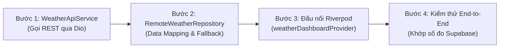

# 📋 KẾ HOẠCH TRIỂN KHAI PHƯƠNG ÁN A: THÔNG LUỒNG DỮ LIỆU CƠ BẢN (BE ➔ APP)
## (ADHT Weather Station - Phase A: Direct REST Data Flow & End-to-End Connectivity)

---

## 1. MỤC TIÊU & BỐI CẢNH DỰ ÁN

### 1.1. Bối cảnh
* **Hiện trạng**: Ứng dụng di động Flutter đã hoàn thiện toàn bộ giao diện người dùng (UI), các biểu đồ thống kê và hiệu ứng động nhưng vẫn đang sử dụng dữ liệu giả lập (`MockWeatherRepository`).
* **Phía máy chủ**: Backend Gateway (NestJS) và Cơ sở dữ liệu (Supabase) đã hoàn thiện 100% các API truy vấn chuỗi thời gian, tích hợp thuật toán làm mịn dữ liệu (Downsampling) và đã vượt qua toàn bộ 7/7 ca kiểm thử đơn vị (`test/supabase.service.test.cjs`).
* **Vấn đề cần giải quyết**: Chiều truyền dữ liệu từ **Backend xuống Mobile App** hiện chưa được thông luồng, dẫn đến việc người dùng chưa xem được số liệu đo đạc thực tế từ trạm phần cứng.

### 1.2. Mục tiêu cụ thể (Objectives)
1. **Thông luồng dữ liệu 100%**: Thay thế hoàn toàn Mock Data bằng dữ liệu cảm biến thực tế từ Supabase thông qua 2 REST API của Backend.
2. **Không làm gãy giao diện**: Tận dụng triệt để kiến trúc Clean Architecture và State Management (Riverpod) hiện có để đấu nối tầng dữ liệu mới mà không cần chỉnh sửa mã nguồn giao diện (Views/Screens).
3. **Độ trễ thấp & Tải nhẹ**: Đảm bảo ứng dụng tải số đo tức thời trong dưới 500ms và biểu đồ lịch sử trong dưới 1s qua mạng LAN/Cloud.

### 1.3. Tiêu chí hoàn thành (Definition of Done - DoD)
- [ ] Thẻ Hero Weather Card hiển thị số đo thực tế (Nhiệt độ, Độ ẩm, Gió, Mưa) khớp với bản ghi mới nhất trong bảng `weather_logs` của Supabase.
- [ ] Biểu đồ diễn biến trong ngày (Intra-day 24h) vẽ đúng các điểm đo thực tế.
- [ ] Biểu đồ tổng quan 7 ngày (Weekly History) hiển thị đúng trung bình ngày thực tế.
- [ ] Thao tác vuốt màn hình (Pull-to-refresh) tải lại dữ liệu mới thành công.
- [ ] Xử lý ngoại lệ mạng êm dịu: Khi mất mạng hoặc server tắt, app hiện thông báo lỗi nhẹ nhàng và nút "Thử lại", không bị crash (văng ứng dụng).

---

## 2. PHÂN CÔNG TRÁCH NHIỆM & TRẠNG THÁI HỆ THỐNG

| Phân hệ | Thành phần phụ trách | Hiện trạng | Trách nhiệm trong Kế hoạch A |
| :--- | :--- | :---: | :--- |
| **Backend Gateway** | NestJS Controllers & Supabase Service | **ĐÃ HOÀN TẤT 100%** | Khởi chạy máy chủ (`bun run start:dev` hoặc Cloud Render), duy trì kết nối Supabase và cung cấp 2 REST API theo đúng đặc tả ở Mục 3. |
| **Mobile App** | Flutter Network, Repository & Riverpod | **ĐANG CHỜ ĐẤU NỐI** | Xây dựng `WeatherApiService`, `RemoteWeatherRepository` (Data Mapper) và cập nhật `weatherRepositoryProvider`. |

---

## 3. TÀI LIỆU ĐẶC TẢ API CHIỀU BE ➔ APP (API CONTRACTS)

Dành cho đội ngũ phát triển Mobile App nắm rõ chuẩn dữ liệu từ Backend để xây dựng tầng mạng và bộ chuyển đổi (Adapter/Mapper).

### 3.1. Cấu hình kết nối chung
* **Base URL**:
  * Chạy máy thật qua Wi-Fi LAN: `http://192.168.100.29:8000/api`
  * Chạy qua cáp USB Android (adb reverse): `http://localhost:8000/api`
  * Chạy qua Cloud Render: `https://adht-weather-backend-oo0a.onrender.com/api`
* **Cấu trúc Envelope chuẩn**:
  Mọi response từ Backend đều được bọc trong đối tượng:
  ```json
  {
    "statusCode": 200,
    "data": { ... },
    "timestamp": "2026-11-10T16:00:00.000Z"
  }
  ```

---

### 3.2. API 1: Số đo thời gian thực mới nhất (`GET /weather/latest`)
* **Endpoint**: `GET /api/weather/latest?device_id={device_id}`
* **Query Params**:
  * `device_id` (tùy chọn, mặc định `adht_weather_01`): Mã trạm cần xem.
* **Response Body (`data`) khi thành công**:
  ```json
  {
    "statusCode": 200,
    "data": {
      "device_id": "adht_weather_01",
      "temp": 28.5,
      "humi": 76.2,
      "rain_rate": 0.0,
      "wind_speed": 3.4,
      "recorded_at": "2026-11-10T15:53:30.033Z"
    },
    "timestamp": "2026-11-10T16:00:00.000Z"
  }
  ```
* **Khi trạm chưa có số liệu**: `data: null`.

---

### 3.3. API 2: Lịch sử số đo đã làm mịn (`GET /weather/history`)
* **Endpoint**: `GET /api/weather/history?device_id={device_id}&range={range}`
* **Query Params**:
  * `device_id` (bắt buộc): `adht_weather_01`.
  * `range` (bắt buộc): `'24h'` (xem trong ngày) hoặc `'7d'` (xem 7 ngày).
* **Response Body (`data`) khi thành công**:
  ```json
  {
    "statusCode": 200,
    "data": {
      "device_id": "adht_weather_01",
      "range": "24h",
      "points_count": 144,
      "data": [
        {
          "device_id": "adht_weather_01",
          "temp": 26.1,
          "humi": 82.0,
          "rain_rate": 0.0,
          "wind_speed": 2.1,
          "recorded_at": "2026-11-10T00:00:00.000Z"
        },
        ...
      ]
    },
    "timestamp": "2026-11-10T16:00:00.000Z"
  }
  ```

---

### 3.4. Bảng quy tắc ánh xạ dữ liệu (Data Mapping Guide)

| Trường JSON từ Backend | Trường Model trong Flutter | Kiểu dữ liệu | Quy tắc chuyển đổi trong Repository |
| :--- | :--- | :--- | :--- |
| `data.device_id` | `WeatherCurrentModel.stationId` | `String` | Gán trực tiếp. |
| `data.device_id` | `WeatherCurrentModel.stationName` | `String` | Tra cứu tên qua `ApiConstants.deviceStationMap[id] ?? 'Trạm IoT'`. |
| `data.temp` | `WeatherCurrentModel.temperature` | `double` | `(data['temp'] as num).toDouble()`. |
| `data.humi` | `WeatherCurrentModel.humidity` | `double` | `(data['humi'] as num).toDouble()`. |
| `data.rain_rate` | `WeatherCurrentModel.rainfall` | `double` | `(data['rain_rate'] as num).toDouble()`. |
| `data.wind_speed` | `WeatherCurrentModel.windSpeed` | `double` | `(data['wind_speed'] as num).toDouble()`. |
| `data.recorded_at`| `WeatherCurrentModel.timestamp` | `DateTime` | `DateTime.parse(data['recorded_at'] as String).toLocal()`. |

---

## 4. KẾ HOẠCH HÀNH ĐỘNG & MÃ NGUỒN MẪU (ACTION PLAN & CODE SAMPLES)



---

### Bước 1: Xây dựng `WeatherApiService`
* **Vị trí file**: [`adht-weather-app/lib/data/network/weather_api_service.dart`](file:///home/duongan/Documents/Code/IoT-project/adht-weather-app/lib/data/network/)
* **Nhiệm vụ**: Đóng gói các lời gọi HTTP REST bằng `Dio`, quản lý tham số truy vấn và bắt lỗi mạng chuẩn hóa.
* **Mã nguồn hoàn chỉnh**:
  ```dart
  import 'package:dio/dio.dart';
  import '../../core/constants/api_constants.dart';
  import 'api_exceptions.dart';
  import 'api_response.dart';
  import 'dio_client.dart';

  /// Dịch vụ giao tiếp API lấy số liệu thời tiết từ Backend Gateway
  class WeatherApiService {
    final DioClient _dioClient;

    WeatherApiService(this._dioClient);

    Dio get _dio => _dioClient.dio;

    /// Gọi GET /api/weather/latest?device_id=...
    Future<ApiResponse<Map<String, dynamic>?>> fetchLatestWeather(String deviceId) async {
      try {
        final response = await _dio.get(
          ApiConstants.endpointWeatherLatest,
          queryParameters: {'device_id': deviceId},
        );

        return ApiResponse.fromJson(
          response.data as Map<String, dynamic>,
          (dataJson) => dataJson as Map<String, dynamic>?,
        );
      } on DioException catch (e) {
        throw handleDioError(e);
      }
    }

    /// Gọi GET /api/weather/history?device_id=...&range=...
    Future<ApiResponse<Map<String, dynamic>>> fetchHistory({
      required String deviceId,
      required String range,
    }) async {
      try {
        final response = await _dio.get(
          ApiConstants.endpointWeatherHistory,
          queryParameters: {
            'device_id': deviceId,
            'range': range,
          },
        );

        return ApiResponse.fromJson(
          response.data as Map<String, dynamic>,
          (dataJson) => dataJson as Map<String, dynamic>,
        );
      } on DioException catch (e) {
        throw handleDioError(e);
      }
    }
  }
  ```

---

### Bước 2: Xây dựng `RemoteWeatherRepository` (Tầng Chuyển Đổi Dữ Liệu)
* **Vị trí file**: `adht-weather-app/lib/data/repositories/remote_weather_repository.dart`
* **Nhiệm vụ**: Triển khai [`WeatherRepository`](file:///home/duongan/Documents/Code/IoT-project/adht-weather-app/lib/data/repositories/weather_repository.dart), bóc tách JSON từ `WeatherApiService` và chuyển đổi sang các thực thể Model của App.
* **Mã nguồn hoàn chỉnh**:
  ```dart
  import '../../core/constants/api_constants.dart';
  import '../../core/utils/date_time_formatter.dart';
  import '../models/weather_current_model.dart';
  import '../models/weather_daily_summary.dart';
  import '../models/weather_point_5m.dart';
  import '../network/weather_api_service.dart';
  import 'weather_repository.dart';

  /// Triển khai WeatherRepository kết nối dữ liệu thật từ Backend Gateway
  class RemoteWeatherRepository implements WeatherRepository {
    final WeatherApiService _apiService;
    final String currentDeviceId;

    RemoteWeatherRepository(
      this._apiService, {
      this.currentDeviceId = ApiConstants.defaultStationId,
    });

    @override
    Future<WeatherCurrentModel> getCurrentWeather() async {
      final response = await _apiService.fetchLatestWeather(currentDeviceId);
      final data = response.data;

      if (data == null) {
        // Fallback an toàn khi trạm mới chưa phát bản ghi nào
        return WeatherCurrentModel(
          stationId: currentDeviceId,
          stationName: ApiConstants.deviceStationMap[currentDeviceId] ?? 'Trạm IoT',
          timestamp: DateTime.now(),
          temperature: 0.0,
          humidity: 0.0,
          rainfall: 0.0,
          windSpeed: 0.0,
          isOnline: false,
        );
      }

      return WeatherCurrentModel(
        stationId: data['device_id'] as String? ?? currentDeviceId,
        stationName: ApiConstants.deviceStationMap[data['device_id']] ?? 'Trạm IoT',
        timestamp: data['recorded_at'] != null
            ? DateTime.parse(data['recorded_at'] as String).toLocal()
            : DateTime.now(),
        temperature: (data['temp'] as num?)?.toDouble() ?? 0.0,
        humidity: (data['humi'] as num?)?.toDouble() ?? 0.0,
        rainfall: (data['rain_rate'] as num?)?.toDouble() ?? 0.0,
        windSpeed: (data['wind_speed'] as num?)?.toDouble() ?? 0.0,
        isOnline: true,
      );
    }

    @override
    Future<List<WeatherPoint5m>> getIntraDayData5m() async {
      final response = await _apiService.fetchHistory(
        deviceId: currentDeviceId,
        range: '24h',
      );

      final rawList = response.data['data'] as List<dynamic>? ?? [];
      return rawList.map((item) {
        final map = item as Map<String, dynamic>;
        return WeatherPoint5m(
          timestamp: map['recorded_at'] != null
              ? DateTime.parse(map['recorded_at'] as String).toLocal()
              : DateTime.now(),
          temperature: (map['temp'] as num?)?.toDouble() ?? 0.0,
          humidity: (map['humi'] as num?)?.toDouble() ?? 0.0,
          rainfall: (map['rain_rate'] as num?)?.toDouble() ?? 0.0,
          windSpeed: (map['wind_speed'] as num?)?.toDouble() ?? 0.0,
        );
      }).toList();
    }

    @override
    Future<List<WeatherDailySummary>> get7DaysSummary() async {
      final response = await _apiService.fetchHistory(
        deviceId: currentDeviceId,
        range: '7d',
      );

      final rawList = response.data['data'] as List<dynamic>? ?? [];
      if (rawList.isEmpty) return [];

      // Gom nhóm các điểm theo từng ngày YYYY-MM-DD
      final Map<String, List<Map<String, dynamic>>> groupedByDate = {};
      for (final item in rawList) {
        final map = item as Map<String, dynamic>;
        final recordedAt = map['recorded_at'] as String?;
        if (recordedAt != null) {
          final dateKey = recordedAt.substring(0, 10);
          groupedByDate.putIfAbsent(dateKey, () => []).add(map);
        }
      }

      final List<WeatherDailySummary> summaries = [];
      groupedByDate.forEach((dateStr, points) {
        final date = DateTime.parse(dateStr).toLocal();
        double sumTemp = 0, minTemp = 999, maxTemp = -999;
        double sumHumi = 0, sumRain = 0, sumWind = 0;

        for (final p in points) {
          final t = (p['temp'] as num?)?.toDouble() ?? 0.0;
          final h = (p['humi'] as num?)?.toDouble() ?? 0.0;
          final r = (p['rain_rate'] as num?)?.toDouble() ?? 0.0;
          final w = (p['wind_speed'] as num?)?.toDouble() ?? 0.0;

          sumTemp += t;
          if (t < minTemp) minTemp = t;
          if (t > maxTemp) maxTemp = t;
          sumHumi += h;
          sumRain += r;
          sumWind += w;
        }

        final count = points.length;
        summaries.add(WeatherDailySummary(
          date: date,
          dayOfWeek: DateTimeFormatter.getDayOfWeekLabel(date),
          avgTemperature: double.parse((sumTemp / count).toStringAsFixed(1)),
          minTemperature: double.parse(minTemp.toStringAsFixed(1)),
          maxTemperature: double.parse(maxTemp.toStringAsFixed(1)),
          avgHumidity: double.parse((sumHumi / count).toStringAsFixed(1)),
          totalRainfall: double.parse(sumRain.toStringAsFixed(1)),
          avgWindSpeed: double.parse((sumWind / count).toStringAsFixed(1)),
        ));
      });

      // Sắp xếp thứ tự theo ngày tăng dần
      summaries.sort((a, b) => a.date.compareTo(b.date));
      return summaries;
    }

    @override
    Future<void> refreshAllData() async {
      // Làm mới dữ liệu (tự động invalidate cache khi cần)
      await Future.delayed(const Duration(milliseconds: 100));
    }
  }
  ```

---

### Bước 3: Đấu nối vào Riverpod State Provider
* **Vị trí file**: [`adht-weather-app/lib/providers/weather_dashboard_provider.dart`](file:///home/duongan/Documents/Code/IoT-project/adht-weather-app/lib/providers/weather_dashboard_provider.dart)
* **Nhiệm vụ**: Khai báo Provider cho `WeatherApiService` và thay thế `MockWeatherRepository` bằng `RemoteWeatherRepository`.
* **Mã nguồn thay đổi**:
  ```dart
  import 'dart:async';
  import 'package:flutter_riverpod/flutter_riverpod.dart';
  import '../data/network/weather_api_service.dart';
  import '../data/repositories/remote_weather_repository.dart';
  import '../data/repositories/weather_repository.dart';
  import 'device_settings_provider.dart';
  import 'weather_dashboard_state.dart';

  /// Provider cung cấp WeatherApiService dùng chung DioClient
  final weatherApiServiceProvider = Provider<WeatherApiService>((ref) {
    final dioClient = ref.watch(dioClientProvider);
    return WeatherApiService(dioClient);
  });

  /// Provider cung cấp WeatherRepository kết nối dữ liệu thật
  final weatherRepositoryProvider = Provider<WeatherRepository>((ref) {
    final apiService = ref.watch(weatherApiServiceProvider);
    final selectedDeviceId = ref.watch(selectedDeviceIdProvider);
    return RemoteWeatherRepository(apiService, currentDeviceId: selectedDeviceId);
  });

  /// AsyncNotifier quản lý trạng thái tải và tự động làm mới
  class WeatherDashboardNotifier extends AsyncNotifier<WeatherDashboardState> {
    Timer? _refreshTimer;

    @override
    Future<WeatherDashboardState> build() async {
      // Hủy timer cũ nếu có khi rebuild
      _refreshTimer?.cancel();
      // Thiết lập tự động polling số đo mới nhất mỗi 30 giây
      _refreshTimer = Timer.periodic(const Duration(seconds: 30), (_) {
        refresh();
      });

      ref.onDispose(() => _refreshTimer?.cancel());
      return _fetchData();
    }

    Future<WeatherDashboardState> _fetchData() async {
      final repo = ref.read(weatherRepositoryProvider);

      final results = await Future.wait([
        repo.getCurrentWeather(),
        repo.getIntraDayData5m(),
        repo.get7DaysSummary(),
      ]);

      return WeatherDashboardState(
        current: results[0] as dynamic,
        intraDayPoints: results[1] as dynamic,
        weeklySummaries: results[2] as dynamic,
        lastUpdated: DateTime.now(),
        isOffline: false,
      );
    }

    /// Làm mới khi người dùng vuốt Pull-to-refresh
    Future<void> refresh() async {
      state = await AsyncValue.guard(() async {
        final repo = ref.read(weatherRepositoryProvider);
        await repo.refreshAllData();
        return _fetchData();
      });
    }

    /// Đổi trạm quan trắc
    Future<void> changeStation(String newStation) async {
      state = const AsyncValue.loading();
      state = await AsyncValue.guard(() async {
        return _fetchData();
      });
    }
  }
  ```

---

### Bước 4: Kiểm thử và tinh chỉnh thực tế
* Khởi chạy Backend Gateway local:
  ```bash
  cd adht-weather-backend && bun run start:dev
  ```
* Chạy ứng dụng Flutter trên điện thoại / máy ảo Android:
  ```bash
  cd adht-weather-app && flutter run
  ```
* Kiểm tra thẻ Hero Card, biểu đồ trong ngày và biểu đồ 7 ngày xem các điểm dữ liệu có ăn khớp với bảng `weather_logs` của Supabase hay không.

---

## 5. KỊCH BẢN KIỂM THỬ NGHIỆM THU (TESTING & VERIFICATION)

| Mã test | Kịch bản kiểm thử | Thao tác thực hiện | Kết quả kỳ vọng |
| :--- | :--- | :--- | :--- |
| **TC-A01** | Kiểm tra kết nối API Backend | Chạy curl `GET /api/weather/latest?device_id=adht_weather_01` trên terminal. | Trả về HTTP 200, JSON chứa số đo mới nhất từ Supabase. |
| **TC-A02** | Khởi động App tải dữ liệu thật | Mở ứng dụng Flutter với Base URL LAN hoặc Localhost. | Màn hình Dashboard hiện số đo thật (khớp với bản ghi mới nhất trong Supabase). |
| **TC-A03** | Thao tác Pull-to-refresh | Vuốt kéo danh sách từ trên xuống trên màn hình chính. | Vòng xoay xuất hiện, biến mất sau ~0.5s và thời gian `Cập nhật lúc ...` cập nhật thời gian hiện tại. |
| **TC-A04** | Đổi trạm quan trắc | Chọn trạm khác trên Dropdown (`adht_weather_02`). | App gửi request với `device_id=adht_weather_02` và cập nhật dữ liệu của trạm đó. |
| **TC-A05** | Biểu đồ trong ngày (24h) | Mở màn hình Diễn Biến Trong Ngày. | Biểu đồ Spline Chart vẽ đúng số điểm nhận được từ Backend. |
| **TC-A06** | Xử lý khi mất mạng | Ngắt Wi-Fi / tắt backend rồi bấm làm mới. | Giao diện hiện trạng thái lỗi nhẹ nhàng kèm nút "Thử lại", app không bị crash. |

---

## 6. PHÂN TÍCH RỦI RO & PHƯƠNG ÁN DỰ PHÒNG (RISK & CONTINGENCY)

| Rủi ro tiềm ẩn | Mức độ | Biện pháp phòng ngừa & Xử lý |
| :--- | :---: | :--- |
| **Khác biệt dải IP LAN khi đổi mạng Wi-Fi** | Trung bình | `api_constants.dart` đã ghi chú sẵn cả 3 tùy chọn (LAN IP, Localhost adb reverse, Cloud Render). Dev chỉ cần đổi dòng comment URL khi đổi môi trường test. |
| **Bảng Supabase chưa có dữ liệu của ngày hôm nay** | Thấp | Trong `RemoteWeatherRepository`, nếu `data` trả về rỗng, hệ thống sẽ fallback trả về đối tượng mặc định với giá trị an toàn thay vì ném ngoại lệ làm trắng màn hình. |
| **Lệch múi giờ UTC vs Local (GMT+7)** | Thấp | Tất cả chuỗi `recorded_at` (ISO 8601 UTC) từ Backend đều được parse qua `DateTime.parse(...).toLocal()` để khớp chính xác giờ Việt Nam. |
