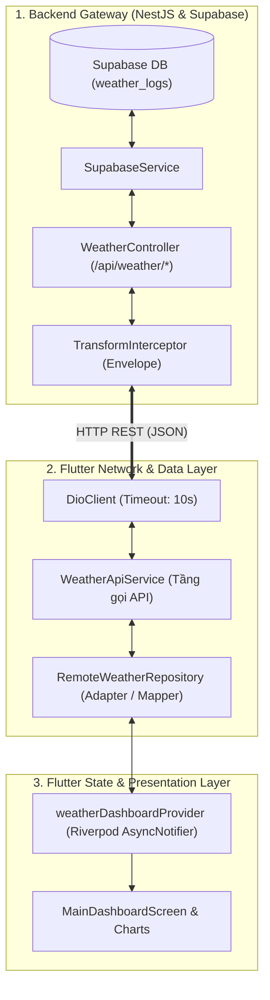

# 📋 KẾ HOẠCH TRIỂN KHAI PHƯƠNG ÁN A: THÔNG LUỒNG DỮ LIỆU CƠ BẢN (BE ➔ APP)
## (ADHT Weather Station - Phase A: Direct REST Data Flow & End-to-End Connectivity)

> **Mục tiêu**: Xóa bỏ hoàn toàn Mock Data, đấu nối trực tiếp Flutter App vào NestJS Backend Gateway qua REST API (Dio) để lấy dữ liệu cảm biến thời gian thực và lịch sử từ Supabase hiển thị lên giao diện.  
> **Nguyên tắc**: Đơn giản - Nhanh chóng - Thông luồng chuẩn xác (Thin Client Model).  
> **Phiên bản tài liệu**: 1.0.0

---

## 1. TỔNG QUAN LUỒNG DỮ LIỆU PHƯƠNG ÁN A

Trong Phương án A, ứng dụng di động đóng vai trò là một **Thin Client** (máy khách tinh gọn). Mọi dữ liệu hiển thị trên màn hình đều được truy vấn trực tiếp từ Backend Gateway mỗi khi mở app, chuyển trạm hoặc người dùng thực hiện thao tác vuốt làm mới (Pull-to-refresh).



---

## 2. HỢP ĐỒNG API CHIỀU BE ➔ APP (API CONTRACTS)

Toàn bộ response từ Backend đều được bọc trong Envelope chuẩn bởi `TransformInterceptor`:
```json
{
  "statusCode": 200,
  "data": { ... },
  "timestamp": "2026-11-10T15:53:30.033Z"
}
```

### 2.1. API 1: Số đo thời gian thực mới nhất (`GET /api/weather/latest`)
* **Endpoint**: `GET /api/weather/latest?device_id={device_id}`
* **Query Params**:
  * `device_id` (tùy chọn, mặc định `adht_weather_01`).
* **Backend Controller**: [`weather.controller.ts:17-22`](file:///home/duongan/Documents/Code/IoT-project/adht-weather-backend/src/modules/weather/weather.controller.ts#L17-L22)
* **Response Body (`data`)**:
  ```json
  {
    "statusCode": 200,
    "data": {
      "device_id": "adht_weather_01",
      "temp": 28.5,
      "humi": 76.2,
      "rain_rate": 0.0,
      "wind_speed": 3.4,
      "recorded_at": "2026-11-10T15:53:30.033Z"
    },
    "timestamp": "2026-11-10T16:00:00.000Z"
  }
  ```
* **Ánh xạ vào Model App**:
  * `temp` $\rightarrow$ `WeatherCurrentModel.temperature` (°C)
  * `humi` $\rightarrow$ `WeatherCurrentModel.humidity` (%)
  * `rain_rate` $\rightarrow$ `WeatherCurrentModel.rainfall` (mm/h)
  * `wind_speed` $\rightarrow$ `WeatherCurrentModel.windSpeed` (km/h hoặc m/s quy đổi)
  * `recorded_at` $\rightarrow$ `WeatherCurrentModel.timestamp` (`DateTime`)
  * `device_id` $\rightarrow$ `WeatherCurrentModel.stationId`

---

### 2.2. API 2: Lịch sử số đo 24h diễn biến trong ngày (`GET /api/weather/history?range=24h`)
* **Endpoint**: `GET /api/weather/history?device_id={device_id}&range=24h`
* **Query Params**:
  * `device_id`: bắt buộc (vd: `adht_weather_01`).
  * `range`: `'24h'` (mặc định gom bucket 10 phút, trả về tối đa ~144-288 điểm đã làm mịn).
* **Response Body (`data`)**:
  ```json
  {
    "statusCode": 200,
    "data": {
      "device_id": "adht_weather_01",
      "range": "24h",
      "points_count": 144,
      "data": [
        {
          "device_id": "adht_weather_01",
          "temp": 26.1,
          "humi": 82.0,
          "rain_rate": 0.0,
          "wind_speed": 2.1,
          "recorded_at": "2026-11-10T00:00:00.000Z"
        },
        ...
      ]
    },
    "timestamp": "2026-11-10T16:00:00.000Z"
  }
  ```
* **Ánh xạ vào Model App**:
  * Mỗi phần tử trong mảng `data` được chuyển đổi thành một đối tượng [`WeatherPoint5m`](file:///home/duongan/Documents/Code/IoT-project/adht-weather-app/lib/data/models/weather_point_5m.dart).

---

### 2.3. API 3: Lịch sử số đo 7 ngày (`GET /api/weather/history?range=7d`)
* **Endpoint**: `GET /api/weather/history?device_id={device_id}&range=7d`
* **Query Params**:
  * `device_id`: bắt buộc.
  * `range`: `'7d'` (gom bucket 1 giờ, trả về các điểm đo trong 7 ngày).
* **Ánh xạ vào Model App**:
  * App sẽ thực hiện gom nhóm (Group-by) các điểm theo từng ngày để tính `avgTemperature`, `minTemperature`, `maxTemperature`, `avgHumidity`, `totalRainfall`, `avgWindSpeed` $\rightarrow$ đưa vào [`WeatherDailySummary`](file:///home/duongan/Documents/Code/IoT-project/adht-weather-app/lib/data/models/weather_daily_summary.dart).

---

## 3. CÁC BƯỚC THỰC THI CHI TIẾT

### Bước 1: Xây dựng `WeatherApiService`
* **Vị trí file**: `adht-weather-app/lib/data/network/weather_api_service.dart`
* **Nhiệm vụ**:
  * Nhận `DioClient` qua dependency injection.
  * Thực hiện gọi 2 endpoint `ApiConstants.endpointWeatherLatest` và `ApiConstants.endpointWeatherHistory`.
  * Bắt lỗi mạng qua hàm tiện ích `handleDioError(e)` trong `api_exceptions.dart`.
* **Mẫu cài đặt**:
  ```dart
  class WeatherApiService {
    final DioClient _dioClient;
    WeatherApiService(this._dioClient);

    Dio get _dio => _dioClient.dio;

    Future<ApiResponse<Map<String, dynamic>?>> fetchLatestWeather(String deviceId) async {
      try {
        final response = await _dio.get(
          ApiConstants.endpointWeatherLatest,
          queryParameters: {'device_id': deviceId},
        );
        return ApiResponse.fromJson(
          response.data as Map<String, dynamic>,
          (data) => data as Map<String, dynamic>?,
        );
      } on DioException catch (e) {
        throw handleDioError(e);
      }
    }

    Future<ApiResponse<Map<String, dynamic>>> fetchHistory({
      required String deviceId,
      required String range,
    }) async {
      try {
        final response = await _dio.get(
          ApiConstants.endpointWeatherHistory,
          queryParameters: {
            'device_id': deviceId,
            'range': range,
          },
        );
        return ApiResponse.fromJson(
          response.data as Map<String, dynamic>,
          (data) => data as Map<String, dynamic>,
        );
      } on DioException catch (e) {
        throw handleDioError(e);
      }
    }
  }
  ```

---

### Bước 2: Xây dựng `RemoteWeatherRepository`
* **Vị trí file**: `adht-weather-app/lib/data/repositories/remote_weather_repository.dart`
* **Nhiệm vụ**:
  * Triển khai interface [`WeatherRepository`](file:///home/duongan/Documents/Code/IoT-project/adht-weather-app/lib/data/repositories/weather_repository.dart).
  * Gọi `WeatherApiService` để lấy JSON từ BE.
  * Chuyển đổi JSON sang các Model hiển thị của UI (`WeatherCurrentModel`, `WeatherPoint5m`, `WeatherDailySummary`).
  * Xử lý trường hợp dữ liệu rỗng (Fallback an toàn): nếu Backend mới khởi động hoặc chưa có bản ghi cho ngày hiện tại, trả về danh sách an toàn không làm crash UI.

---

### Bước 3: Đấu nối vào Riverpod State
* **Vị trí file**: `adht-weather-app/lib/providers/weather_dashboard_provider.dart`
* **Thay đổi**:
  * Khai báo `weatherApiServiceProvider` dùng chung `dioClientProvider`.
  * Thay thế `MockWeatherRepository()` bằng `RemoteWeatherRepository(apiService)`:
  ```dart
  final weatherApiServiceProvider = Provider<WeatherApiService>((ref) {
    final dioClient = ref.watch(dioClientProvider);
    return WeatherApiService(dioClient);
  });

  final weatherRepositoryProvider = Provider<WeatherRepository>((ref) {
    final apiService = ref.watch(weatherApiServiceProvider);
    return RemoteWeatherRepository(apiService);
  });
  ```

---

### Bước 4: Thêm cơ chế Polling tự động nhẹ nhàng
* Trong `WeatherDashboardNotifier`:
  * Mặc định khi người dùng mở màn hình: Tải dữ liệu lần đầu.
  * Khi người dùng kéo màn hình xuống (Pull-to-refresh): Gọi `refresh()`.
  * Bổ sung `Timer.periodic(const Duration(seconds: 30), ...)`: Tự động tải lại số đo mới nhất của trạm để Hero Card luôn cập nhật số đo mà không cần người dùng thao tác bằng tay. Khi widget dispose, tự hủy timer để không rò rỉ bộ nhớ.

---

## 4. DANH MỤC KIỂM THỬ THÔNG LUỒNG (TESTING & VERIFICATION)

| STT | Kịch bản kiểm thử | Thao tác thực hiện | Kết quả kỳ vọng |
| :--- | :--- | :--- | :--- |
| **TC-01** | Kiểm tra kết nối API Backend | Chạy `curl http://localhost:8000/api/weather/latest?device_id=adht_weather_01` trên terminal. | Trả về HTTP 200, JSON chứa số đo mới nhất từ Supabase. |
| **TC-02** | Khởi động App tải dữ liệu thật | Mở ứng dụng Flutter với Base URL LAN `http://192.168.100.29:8000/api`. | Màn hình Dashboard hiện số đo thật (khớp với bản ghi mới nhất trong bảng `weather_logs`). |
| **TC-03** | Thao tác Pull-to-refresh | Vuốt kéo danh sách từ trên xuống trên màn hình chính. | Vòng xoay tải xuất hiện, biến mất sau ~0.5s và thời gian `Cập nhật lúc ...` nhảy lên thời điểm hiện tại. |
| **TC-04** | Đổi trạm quan trắc | Bấm chọn trạm khác trên Header (`adht_weather_02`). | Request gửi lên Backend mang đúng tham số `device_id=adht_weather_02`. |
| **TC-05** | Biểu đồ trong ngày (24h) | Kiểm tra tab Biểu đồ trong ngày. | Biểu đồ Spline Chart vẽ đúng số điểm nhận được từ Backend API. |
| **TC-06** | Xử lý khi mất kết nối mạng | Tắt Wi-Fi hoặc tắt Backend rồi bấm làm mới. | Giao diện hiển thị trạng thái lỗi nhẹ nhàng kèm nút "Thử lại", app không bị văng (crash). |

---

## 5. ĐÁNH GIÁ KẾT QUẢ GIAI ĐOẠN A
Sau khi hoàn thành Phương án A:
* Hệ thống đạt cột mốc **Thông luồng hoàn chỉnh 100%**: Dữ liệu từ vi điều khiển ESP32 / Supabase đi qua Backend Gateway và cập nhật trực tiếp lên màn hình điện thoại người dùng.
* Toàn bộ mã nguồn giả lập (`MockWeatherRepository`, `MockWeatherDataGenerator`) được đưa về chế độ lưu trữ/fallback, mã nguồn chính thức hoàn toàn chạy trên dữ liệu thời gian thực.
