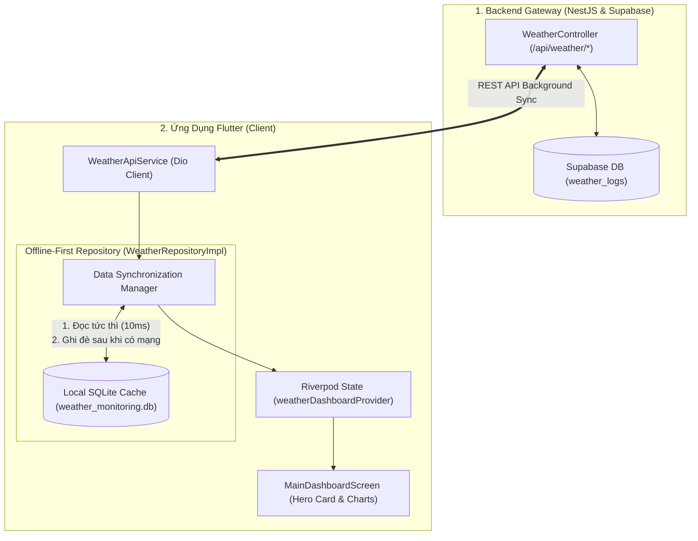
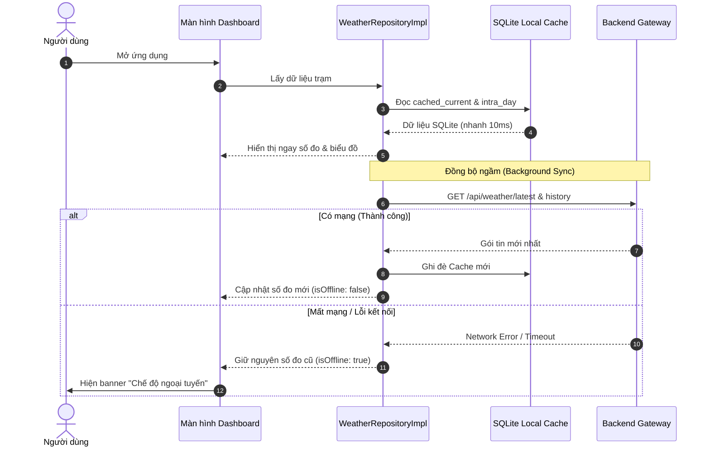

# 🚀 KẾ HOẠCH TRIỂN KHAI PHƯƠNG ÁN B: HOÀN THIỆN TRẢI NGHIỆM & CACHE NGOẠI TUYẾN (ADVANCED)
## (ADHT Weather Station - Phase B: Offline-First SQLite Cache & Network Resilience)

---

## 1. MỤC TIÊU & BỐI CẢNH DỰ ÁN

### 1.1. Bối cảnh
* **Sau Phương án A**: Ứng dụng đã thông luồng thành công với Backend, hiển thị dữ liệu thời gian thực và lịch sử từ Supabase. Tuy nhiên, app vẫn hoạt động theo mô hình *Thin Client*: mỗi lần khởi động phải chờ mạng tải, và khi mất kết nối mạng (hoặc đi vào vùng sóng yếu) app sẽ báo lỗi.
* **Yêu cầu thực tế**: Ứng dụng quan trắc thời tiết / thiên tai đòi hỏi độ tin cậy rất cao. Khi có mưa bão lớn làm đứt cáp mạng hoặc chập chờn 4G, người dùng vẫn cần xem lại được diễn biến thời tiết của những giờ trước đó.

### 1.2. Mục tiêu cụ thể (Objectives)
1. **Khởi động tức thì (Zero-latency Cold Start)**: Mở ứng dụng là hiển thị ngay lập tức (dưới 10ms) dữ liệu lần trước từ SQLite mà không cần chờ màn hình xoay vòng loading.
2. **Khả năng chịu lỗi & Chế độ ngoại tuyến (Offline Resilience)**: Khi mất mạng, app vẫn hiển thị đầy đủ thẻ thời tiết và biểu đồ 7 ngày từ bộ đệm cục bộ, tự động trượt thanh thông báo `OfflineIndicator`.
3. **Đồng bộ ngầm êm ái (Background Sync)**: Khi có mạng trở lại, app tự động đồng bộ số liệu mới nhất từ Backend vào SQLite mà không làm giật lag giao diện.
4. **Bảo vệ bộ nhớ điện thoại (TTL Cleanup)**: Tự động dọn dẹp các bản ghi lịch sử cũ hơn 7-14 ngày để tránh tốn dung lượng máy.

### 1.3. Tiêu chí hoàn thành (Definition of Done - DoD)
- [ ] Khởi động lại app khi bật chế độ máy bay (Airplane Mode): Giao diện vẫn hiển thị đầy đủ số đo và các biểu đồ đã cache lần trước.
- [ ] Widget `OfflineIndicator` tự động xuất hiện khi mất mạng và tự biến mất khi có mạng trở lại.
- [ ] Thời gian hiển thị giao diện khi mở app lần thứ 2 đạt dưới **50ms**.
- [ ] File SQLite `weather_monitoring.db` được tạo thành công trên thiết bị và tự dọn dẹp dữ liệu cũ theo chính sách TTL.

---

## 2. PHÂN CÔNG TRÁCH NHIỆM & TRẠNG THÁI HỆ THỐNG

| Phân hệ | Thành phần phụ trách | Hiện trạng | Trách nhiệm trong Kế hoạch B |
| :--- | :--- | :---: | :--- |
| **Backend Gateway** | NestJS Controllers & Headers | **ĐÃ CÓ SẴN** | Thêm header `@Header('Cache-Control', 'public, max-age=60')` cho API `/weather/history`. Sẵn sàng WebSocket Gateway tại `/ws/telemetry`. |
| **Mobile App** | SQLite (`sqflite`), Repository & UI | **CẦN XÂY DỰNG** | Xây dựng `LocalDatabaseService`, nâng cấp `WeatherRepositoryImpl` theo mẫu Cache-First, và kết nối banner `OfflineIndicator`. |

---

## 3. TỔNG QUAN KIẾN TRÚC OFFLINE-FIRST (CACHE-ASIDE)



---

## 4. THIẾT KẾ CƠ SỞ DỮ LIỆU CỤC BỘ (SQLITE LOCAL SCHEMA)

Hệ thống sử dụng package `sqflite: ^2.4.1` với file cơ sở dữ liệu `weather_monitoring.db` (đã định nghĩa trong [`ApiConstants.databaseName`](file:///home/duongan/Documents/Code/IoT-project/adht-weather-app/lib/core/constants/api_constants.dart#L40)).

### 4.1. Bảng 1: `cached_current_weather` (Số đo mới nhất của từng trạm)
```sql
CREATE TABLE cached_current_weather (
    station_id TEXT PRIMARY KEY,
    station_name TEXT NOT NULL,
    temperature REAL NOT NULL,
    humidity REAL NOT NULL,
    rainfall REAL NOT NULL,
    wind_speed REAL NOT NULL,
    timestamp INTEGER NOT NULL,
    updated_at INTEGER NOT NULL
);
```

### 4.2. Bảng 2: `cached_intra_day_points` (Điểm đo 24h vẽ biểu đồ trong ngày)
```sql
CREATE TABLE cached_intra_day_points (
    id INTEGER PRIMARY KEY AUTOINCREMENT,
    station_id TEXT NOT NULL,
    timestamp INTEGER NOT NULL,
    temperature REAL NOT NULL,
    humidity REAL NOT NULL,
    rainfall REAL NOT NULL,
    wind_speed REAL NOT NULL
);
CREATE INDEX idx_intra_day_station_time ON cached_intra_day_points(station_id, timestamp);
```

### 4.3. Bảng 3: `cached_daily_summaries` (Tóm tắt 7 ngày vẽ biểu đồ tuần)
```sql
CREATE TABLE cached_daily_summaries (
    station_id TEXT NOT NULL,
    date TEXT NOT NULL,
    day_of_week TEXT NOT NULL,
    avg_temperature REAL NOT NULL,
    min_temperature REAL NOT NULL,
    max_temperature REAL NOT NULL,
    avg_humidity REAL NOT NULL,
    total_rainfall REAL NOT NULL,
    avg_wind_speed REAL NOT NULL,
    PRIMARY KEY (station_id, date)
);
```

### 4.4. Chính sách dọn dẹp bộ nhớ (Cache TTL / Cleanup Policy)
* Khi khởi tạo hoặc sau mỗi lần đồng bộ mạng thành công:
  ```sql
  -- Tự động xóa các điểm đo chi tiết trong ngày cũ hơn 48 giờ
  DELETE FROM cached_intra_day_points WHERE timestamp < ?;
  -- Tự động xóa các bản ghi tóm tắt ngày cũ hơn 14 ngày
  DELETE FROM cached_daily_summaries WHERE date < ?;
  ```

---

## 5. CHIẾN LƯỢC ĐỒNG BỘ DỮ LIỆU (SYNCHRONIZATION STRATEGY)



---

## 6. KẾ HOẠCH HÀNH ĐỘNG & MÃ NGUỒN MẪU (ACTION PLAN & CODE SAMPLES)

### PHẦN I: TỐI ƯU HÓA PHÍA BACKEND GATEWAY

#### **Bước BE-B1: Thêm Header Cache-Control cho Lịch sử**
* **Vị trí**: [`adht-weather-backend/src/modules/weather/weather.controller.ts`](file:///home/duongan/Documents/Code/IoT-project/adht-weather-backend/src/modules/weather/weather.controller.ts)
* **Mã nguồn thay đổi**:
  ```typescript
  import { Controller, Get, Query, Header } from '@nestjs/common';

  @Get('history')
  @Header('Cache-Control', 'public, max-age=60') // Cache 60 giây ở tầng client/proxy
  getHistory(@Query() query: QueryHistoryDto) {
    return this.weatherService.getHistory(query.device_id, query.range);
  }
  ```

---

### PHẦN II: CÁC CÔNG VIỆC PHÍA MOBILE APP (FLUTTER)

#### **Bước APP-B1: Xây dựng `LocalDatabaseService` (SQLite Helper)**
* **Vị trí file**: `adht-weather-app/lib/data/local/local_database_service.dart`
* **Mã nguồn hoàn chỉnh**:
  ```dart
  import 'package:path/path.dart';
  import 'package:path_provider/path_provider.dart';
  import 'package:sqflite/sqflite.dart';
  import '../../core/constants/api_constants.dart';
  import '../models/weather_current_model.dart';
  import '../models/weather_daily_summary.dart';
  import '../models/weather_point_5m.dart';

  class LocalDatabaseService {
    static Database? _database;

    Future<Database> get database async {
      _database ??= await _initDatabase();
      return _database!;
    }

    Future<Database> _initDatabase() async {
      final documentsDirectory = await getApplicationDocumentsDirectory();
      final path = join(documentsDirectory.path, ApiConstants.databaseName);

      return await openDatabase(
        path,
        version: ApiConstants.databaseVersion,
        onCreate: (db, version) async {
          await db.execute('''
            CREATE TABLE cached_current_weather (
              station_id TEXT PRIMARY KEY,
              station_name TEXT NOT NULL,
              temperature REAL NOT NULL,
              humidity REAL NOT NULL,
              rainfall REAL NOT NULL,
              wind_speed REAL NOT NULL,
              timestamp INTEGER NOT NULL,
              updated_at INTEGER NOT NULL
            )
          ''');

          await db.execute('''
            CREATE TABLE cached_intra_day_points (
              id INTEGER PRIMARY KEY AUTOINCREMENT,
              station_id TEXT NOT NULL,
              timestamp INTEGER NOT NULL,
              temperature REAL NOT NULL,
              humidity REAL NOT NULL,
              rainfall REAL NOT NULL,
              wind_speed REAL NOT NULL
            )
          ''');
          await db.execute(
            'CREATE INDEX idx_intra_day_station_time ON cached_intra_day_points(station_id, timestamp)'
          );

          await db.execute('''
            CREATE TABLE cached_daily_summaries (
              station_id TEXT NOT NULL,
              date TEXT NOT NULL,
              day_of_week TEXT NOT NULL,
              avg_temperature REAL NOT NULL,
              min_temperature REAL NOT NULL,
              max_temperature REAL NOT NULL,
              avg_humidity REAL NOT NULL,
              total_rainfall REAL NOT NULL,
              avg_wind_speed REAL NOT NULL,
              PRIMARY KEY (station_id, date)
            )
          ''');
        },
      );
    }

    // 1. Current Weather Cache
    Future<void> saveCurrentWeather(WeatherCurrentModel model) async {
      final db = await database;
      await db.insert(
        'cached_current_weather',
        {
          'station_id': model.stationId,
          'station_name': model.stationName,
          'temperature': model.temperature,
          'humidity': model.humidity,
          'rainfall': model.rainfall,
          'wind_speed': model.windSpeed,
          'timestamp': model.timestamp.millisecondsSinceEpoch,
          'updated_at': DateTime.now().millisecondsSinceEpoch,
        },
        conflictAlgorithm: ConflictAlgorithm.replace,
      );
    }

    Future<WeatherCurrentModel?> getCurrentWeather(String stationId) async {
      final db = await database;
      final maps = await db.query(
        'cached_current_weather',
        where: 'station_id = ?',
        whereArgs: [stationId],
        limit: 1,
      );

      if (maps.isEmpty) return null;
      final m = maps.first;
      return WeatherCurrentModel(
        stationId: m['station_id'] as String,
        stationName: m['station_name'] as String,
        timestamp: DateTime.fromMillisecondsSinceEpoch(m['timestamp'] as int),
        temperature: (m['temperature'] as num).toDouble(),
        humidity: (m['humidity'] as num).toDouble(),
        rainfall: (m['rainfall'] as num).toDouble(),
        windSpeed: (m['wind_speed'] as num).toDouble(),
        isOnline: false,
      );
    }

    // 2. Intra-day Points Cache
    Future<void> saveIntraDayPoints(String stationId, List<WeatherPoint5m> points) async {
      final db = await database;
      final batch = db.batch();
      batch.delete('cached_intra_day_points', where: 'station_id = ?', whereArgs: [stationId]);

      for (final p in points) {
        batch.insert('cached_intra_day_points', {
          'station_id': stationId,
          'timestamp': p.timestamp.millisecondsSinceEpoch,
          'temperature': p.temperature,
          'humidity': p.humidity,
          'rainfall': p.rainfall,
          'wind_speed': p.windSpeed,
        });
      }
      await batch.commit(noResult: true);
    }

    Future<List<WeatherPoint5m>> getIntraDayPoints(String stationId) async {
      final db = await database;
      final maps = await db.query(
        'cached_intra_day_points',
        where: 'station_id = ?',
        whereArgs: [stationId],
        orderBy: 'timestamp ASC',
      );

      return maps.map((m) {
        return WeatherPoint5m(
          timestamp: DateTime.fromMillisecondsSinceEpoch(m['timestamp'] as int),
          temperature: (m['temperature'] as num).toDouble(),
          humidity: (m['humidity'] as num).toDouble(),
          rainfall: (m['rainfall'] as num).toDouble(),
          windSpeed: (m['wind_speed'] as num).toDouble(),
        );
      }).toList();
    }

    // 3. Daily Summaries Cache
    Future<void> saveDailySummaries(String stationId, List<WeatherDailySummary> summaries) async {
      final db = await database;
      final batch = db.batch();

      for (final s in summaries) {
        batch.insert(
          'cached_daily_summaries',
          {
            'station_id': stationId,
            'date': s.date.toIso8601String().substring(0, 10),
            'day_of_week': s.dayOfWeek,
            'avg_temperature': s.avgTemperature,
            'min_temperature': s.minTemperature,
            'max_temperature': s.maxTemperature,
            'avg_humidity': s.avgHumidity,
            'total_rainfall': s.totalRainfall,
            'avg_wind_speed': s.avgWindSpeed,
          },
          conflictAlgorithm: ConflictAlgorithm.replace,
        );
      }
      await batch.commit(noResult: true);
    }

    Future<List<WeatherDailySummary>> getDailySummaries(String stationId) async {
      final db = await database;
      final maps = await db.query(
        'cached_daily_summaries',
        where: 'station_id = ?',
        whereArgs: [stationId],
        orderBy: 'date ASC',
      );

      return maps.map((m) {
        return WeatherDailySummary(
          date: DateTime.parse(m['date'] as String),
          dayOfWeek: m['day_of_week'] as String,
          avgTemperature: (m['avg_temperature'] as num).toDouble(),
          minTemperature: (m['min_temperature'] as num).toDouble(),
          maxTemperature: (m['max_temperature'] as num).toDouble(),
          avgHumidity: (m['avg_humidity'] as num).toDouble(),
          totalRainfall: (m['total_rainfall'] as num).toDouble(),
          avgWindSpeed: (m['avg_wind_speed'] as num).toDouble(),
        );
      }).toList();
    }

    // 4. Purge Old Data (TTL Policy)
    Future<void> purgeOldData() async {
      final db = await database;
      final twoDaysAgoMs = DateTime.now().subtract(const Duration(days: 2)).millisecondsSinceEpoch;
      final fourteenDaysAgoStr = DateTime.now().subtract(const Duration(days: 14)).toIso8601String().substring(0, 10);

      await db.delete('cached_intra_day_points', where: 'timestamp < ?', whereArgs: [twoDaysAgoMs]);
      await db.delete('cached_daily_summaries', where: 'date < ?', whereArgs: [fourteenDaysAgoStr]);
    }
  }
  ```

---

#### **Bước APP-B2: Xây dựng `OfflineFirstWeatherRepository`**
* **Vị trí file**: `adht-weather-app/lib/data/repositories/weather_repository_impl.dart`
* **Nhiệm vụ**: Kết hợp `WeatherApiService` và `LocalDatabaseService` theo mô hình Cache-First + Network-Fallback.
* **Mã nguồn hoàn chỉnh**:
  ```dart
  import '../../core/constants/api_constants.dart';
  import '../local/local_database_service.dart';
  import '../models/weather_current_model.dart';
  import '../models/weather_daily_summary.dart';
  import '../models/weather_point_5m.dart';
  import '../network/weather_api_service.dart';
  import 'remote_weather_repository.dart';
  import 'weather_repository.dart';

  class WeatherRepositoryImpl implements WeatherRepository {
    final WeatherApiService _apiService;
    final LocalDatabaseService _localDb;
    final RemoteWeatherRepository _remoteRepo;
    final String currentDeviceId;

    WeatherRepositoryImpl({
      required WeatherApiService apiService,
      required LocalDatabaseService localDb,
      this.currentDeviceId = ApiConstants.defaultStationId,
    })  : _apiService = apiService,
          _localDb = localDb,
          _remoteRepo = RemoteWeatherRepository(apiService, currentDeviceId: currentDeviceId);

    @override
    Future<WeatherCurrentModel> getCurrentWeather() async {
      try {
        final fresh = await _remoteRepo.getCurrentWeather();
        await _localDb.saveCurrentWeather(fresh);
        return fresh;
      } catch (e) {
        // Fallback sang cache SQLite khi mất mạng
        final cached = await _localDb.getCurrentWeather(currentDeviceId);
        if (cached != null) return cached;
        rethrow;
      }
    }

    @override
    Future<List<WeatherPoint5m>> getIntraDayData5m() async {
      try {
        final freshPoints = await _remoteRepo.getIntraDayData5m();
        if (freshPoints.isNotEmpty) {
          await _localDb.saveIntraDayPoints(currentDeviceId, freshPoints);
        }
        return freshPoints;
      } catch (e) {
        final cachedPoints = await _localDb.getIntraDayPoints(currentDeviceId);
        if (cachedPoints.isNotEmpty) return cachedPoints;
        rethrow;
      }
    }

    @override
    Future<List<WeatherDailySummary>> get7DaysSummary() async {
      try {
        final freshSummaries = await _remoteRepo.get7DaysSummary();
        if (freshSummaries.isNotEmpty) {
          await _localDb.saveDailySummaries(currentDeviceId, freshSummaries);
        }
        return freshSummaries;
      } catch (e) {
        final cachedSummaries = await _localDb.getDailySummaries(currentDeviceId);
        if (cachedSummaries.isNotEmpty) return cachedSummaries;
        rethrow;
      }
    }

    @override
    Future<void> refreshAllData() async {
      await _localDb.purgeOldData();
    }
  }
  ```

---

#### **Bước APP-B3: Hoàn thiện trạng thái Ngoại Tuyến trên UI**
* **Vị trí file**: [`adht-weather-app/lib/views/screens/main_dashboard_screen.dart`](file:///home/duongan/Documents/Code/IoT-project/adht-weather-app/lib/views/screens/main_dashboard_screen.dart)
* Widget `OfflineIndicator` đã được gắn sẵn ở dòng 104-105:
  ```dart
  if (state.isOffline)
    OfflineIndicator(lastSavedTime: state.lastUpdated),
  ```
* Khi `WeatherRepositoryImpl` kích hoạt chế độ fallback, provider sẽ set `isOffline: true`, thanh thông báo màu cam tự động trượt xuống để người dùng an tâm rằng số liệu đang xem là từ bộ nhớ đệm an toàn.

---

## 7. DANH MỤC KIỂM THỬ GIAI ĐOẠN B (TESTING & RESILIENCE)

| STT | Kịch bản kiểm thử | Thao tác thực hiện | Kết quả kỳ vọng |
| :--- | :--- | :--- | :--- |
| **TC-B01** | Khởi động tức thì (Zero Latency) | Tắt hoàn toàn app (Kill App) rồi mở lại. | Giao diện hiện ngay lập tức dữ liệu lần trước, không thấy màn hình loading trắng (<50ms). |
| **TC-B02** | Ngoại tuyến hoàn toàn (Airplane Mode) | Bật chế độ máy bay trên điện thoại rồi mở app. | App vẫn hiển thị đầy đủ thẻ thời tiết và biểu đồ 7 ngày từ SQLite; thanh Offline Indicator hiện màu cam. |
| **TC-B03** | Khôi phục mạng (Auto-Reconnection) | Tắt chế độ máy bay (bật lại Wi-Fi). | App tự động gọi API cập nhật số đo mới nhất, thanh Offline tự động biến mất. |
| **TC-B04** | Dọn dẹp dữ liệu cũ (Purge) | Tua thời gian hệ thống qua 15 ngày. | Các bản ghi cũ hơn 7 ngày tự động bị dọn dẹp, dung lượng file `.db` không tăng vô hạn. |

---

## 8. PHÂN TÍCH RỦI RO & PHƯƠNG ÁN DỰ PHÒNG (RISK & CONTINGENCY)

| Rủi ro tiềm ẩn | Mức độ | Biện pháp phòng ngừa & Xử lý |
| :--- | :---: | :--- |
| **Xung đột ghi đè SQLite (Database Lock)** | Thấp | Sử dụng Transaction `batch` của `sqflite` với cờ `noResult: true` để ghi hàng trăm điểm đo một cách an toàn và tối ưu I/O. |
| **Nâng cấp Schema DB sau này** | Thấp | Khai báo `ApiConstants.databaseVersion = 1` và bổ sung hàm `onUpgrade` khi có nhu cầu thêm bảng mới. |
| **Máy người dùng đầy bộ nhớ** | Rất thấp | Hàm `purgeOldData()` tự động chạy mỗi khi khởi tạo app hoặc refresh dữ liệu, giới hạn tối đa dung lượng DB dưới 2MB. |

---

## 9. PHỤ LỤC: TÍNH NĂNG MỞ RỘNG SAU CÙNG (BONUS: REALTIME WEBSOCKET PUSH)

> [!NOTE]
> Phần này được **xếp ở bước sau cùng**, chỉ triển khai khi toàn bộ hệ thống Cache SQLite ở trên đã chạy hoàn hảo và bạn muốn số đo trên màn hình nhảy từng giây mỗi khi ESP32 phát MQTT.

### 9.1. Hợp đồng WebSocket Backend
* **Host**: `ws://<backend_host>/ws/telemetry` (hoặc `wss://...` trên Cloud)
* **Event phát từ BE**: `'telemetry'` kèm payload `CreateTelemetryDto`.

### 9.2. Cài đặt thư viện trên Flutter
```yaml
dependencies:
  socket_io_client: ^3.0.2
```

### 9.3. Xây dựng `TelemetrySocketService`
```dart
socket.on('telemetry', (data) {
  if (data != null && data is Map<String, dynamic>) {
    final deviceId = data['device_id'] as String?;
    if (deviceId == currentSelectedDeviceId) {
      _telemetryStreamController.add(data);
    }
  }
});
```

---

## 10. BẢNG SO SÁNH TỔNG KẾT: PHƯƠNG ÁN A vs PHƯƠNG ÁN B

| Tiêu chí so sánh | Phương án A (Basic Flow) | Phương án B (Advanced Offline-First) |
| :--- | :--- | :--- |
| **Độ phức tạp mã nguồn** | Thấp (Khoảng 2-3 files) | Trung bình (Thêm SQLite Cache) |
| **Thời gian khởi động App** | Chờ tải mạng (1.0s - 2.5s) | **Tức thì (< 50ms)** |
| **Trải nghiệm khi mất mạng** | Hiện màn hình báo lỗi | **Xem bình thường (Đầy đủ biểu đồ 7 ngày)** |
| **Cơ chế cập nhật dữ liệu** | REST API Polling (chu kỳ 30s) | REST API Background Sync + SQLite Cache |
| **Tính năng mở rộng** | Không | Tùy chọn lắp thêm WebSocket Realtime sau cùng |
| **Sẵn sàng thương mại hóa** | Mức đồ án / Proof of Concept | **Mức Production / Ứng dụng thực tế cao cấp** |
