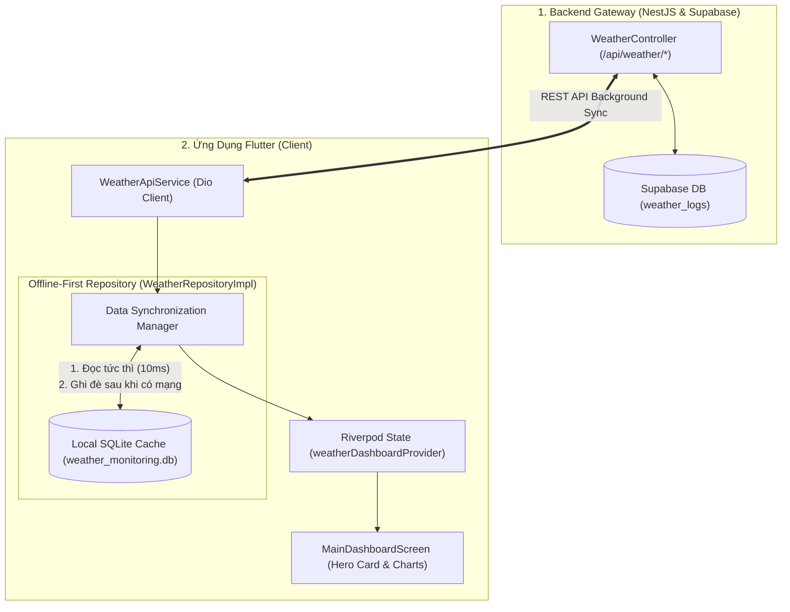
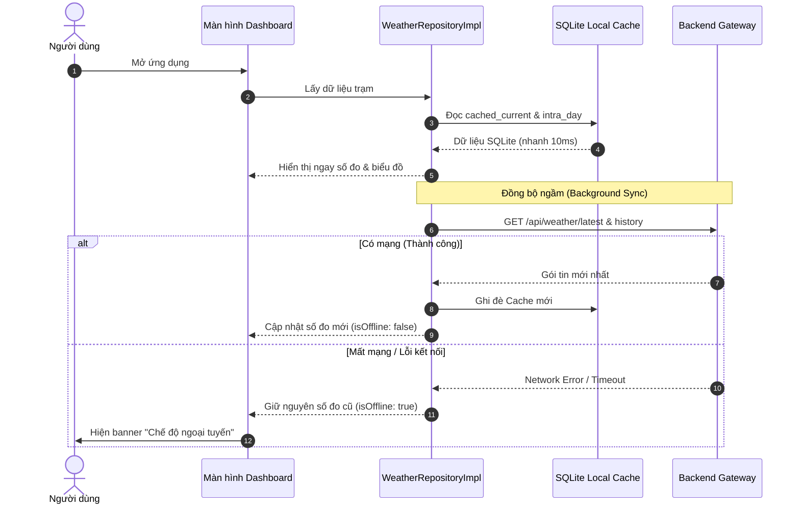

# 🚀 KẾ HOẠCH TRIỂN KHAI PHƯƠNG ÁN B: HOÀN THIỆN TRẢI NGHIỆM & CACHE NGOẠI TUYẾN (ADVANCED)
## (ADHT Weather Station - Phase B: Offline-First SQLite Cache & Network Resilience)

> **Mục tiêu trọng tâm**: Nâng cấp ứng dụng di động từ Thin Client lên mô hình **Offline-First Resilience**:
> 1. Sử dụng SQLite cục bộ (`sqflite`) làm bộ đệm giúp mở app **hiển thị tức thì (0.01 giây)** (Zero-latency Cold Start).
> 2. Hoạt động trơn tru ngay cả khi mất mạng (Offline Mode), người dùng vẫn xem đầy đủ biểu đồ diễn biến 24h và 7 ngày qua.
> 3. Cơ chế tự động dọn dẹp cache (TTL Cleanup) để bảo vệ bộ nhớ máy.  
> *(Lưu ý: Tính năng **WebSocket Push** thời gian thực được xếp vào **Giai đoạn mở rộng sau cùng** sau khi Offline Cache đã ổn định 100%).*  
> **Phiên bản tài liệu**: 1.1.0 (Chuẩn hóa ưu tiên cốt lõi)

---

## 1. TỔNG QUAN KIẾN TRÚC OFFLINE-FIRST (CACHE-ASIDE)



---

## 2. THIẾT KẾ CƠ SỞ DỮ LIỆU CỤC BỘ (SQLITE LOCAL SCHEMA)

Hệ thống sử dụng package `sqflite: ^2.4.1` với file cơ sở dữ liệu `weather_monitoring.db` (đã định nghĩa trong [`ApiConstants.databaseName`](file:///home/duongan/Documents/Code/IoT-project/adht-weather-app/lib/core/constants/api_constants.dart#L40)).

### 2.1. Bảng 1: `cached_current_weather` (Số đo mới nhất của từng trạm)
Lưu lại trạng thái thời tiết tức thời gần nhất của mỗi trạm để khi mở app lên là hiển thị ngay lập tức.
```sql
CREATE TABLE cached_current_weather (
    station_id TEXT PRIMARY KEY,
    station_name TEXT NOT NULL,
    temperature REAL NOT NULL,
    humidity REAL NOT NULL,
    rainfall REAL NOT NULL,
    wind_speed REAL NOT NULL,
    timestamp INTEGER NOT NULL,
    updated_at INTEGER NOT NULL
);
```

### 2.2. Bảng 2: `cached_intra_day_points` (Điểm đo 24h vẽ biểu đồ trong ngày)
Lưu các điểm đo mốc 5-10 phút của ngày hôm nay.
```sql
CREATE TABLE cached_intra_day_points (
    id INTEGER PRIMARY KEY AUTOINCREMENT,
    station_id TEXT NOT NULL,
    timestamp INTEGER NOT NULL,
    temperature REAL NOT NULL,
    humidity REAL NOT NULL,
    rainfall REAL NOT NULL,
    wind_speed REAL NOT NULL
);
CREATE INDEX idx_intra_day_station_time ON cached_intra_day_points(station_id, timestamp);
```

### 2.3. Bảng 3: `cached_daily_summaries` (Tóm tắt 7 ngày vẽ biểu đồ tuần)
Lưu dữ liệu trung bình ngày, cực đại, cực tiểu và tổng lượng mưa của 7 ngày gần nhất.
```sql
CREATE TABLE cached_daily_summaries (
    station_id TEXT NOT NULL,
    date TEXT NOT NULL, -- Định dạng 'YYYY-MM-DD'
    day_of_week TEXT NOT NULL,
    avg_temperature REAL NOT NULL,
    min_temperature REAL NOT NULL,
    max_temperature REAL NOT NULL,
    avg_humidity REAL NOT NULL,
    total_rainfall REAL NOT NULL,
    avg_wind_speed REAL NOT NULL,
    PRIMARY KEY (station_id, date)
);
```

### 2.4. Chính sách dọn dẹp bộ nhớ (Cache TTL / Cleanup Policy)
Để tránh ứng dụng chiếm dụng bộ nhớ trong của điện thoại sau nhiều tháng sử dụng:
* Mỗi khi khởi tạo ứng dụng hoặc kết nối mạng thành công:
  ```sql
  -- Tự động xóa các điểm đo chi tiết trong ngày cũ hơn 48 giờ
  DELETE FROM cached_intra_day_points WHERE timestamp < ?;
  -- Tự động xóa các bản ghi tóm tắt ngày cũ hơn 14 ngày
  DELETE FROM cached_daily_summaries WHERE date < ?;
  ```

---

## 3. CHIẾN LƯỢC ĐỒNG BỘ DỮ LIỆU (SYNCHRONIZATION STRATEGY)

### 3.1. Luồng Khởi Động App: Cache-First với Network-Update ngầm
1. **T0 (0.00s)**: Người dùng mở ứng dụng.
2. **T1 (0.01s)**: Repository đọc nhanh dữ liệu từ SQLite $\rightarrow$ đẩy lên Riverpod State $\rightarrow$ Màn hình hiển thị ngay lập tức (không có màn hình chờ xoay vòng).
3. **T2 (0.02s)**: Repository âm thầm gửi request `GET /api/weather/latest` và `GET /api/weather/history` lên Backend.
4. **T3 (0.30s)**: Backend phản hồi dữ liệu mới:
   * Cập nhật lại Riverpod State (số đo trên giao diện cập nhật êm dịu, không giật màn hình).
   * Ghi đè bản ghi mới vào SQLite.
5. **Nếu T3 gặp lỗi (Mất mạng / Timeout)**:
   * Giữ nguyên dữ liệu SQLite đang hiển thị.
   * Kích hoạt cờ `isOffline: true` trong `WeatherDashboardState`.
   * Banner [`OfflineIndicator`](file:///home/duongan/Documents/Code/IoT-project/adht-weather-app/lib/views/widgets/common/offline_indicator.dart) tự động trượt xuống thông báo: *"Bạn đang ở chế độ ngoại tuyến. Dữ liệu cập nhật lần cuối lúc HH:mm"*.



---

## 4. CÁC BƯỚC THỰC THI CHI TIẾT (LỘ TRÌNH CHÍNH)

### Bước B1: Xây dựng `LocalDatabaseService` (SQLite Helper)
* **Vị trí file**: `adht-weather-app/lib/data/local/local_database_service.dart`
* **Chức năng**:
  * Khởi tạo database SQLite `weather_monitoring.db` (sử dụng `openDatabase` từ `sqflite`).
  * Thực thi các lệnh `CREATE TABLE` và `CREATE INDEX` ở mục 2.
  * Cung cấp các phương thức CRUD chuẩn:
    * `Future<void> saveCurrentWeather(WeatherCurrentModel current)`
    * `Future<WeatherCurrentModel?> getCurrentWeather(String stationId)`
    * `Future<void> saveIntraDayPoints(String stationId, List<WeatherPoint5m> points)`
    * `Future<List<WeatherPoint5m>> getIntraDayPoints(String stationId)`
    * `Future<void> saveDailySummaries(String stationId, List<WeatherDailySummary> summaries)`
    * `Future<List<WeatherDailySummary>> getDailySummaries(String stationId)`
    * `Future<void> purgeOldData()`

---

### Bước B2: Nâng cấp `WeatherRepositoryImpl` (Offline-First Pattern)
* **Vị trí file**: `adht-weather-app/lib/data/repositories/weather_repository_impl.dart`
* **Cơ chế xử lý kết hợp Cache + API**:
  ```dart
  class WeatherRepositoryImpl implements WeatherRepository {
    final WeatherApiService _apiService;
    final LocalDatabaseService _localDb;

    @override
    Future<WeatherCurrentModel> getCurrentWeather() async {
      // 1. Thử lấy từ API trước
      try {
        final response = await _apiService.fetchLatestWeather(selectedStationId);
        if (response.data != null) {
          final freshModel = _mapToCurrentModel(response.data!);
          // Lưu đệm vào SQLite
          await _localDb.saveCurrentWeather(freshModel);
          return freshModel;
        }
      } catch (e) {
        // 2. Nếu API lỗi, fallback sang SQLite
        final cached = await _localDb.getCurrentWeather(selectedStationId);
        if (cached != null) {
          return cached.copyWith(isOnline: false);
        }
        rethrow;
      }
      ...
    }
  }
  ```

---

### Bước B3: Hoàn thiện trạng thái Ngoại Tuyến trên UI
* **Vị trí file**: `adht-weather-app/lib/views/screens/main_dashboard_screen.dart`
* **Nhiệm vụ**:
  * Lắng nghe biến `state.isOffline` từ Riverpod.
  * Hiển thị widget `OfflineIndicator` phía trên cùng của Dashboard khi mất mạng.
  * Hiển thị nút "Thử kết nối lại" để người dùng kích hoạt tải lại mạng khi có kết nối.

---

## 5. DANH MỤC KIỂM THỬ GIAI ĐOẠN B (TESTING & RESILIENCE)

| STT | Kịch bản kiểm thử | Thao tác thực hiện | Kết quả kỳ vọng |
| :--- | :--- | :--- | :--- |
| **TC-B01** | Khởi động tức thì (Zero Latency) | Tắt hoàn toàn app (Kill App) rồi mở lại. | Giao diện hiện ngay lập tức dữ liệu lần trước, không thấy màn hình loading trắng. |
| **TC-B02** | Ngoại tuyến hoàn toàn (Airplane Mode) | Bật chế độ máy bay trên điện thoại rồi mở app. | App vẫn hiển thị đầy đủ thẻ thời tiết và biểu đồ 7 ngày từ SQLite; thanh Offline Indicator hiện màu cam cảnh báo ngoại tuyến. |
| **TC-B03** | Khôi phục mạng (Auto-Reconnection) | Tắt chế độ máy bay (bật lại Wi-Fi). | App tự động gọi API cập nhật số đo mới nhất, thanh Offline tự động biến mất. |
| **TC-B04** | Dọn dẹp dữ liệu cũ (Purge) | Tua thời gian hệ thống qua 15 ngày. | Các bản ghi cũ hơn 7 ngày tự động bị dọn dẹp, dung lượng file `.db` không tăng vô hạn. |

---

## 6. PHỤ LỤC: TÍNH NĂNG MỞ RỘNG SAU CÙNG (BONUS: REALTIME WEBSOCKET PUSH)

> [!NOTE]
> Phần này được **xếp ở bước sau cùng**, chỉ triển khai khi toàn bộ hệ thống Cache SQLite ở trên đã chạy hoàn hảo và bạn muốn số đo trên màn hình nhảy từng giây mỗi khi ESP32 phát MQTT.

### 6.1. Hợp đồng WebSocket Backend
Backend đã có sẵn WebSocket Gateway Socket.IO tại:
* **Host**: `ws://<backend_host>/ws/telemetry` (hoặc `wss://...` trên Cloud)
* **Event phát từ BE**: `'telemetry'` kèm payload `CreateTelemetryDto`.

### 6.2. Cài đặt thư viện trên Flutter
Bổ sung vào `adht-weather-app/pubspec.yaml`:
```yaml
dependencies:
  socket_io_client: ^3.0.2
```

### 6.3. Xây dựng `TelemetrySocketService`
* **Vị trí file**: `adht-weather-app/lib/data/network/telemetry_socket_service.dart`
* **Nhiệm vụ**:
  * Quản lý vòng đời kết nối Socket.IO (kết nối khi app vào foreground, tự ngắt khi background để tiết kiệm pin).
  * Lắng nghe event `'telemetry'`:
    ```dart
    socket.on('telemetry', (data) {
      if (data != null && data is Map<String, dynamic>) {
        final deviceId = data['device_id'] as String?;
        if (deviceId == currentSelectedDeviceId) {
          // Bắn Stream/Notifier cập nhật trực tiếp thẻ thời tiết tức thời
          _telemetryStreamController.add(data);
        }
      }
    });
    ```
* **Lợi ích**: Mỗi khi ESP32 đọc cảm biến xong và bắn MQTT lên broker $\rightarrow$ Backend nhận được sẽ chuyển tiếp ngay xuống điện thoại trong vòng **dưới 100ms**.

---

## 7. BẢNG SO SÁNH TỔNG KẾT: PHƯƠNG ÁN A vs PHƯƠNG ÁN B

| Tiêu chí so sánh | Phương án A (Basic Flow) | Phương án B (Advanced Offline-First) |
| :--- | :--- | :--- |
| **Độ phức tạp mã nguồn** | Thấp (Khoảng 2-3 files) | Trung bình (Thêm SQLite Cache) |
| **Thời gian khởi động App** | Chờ tải mạng (1.0s - 2.5s) | **Tức thì (0.01s)** |
| **Trải nghiệm khi mất mạng** | Hiện màn hình báo lỗi | **Xem bình thường (Đầy đủ biểu đồ 7 ngày)** |
| **Cơ chế cập nhật dữ liệu** | REST API Polling (chu kỳ 30s) | REST API Background Sync + Cache |
| **Tính năng mở rộng** | Không | Tùy chọn lắp thêm WebSocket Realtime sau cùng |
| **Sẵn sàng thương mại hóa** | Mức đồ án / Proof of Concept | **Mức Production / Ứng dụng thực tế cao cấp** |
