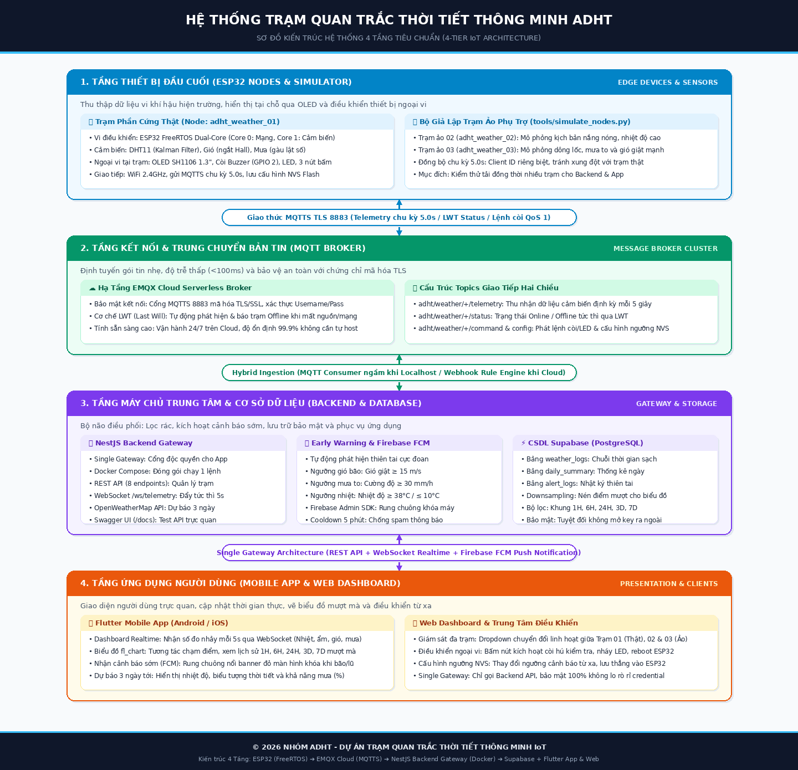

# 🌦️ KẾ HOẠCH DỰ ÁN: TRẠM QUAN TRẮC THỜI TIẾT THÔNG MINH ADHT

> **Đơn vị phát triển**: Nhóm ADHT  
> **Mô hình Repository**: Monorepo (Quản lý tập trung Firmware, Backend Server, Mobile App & Simulator trong 1 Repository duy nhất)  
> **Kiến trúc hệ thống**: 4 Tầng chuẩn IoT (Thiết bị ➔ MQTT Broker ➔ Backend Gateway & CSDL ➔ Client Apps & Web)  
> **Công nghệ lõi**: ESP32 (FreeRTOS) + EMQX Cloud (MQTT TLS 8883) + NestJS Backend Gateway (TypeScript / Docker Compose) + Supabase (PostgreSQL) + Flutter App & Web Dashboard  

---

## MỤC LỤC
1. [Cấu trúc Thư mục Dự án (Monorepo Structure)](#1-cấu-trúc-thư-mục-dự-án-monorepo-structure)
2. [Sơ đồ Kiến trúc Hệ thống 4 Tầng](#2-sơ-đồ-kiến-trúc-hệ-thống-4-tầng)
3. [Đặc tả Phần cứng & Sơ đồ nối chân (Pinout)](#3-đặc-tả-phần-cứng--sơ-đồ-nối-chân-pinout)
4. [Đặc tả Giao thức Mạng & MQTT Topics](#4-đặc-tả-giao-thức-mạng--mqtt-topics)
5. [Đặc tả Tầng Máy chủ Backend (Docker) & Cơ sở dữ liệu Supabase](#5-đặc-tả-tầng-máy-chủ-backend-docker--cơ-sở-dữ-liệu-supabase)
6. [Đặc tả Ứng dụng Người dùng (Flutter Mobile App & Web Dashboard)](#6-đặc-tả-ứng-dụng-người-dùng-flutter-mobile-app--web-dashboard)
7. [Lộ trình Triển khai Dự án (5 Tuần)](#7-lộ-trình-triển-khai-dự-án-5-tuần)
8. [Kế hoạch Kiểm thử & Đánh giá chất lượng (QA/QC)](#8-kế-hoạch-kiểm-thử--đánh-giá-chất-lượng-qaqc)
9. [Hướng dẫn Cài đặt & Vận hành Nhanh (Quickstart)](#9-hướng-dẫn-cài-đặt--vận-hành-nhanh-quickstart)

---

## 1. CẤU TRÚC THƯ MỤC DỰ ÁN (MONOREPO STRUCTURE)

Dự án được tổ chức theo mô hình **Monorepo** với 3 phân hệ độc lập: Phần cứng nhúng (`adht-weather-firmware`), Máy chủ trung tâm (`adht-weather-backend`) và Ứng dụng người dùng (`adht-weather-app`), kèm bộ công cụ mô phỏng (`tools/`).

```text
IoT-project/
├── adht-weather-firmware/               # Phân hệ Nhúng (ESP32 PlatformIO C++)
│   ├── platformio.ini                  # Cấu hình board esp32doit-devkit-v1, partition huge_app, load_env.py
│   ├── load_env.py                     # Pre-build script trích xuất biến môi trường từ .env thành cờ -D
│   ├── .env.example                    # Template cấu hình mẫu WiFi, EMQX Credentials
│   ├── .env                            # [Bảo mật] Chứa thông tin WiFi và EMQX thật (không commit vào Git)
│   ├── include/                        # Header dùng chung
│   ├── lib/                            # Thư viện cục bộ (Adafruit GFX, SH110X, DHT, Kalman)
│   └── src/
│       ├── config.h                    # Định nghĩa Pinout, Timing intervals (5s), MQTT Topics
│       ├── types.h                     # Cấu trúc dữ liệu WeatherData, SystemConfig, NetworkStatus
│       ├── main.cpp                    # Khởi tạo và điều phối 4 Task FreeRTOS trên 2 Core
│       ├── sensors/                    # Bộ đọc cảm biến DHT11, ngắt xung Mưa (GPIO 15) và Gió (GPIO 13)
│       ├── network/                    # WiFiManager và MqttManager (MQTTS TLS 8883, QoS 1)
│       ├── display/                    # OledManager hiển thị 128x64 SH1106
│       └── storage/                    # StorageManager lưu cấu hình ngưỡng vào NVS Flash
│
├── adht-weather-backend/                # Phân hệ Máy chủ Trung tâm (NestJS TypeScript + Docker Compose)
│   ├── Dockerfile                      # Multi-stage build Node.js 20 Alpine
│   ├── docker-compose.yml              # Khởi chạy dịch vụ Backend chỉ bằng 1 lệnh duy nhất
│   ├── package.json                    # Khai báo NestJS, MQTT, Supabase SDK, Firebase Admin SDK
│   ├── .env.example                    # Template biến môi trường: Supabase URL/Key, Firebase Admin Key, EMQX
│   ├── DEVELOPMENT_GUIDE.md            # Sổ tay kỹ thuật chi tiết dành cho lập trình viên Backend
│   ├── src/
│   │   ├── main.ts                     # Bootstrap: CORS, Swagger (/docs), ValidationPipe, Global Prefix
│   │   ├── app.module.ts               # Root Module
│   │   ├── config/                     # Quản lý cấu hình biến môi trường
│   │   └── modules/
│   │       ├── mqtt/                   # MqttService kết nối Broker MQTTS 8883 hút telemetry & phát lệnh
│   │       ├── websocket/              # TelemetryGateway (@WebSocketGateway phát realtime /ws/telemetry)
│   │       ├── database/               # SupabaseService ghi PostgreSQL & thuật toán Downsampling biểu đồ
│   │       ├── notifications/          # NotificationsService kiểm tra thiên tai & gọi Firebase FCM Admin
│   │       ├── telemetry/              # TelemetryController nhận Webhook từ EMQX Cloud Rule Engine
│   │       ├── weather/                # WeatherController: latest, history downsampled, 3-day forecast
│   │       └── devices/                # DevicesController: send command còi/LED & update config NVS
│
├── adht-weather-app/                    # Phân hệ Ứng dụng Người dùng (Flutter Mobile & Web)
│   ├── pubspec.yaml                    # Khai báo dependencies: dio/http, web_socket_channel, fl_chart, firebase_messaging
│   └── lib/
│       ├── main.dart                   # Điểm khởi chạy ứng dụng (Hỗ trợ cả Android, iOS và Web)
│       ├── core/                       # Hằng số kết nối Backend API URL, Theme, Helpers
│       ├── data/
│       │   ├── models/                 # Model dữ liệu thời tiết, cấu hình và dự báo
│       │   └── services/               # ApiClientService (REST) & WebSocketService (Realtime)
│       └── presentation/
│           ├── providers/              # Quản lý State dữ liệu thời gian thực và lịch sử
│           ├── screens/                # Màn hình Dashboard, Biểu đồ lịch sử, Cài đặt & Điều khiển
│           └── widgets/                # Các thẻ Gauge, Card thông số, Biểu đồ fl_chart
│
├── tools/                              # Bộ công cụ kiểm thử & mô phỏng
│   ├── simulate_nodes.py               # Script mô phỏng các trạm ảo đồng hành (adht_weather_02, 03)
│   ├── requirements.txt                # Thư viện paho-mqtt
│   └── README.md                       # Hướng dẫn chạy giả lập
│
└── docs/                               # Tài liệu thiết kế & phân tích hệ thống
    ├── PROJECT_PLAN.md                 # Tài liệu kế hoạch & đặc tả kỹ thuật chi tiết
    ├── FIRMWARE_REFINEMENT_PLAN.md     # Báo cáo phân tích chuyên sâu 11 lỗi & kế hoạch tinh chỉnh Firmware
    ├── architecture_4_tiers.png        # Ảnh sơ đồ kiến trúc hệ thống 4 tầng độ phân giải cao
    └── architecture_4_tiers.svg        # Ảnh sơ đồ kiến trúc định dạng Vector
```

---

## 2. SƠ ĐỒ KIẾN TRÚC HỆ THỐNG 4 TẦNG

Hệ thống được thiết kế theo chuẩn **3-Tier IoT Enterprise Architecture (4 Tầng tuần tự rõ ràng)**:



```mermaid
flowchart TD
    subgraph T1["1. TẦNG THIẾT BỊ (ESP32 NODES & SIMULATOR)"]
        Node["ESP32 Trạm thật (adht_weather_01) + Trạm ảo phụ trợ (simulate_nodes.py)<br/>• Thu thập: Gió, Mưa, Nhiệt độ, Độ ẩm<br/>• Hiển thị OLED SH1106, Còi báo động Buzzer, Đèn LED, 3 Nút bấm"]
    end

    subgraph T2["2. TẦNG KẾT NỐI (MQTT BROKER)"]
        Broker["EMQX Cloud Serverless<br/>• Giao thức bảo mật MQTTS (TLS cổng 8883)<br/>• Quản lý trạng thái Online / Offline tức thì qua LWT"]
    end

    subgraph T3["3. TẦNG MÁY CHỦ TRUNG TÂM & CƠ SỞ DỮ LIỆU (BACKEND & DATABASE)"]
        Backend["Backend Application Gateway (Docker Compose)<br/>• Lọc sạch dữ liệu, loại bỏ nhiễu cảm biến<br/>• Cung cấp REST API & WebSocket cho Client<br/>• Tích hợp Firebase Admin SDK bắn thông báo đẩy FCM khi bão/nhiệt cao<br/>• Làm mịn biểu đồ (Downsampling theo giờ)"]
        DB[("Supabase Cloud (PostgreSQL)<br/>• Lưu trữ dữ liệu lịch sử quan trắc & báo cáo ngày")]
        Backend <-->|Lưu và truy vấn an toàn (Chỉ Backend có quyền)| DB
    end

    subgraph T4["4. TẦNG ỨNG DỤNG NGƯỜI DÙNG (CLIENT APPS)"]
        Client["Flutter Mobile App + Web Dashboard<br/>• Màn hình Realtime: Nhận số đo nhảy mỗi 5s (qua WebSocket từ Backend)<br/>• Màn hình Biểu đồ: 1H, 6H, 24H, 3D, 7D (qua REST API từ Backend)<br/>• Màn hình Điều khiển: Bấm còi khẩn cấp, chỉnh ngưỡng cảnh báo<br/>• Nhận thông báo rung chuông màn hình khóa khi có bão/nhiệt cao (FCM)"]
    end

    %% Luồng truyền thông tuần tự
    T1 <==>|1. Gửi số đo định kỳ 5s & Nhận lệnh còi (QoS 1)| T2
    T2 <==>|2. Chuyển tiếp gói tin sang Backend (Webhook / MQTT Sub)| Backend
    Backend <==>|3. REST API + WebSocket Realtime + Thông báo đẩy FCM| T4
```

### 💡 Điểm cải tiến vượt trội của Kiến trúc 4 Tầng:
1. **App & Web chỉ nói chuyện DUY NHẤT với Backend (Single Gateway Pattern)**:
   * Ứng dụng di động và Web không cần lưu API Key của Supabase hay Password của Broker MQTT. Dù có bị dịch ngược file APK cũng **không bao giờ bị lộ Database**.
   * App Flutter cực kỳ nhẹ, không cần kéo các thư viện nặng `supabase_flutter` hay `mqtt_client`, chỉ cần gọi REST API và lắng nghe WebSocket.
2. **Hệ thống Cảnh báo Sớm (Early Warning System với Firebase FCM)**:
   * Khi giông bão giật $> 15\text{ m/s}$ hoặc nhiệt độ $> 38^\circ\text{C}$, Backend tự động kích hoạt **Firebase Cloud Messaging** để rung chuông và hiện banner cảnh báo trên màn hình khóa điện thoại, kể cả khi người dùng đang tắt hoàn toàn App.
3. **Bảo toàn 100% Hạ tầng ESP32 & EMQX Cloud**:
   * ESP32 giữ nguyên kết nối nhẹ MQTTS TLS cổng 8883, phát số liệu chu kỳ **5.0 giây/lần**.
4. **Hỗ trợ Đa trạm (Multi-Device Support)**:
   * Script `tools/simulate_nodes.py` chạy 2 trạm ảo đồng hành (`adht_weather_02`, `adht_weather_03`) song song với trạm thật `adht_weather_01` giúp kiểm thử toàn diện tính năng đổi trạm và so sánh thời tiết trên App.

---

## 3. ĐẶC TẢ PHẦN CỨNG & SƠ ĐỒ NỐI CHÂN (PINOUT)

### 3.1. Bảng phân bổ chân GPIO ESP32 DevKit V1

| Thiết bị / Module | Loại tín hiệu | Chân GPIO | Chức năng kỹ thuật |
|---|---|---|---|
| **Cảm biến DHT11** | Digital (1-Wire) | `GPIO 26` | Thu thập nhiệt độ (°C) và độ ẩm (%), lọc mịn bằng Kalman Filter |
| **Cảm biến Mưa** | Digital (Interrupt) | `GPIO 15` | Ngắt cạnh xuống (`FALLING`), chống rung xung 150ms |
| **Cảm biến Gió** | Digital (Interrupt) | `GPIO 13` | Ngắt cạnh xuống (`FALLING`), chống rung xung 50ms |
| **OLED SH1106 (SDA)** | I2C Data | `GPIO 21` | Giao tiếp dữ liệu màn hình hiển thị |
| **OLED SH1106 (SCL)** | I2C Clock | `GPIO 22` | Xung nhịp đồng bộ I2C 400kHz |
| **Còi Buzzer** | Digital Output | `GPIO 2` | Báo động khi thông số thời tiết vượt ngưỡng nguy hiểm |
| **Đèn LED Trạng thái**| Digital Output | `GPIO 33` | Nhấp nháy báo nhịp hoạt động (Heartbeat) và mất mạng |
| **Nút nhấn SET** | Digital Input | `GPIO 32` | Kéo lên nội (`INPUT_PULLUP`) |
| **Nút nhấn UP** | Digital Input | `GPIO 35` | Chỉ hỗ trợ Input (`INPUT`) |
| **Nút nhấn DOWN** | Digital Input | `GPIO 34` | Chỉ hỗ trợ Input (`INPUT`) |

### 3.2. Công thức tính toán vật lý

1. **Lượng mưa (Rainfall)**:
   - Diện tích phễu hứng nước: $S = 9498.0 \text{ mm}^2$ (bán kính phễu $55 \text{ mm}$).
   - Lượng nước gàu lật: $V = 6.0 \text{ ml}$.
   - Độ dày lớp nước mỗi xung: 
     $$\Delta h = \frac{1\,000\,000}{S} \times \frac{V}{1000} \approx 0.6317 \text{ mm/xung}$$
   - Cường độ mưa tức thời ($\text{mm/h}$):
     $$\text{Rain Rate} = (\text{Số xung} \times \Delta h) \times \frac{3600}{\Delta t_{\text{giây}}}$$

2. **Tốc độ gió (Wind Speed)**:
   - Đường kính trục chong chóng: $D = 208 \text{ mm} = 0.208 \text{ m}$.
   - Chu vi vòng xoay: $C = \pi \times D \approx 0.6535 \text{ m}$.
   - Tốc độ gió tức thời ($\text{m/s}$):
     $$v = \frac{\text{Số xung} \times C}{\Delta t_{\text{giây}}}$$

---

## 4. ĐẶC TẢ GIAO THỨC MẠNG & MQTT TOPICS

- **MQTT Broker**: EMQX Cloud Serverless
- **Cổng kết nối**: `8883` (MQTTS - Mã hóa TLS/SSL) hoặc `8884` (WSS)
- **Thiết bị định danh (Client ID)**: `adht_weather_01`

### 4.1. Danh mục Topics

| Topic | Chiều truyền | QoS | Retain | Mô tả chức năng |
|---|---|---|---|---|
| `adht/weather/telemetry` | ESP32 / Sim ➔ Broker | 0 | False | Phát số liệu cảm biến chu kỳ 5.0 giây/lần (EMQX chuyển tiếp sang Backend) |
| `adht/weather/status` | ESP32 / Sim ➔ Broker | 1 | **True** | Trạng thái Online / Offline (tự động phát qua LWT khi mất điện/mạng) |
| `adht/weather/command` | Backend ➔ ESP32 | 1 | False | Gửi lệnh kích hoạt (bật còi, đổi trạng thái LED, khởi động lại trạm) |
| `adht/weather/config` | Backend ➔ ESP32 | 1 | **True** | Gửi cập nhật ngưỡng nhiệt/ẩm/gió để ESP32 lưu vào bộ nhớ NVS Flash |

### 4.2. Cấu trúc bản tin JSON chi tiết

#### 1. Bản tin số liệu định kỳ (`adht/weather/telemetry`):
```json
{
  "device_id": "adht_weather_01",
  "temp": 28.6,
  "humi": 65.4,
  "rain_rate": 0.0,
  "rain_total": 5.2,
  "wind_speed": 2.1,
  "wind_max": 4.5,
  "rssi": -58,
  "uptime": 3600
}
```

#### 2. Bản tin trạng thái & LWT (`adht/weather/status`):
- Trạng thái mất kết nối (LWT tự động gửi khi ESP32 tắt nguồn):
  ```json
  {"status": "offline"}
  ```
- Trạng thái hoạt động bình thường:
  ```json
  {"status": "online", "device": "adht_weather_01", "ip": "192.168.1.15"}
  ```

#### 3. Bản tin điều khiển (`adht/weather/command`):
```json
{
  "cmd": "buzzer",
  "arg": "500"
}
```

#### 4. Bản tin cấu hình ngưỡng (`adht/weather/config`):
```json
{
  "temp_max": 38.0,
  "temp_min": 10.0,
  "humi_max": 90.0,
  "wind_max": 15.0,
  "rain_max": 50.0,
  "auto_warning": true,
  "buzzer": true
}
```

---

## 5. ĐẶC TẢ TẦNG MÁY CHỦ BACKEND (DOCKER) & CƠ SỞ DỮ LIỆU SUPABASE

Hệ thống triển khai tầng Máy chủ theo mô hình **Application Server Gateway** đóng gói trong Docker Compose. Backend đóng vai trò là "bộ não" trung tâm điều phối toàn bộ luồng dữ liệu, bảo mật và logic nghiệp vụ.

```text
[ESP32 / Simulators] ──(MQTTS 8883)──► [EMQX Cloud] ──(Webhook / MQTT Sub)──► [BACKEND GATEWAY (Docker)]
                                                                                       │
               ┌───────────────────────────────────────────────────────────────────────┼───────────────────────────────────────────────┐
               ▼                                                                       ▼                                               ▼
     [Supabase Database]                                                    [Firebase FCM Service]                               [Clients: App & Web]
   (PostgreSQL lưu trữ sạch)                                               (Bắn thông báo đẩy khẩn cấp)                       (REST API & WebSocket Realtime)
```

### 5.1. Vai trò cốt lõi của Backend Gateway (`adht-weather-backend`)
1. **Cửa ngõ bảo mật duy nhất (Single Source of Truth)**:
   * Toàn bộ Client (Mobile App & Web Dashboard) chỉ gọi API vào Backend. Không có bất kỳ thiết bị người dùng nào được phép truy cập trực tiếp vào Database hay Broker.
2. **Cơ chế Thu thập Dữ liệu Linh hoạt (Hybrid Ingestion - Webhook & MQTT Consumer)**:
   * **Khi chạy Local / Docker trên máy tính**: Backend khởi tạo một client MQTT kết nối thẳng ra EMQX Cloud để Subscribe `adht/weather/+/telemetry`. Cơ chế này giúp Backend nhận dữ liệu tức thì ở bất kỳ mạng nào mà **không cần mở port modem (NAT) hay cài ngrok**.
   * **Khi deploy lên Cloud (Render/Railway/VPS)**: Cung cấp endpoint `POST /api/telemetry` để EMQX Rule Engine gọi Webhook chuyển tiếp tự động.
3. **Kiểm duyệt & Lọc nhiễu cảm biến (Data Sanitization)**:
   * Kiểm tra tính hợp lệ của gói tin từ ESP32 trước khi lưu (loại bỏ các giá trị lỗi phần cứng như `temp = -999` hoặc `humi = 255%`).
4. **Cảnh báo sớm & Thông báo đẩy (FCM Push Notification Engine)**:
   * Khi phát hiện nhiệt độ cực đoan $> 38.0^\circ\text{C}$, mưa to $> 30.0\text{ mm/h}$ hoặc gió giật $> 15.0\text{ m/s}$, Backend gọi ngay **Firebase Admin SDK** để bắn thông báo khẩn cấp rung chuông điện thoại người dùng (ngay cả khi đã tắt App).
5. **Làm mịn dữ liệu biểu đồ (Downsampling)**:
   * Thay vì trả về hàng vạn điểm dữ liệu thô gây lag giật điện thoại, Backend tự động tổng hợp trung bình theo giờ để trả về biểu đồ siêu mượt cho các mốc `1H`, `6H`, `24H`, `3D`, `7D`.
6. **Dự báo thời tiết tương lai (External Weather API)**:
   * Tự động đồng bộ với OpenWeatherMap API để cung cấp dữ liệu dự báo 3 ngày tới cho ứng dụng người dùng.

---

### 5.2. Danh mục Endpoints REST API & WebSocket

| Phương thức | Endpoint | Tham số | Chức năng |
|---|---|---|---|
| `POST` | `/api/telemetry` | `JSON body` | Nhận bản tin cảm biến chuyển tiếp từ EMQX Cloud Rule Engine (khi chạy Cloud) |
| `GET` | `/api/weather/latest` | `?device_id=...` | Lấy số đo thời gian thực mới nhất của một trạm cụ thể |
| `WS` | `/ws/telemetry` | WebSocket Connect | Kênh WebSocket truyền số đo tức thời (Realtime) mỗi 5s cho Dashboard |
| `GET` | `/api/weather/history` | `?device_id=...&range=1h\|6h\|24h\|3d\|7d` | Truy vấn dữ liệu lịch sử đã được làm mịn (Downsampled) để vẽ biểu đồ |
| `POST` | `/api/devices/:id/command` | `{"cmd": "buzzer", "arg": "500"}` | Nhận lệnh điều khiển còi/LED từ App và phát MQTT xuống ESP32 |
| `PUT` | `/api/devices/:id/config` | `{"temp_max": 39.0, ...}` | Nhận cấu hình ngưỡng mới từ App, lưu DB và phát MQTT xuống ESP32 |
| `GET` | `/api/weather/forecast` | `?lat=...&lon=...` | Trả về dự báo thời tiết 3 ngày tới từ OpenWeatherMap API |
| `POST` | `/api/notifications/register-token`| `{"fcm_token": "..."}` | Đăng ký thiết bị di động nhận thông báo đẩy khi có giông bão |

---

### 5.3. Tích hợp Thông báo Đẩy Firebase Cloud Messaging (FCM)
* **Thư viện Backend**: `firebase-admin`
* **Cơ chế hoạt động**:
  * Khi Mobile App khởi chạy, nó gửi `fcm_token` lên Backend qua endpoint `/api/notifications/register-token`.
  * Trong hàm xử lý `/api/telemetry`, Alert Engine liên tục kiểm tra ngưỡng:
    ```javascript
    if (payload.temp >= sysConfig.temp_max || payload.wind_speed >= sysConfig.wind_max) {
      await admin.messaging().send({
        topic: 'adht_weather_alerts',
        notification: {
          title: '⚠️ CẢNH BÁO THỜI TIẾT KHẨN CẤP!',
          body: `Phát hiện giông bão giật ${payload.wind_speed} m/s tại ${payload.device_id}!`
        },
        data: { device_id: payload.device_id, type: 'CRITICAL_ALERT' }
      });
    }
    ```

---

### 5.4. Đặc tả Cơ sở dữ liệu Supabase (PostgreSQL)

```sql
-- 1. Bảng lưu trữ chi tiết dữ liệu thời gian thực
create table weather_logs (
  id bigint generated by default as identity primary key,
  created_at timestamp with time zone default timezone('utc'::text, now()) not null,
  device_id text default 'adht_weather_01',
  temperature float not null,
  humidity float not null,
  rain_rate float not null,
  wind_speed float not null
);
create index idx_weather_created_at on weather_logs (created_at desc);

-- 2. Bảng tổng hợp số liệu theo ngày (Cronjob tổng kết vào lúc 00:00 hàng đêm)
create table daily_weather_summary (
  id bigint generated by default as identity primary key,
  summary_date date not null,
  device_id text not null,
  temp_min float not null,
  temp_max float not null,
  temp_avg float not null,
  humidity_avg float not null,
  wind_max float not null,
  total_rainfall float not null,
  created_at timestamp with time zone default timezone('utc'::text, now()) not null
);

-- 3. Bảng lịch sử cảnh báo khẩn cấp
create table alert_logs (
  id bigint generated by default as identity primary key,
  device_id text not null,
  alert_type text not null, -- 'HIGH_TEMP', 'STRONG_WIND', 'HEAVY_RAIN'
  alert_value float not null,
  threshold_value float not null,
  created_at timestamp with time zone default timezone('utc'::text, now()) not null
);

-- Cấu hình Row Level Security (Chỉ cho phép Service Role của Backend truy cập)
alter table weather_logs enable row level security;
alter table daily_weather_summary enable row level security;
alter table alert_logs enable row level security;
```

---

### 5.5. Cấu hình Khởi chạy Docker Compose (`adht-weather-backend/docker-compose.yml`)

```yaml
version: '3.8'

services:
  adht-backend:
    build: .
    container_name: adht_weather_backend
    restart: always
    ports:
      - "3000:3000"
    environment:
      - PORT=3000
      - SUPABASE_URL=https://xxxxxxxx.supabase.co
      - SUPABASE_SERVICE_ROLE_KEY=eyJhbGciOi...
      - MQTT_BROKER_HOST=xxxxxxxx.ala.asia-southeast1.emqxsl.com
      - MQTT_BROKER_PORT=8883
      - MQTT_USERNAME=adht_device
      - MQTT_PASSWORD=Your_Mqtt_Password
      - FIREBASE_SERVICE_ACCOUNT_PATH=/app/firebase-service-account.json
      - OPENWEATHER_API_KEY=Your_OpenWeather_Key
```

---

## 6. ĐẶC TẢ ỨNG DỤNG NGƯỜI DÙNG (FLUTTER MOBILE APP & WEB DASHBOARD)

Ứng dụng **ADHT Weather App** được phát triển đa nền tảng bằng **Flutter (Dart)**, hỗ trợ cả **Android, iOS và Web Dashboard** trên máy tính. 

Theo chuẩn kiến trúc bảo mật, **Ứng dụng chỉ giao tiếp DUY NHẤT với Backend Gateway** thông qua hai giao thức tiêu chuẩn: **WebSocket** (cho số liệu thời gian thực) và **REST API** (cho lịch sử, dự báo và lệnh điều khiển), đồng thời tích hợp **Firebase FCM** để nhận cảnh báo giông bão từ xa.

```text
┌─────────────────────────────────────────────────────────────────────────────────────────┐
│                           ADHT WEATHER CLIENT (MOBILE APP & WEB)                        │
└────────────────────────────────────────────┬────────────────────────────────────────────┘
                                             │
               ┌─────────────────────────────┴─────────────────────────────┐
               ▼                                                           ▼
┌───────────────────────────────┐                           ┌───────────────────────────────┐
│     KÊNH REALTIME (WEBSOCKET) │                           │    KÊNH NGHIỆP VỤ (REST API)  │
│      (ws://backend/ws/...)    │                           │    (https://backend/api/...)  │
├───────────────────────────────┤                           ├───────────────────────────────┤
│ • Nhận Telemetry mỗi 5 giây   │                           │ • Truy vấn lịch sử làm mịn    │
│ • Cập nhật tức thì Dashboard  │                           │ • Bộ lọc: 1H, 6H, 24H, 3D, 7D │
│ • Trạng thái Online / Offline │                           │ • Biểu đồ tương tác fl_chart  │
│ • Không tốn tài nguyên DB     │                           │ • Gửi lệnh còi, LED, reset    │
│ • Kết nối nhẹ, không hao pin  │                           │ • Cập nhật ngưỡng báo động NVS│
└───────────────────────────────┘                           │ • Lấy dự báo 3 ngày tới       │
                                                            │ • Đăng ký nhận FCM Token      │
                                                            └───────────────────────────────┘
```

---

### 6.1. Đặc tả các Màn hình Chức năng

```text
├── 1. Dashboard Screen (Màn hình chính - Giám sát Realtime)
│   ├── Thanh chọn trạm: Dropdown chuyển đổi giữa Trạm 01 (Thật), Trạm 02 (Nắng), Trạm 03 (Mưa)
│   ├── Header: Tên trạm, Badge Online/Offline (LWT), Thời gian cập nhật gần nhất
│   ├── Thẻ Gauge chính: Nhiệt độ (°C) & Độ ẩm (%) với vòng tròn gradient màu sắc
│   ├── Thẻ phụ: Tốc độ gió tức thời (m/s), Cường độ mưa (mm/h), Mưa tích lũy (mm)
│   ├── Thẻ hệ thống: Cường độ tín hiệu WiFi (RSSI dBm), Thời gian hoạt động (Uptime)
│   └── Nút bấm bật còi khẩn cấp nhanh (Quick Buzzer Action)
│
├── 2. Analytics Screen (Màn hình Lịch sử & Biểu đồ)
│   ├── Thanh chọn mốc thời gian: [ 1H ] [ 6H ] [ 24H ] [ 3D ] [ 7D ]
│   ├── Card thống kê nhanh: Nhiệt độ Min/Max, Gió giật lớn nhất, Tổng mưa tích lũy
│   ├── Biểu đồ đường kép (Multi-line Chart): Diễn biến Nhiệt độ & Độ ẩm theo thời gian
│   ├── Biểu đồ diện tích (Area Chart): Tốc độ gió qua các mốc thời gian
│   └── Biểu đồ cột (Bar Chart): Lượng mưa đo được theo từng mốc giờ/ngày
│
├── 3. Forecast Screen (Màn hình Dự báo Thời tiết)
│   ├── Dự báo thời tiết 3 ngày tới (Biểu tượng thời tiết, khả năng mưa %, nhiệt độ ngày/đêm)
│   └── Đồng bộ trực tiếp từ OpenWeatherMap API thông qua Backend
│
└── 4. Settings Screen (Màn hình Cấu hình & Điều khiển từ xa)
    ├── Điều khiển thiết bị:
    │   ├── Nút "Kích hoạt Còi kiểm tra" (POST /api/devices/:id/command)
    │   ├── Công tắc "Đèn LED trạng thái" (Toggle LED)
    │   └── Nút "Khởi động lại Trạm ESP32" (Reboot command)
    └── Cài đặt ngưỡng cảnh báo tự động:
        ├── Thanh trượt (Slider): Ngưỡng nhiệt độ cao tối đa (Mặc định 38.0°C)
        ├── Thanh trượt (Slider): Ngưỡng độ ẩm tối đa (Mặc định 90.0%)
        ├── Thanh trượt (Slider): Ngưỡng tốc độ gió nguy hiểm (Mặc định 15.0 m/s)
        ├── Công tắc kích hoạt còi tự động khi chạm ngưỡng
        └── Nút "Lưu Cấu Hình" (Gửi PUT /api/devices/:id/config)
```

---

### 6.2. Cấu trúc Thư mục Clean Architecture (`adht-weather-app/`)
```text
adht-weather-app/lib/
├── core/
│   ├── constants/            # Backend Base URL, WebSocket URL, Theme, Helpers
│   ├── theme/                # Màu sắc giao diện (Dark/Light mode, Glassmorphism)
│   └── utils/                # Hàm format ngày giờ, chuyển đổi đơn vị đo lường
├── data/
│   ├── models/
│   │   ├── weather_telemetry.dart  # Parse dữ liệu từ WebSocket
│   │   ├── weather_history.dart    # Model dữ liệu biểu đồ từ REST API
│   │   └── alert_config.dart       # Model cấu hình ngưỡng cảnh báo
│   └── services/
│       ├── api_client_service.dart    # Gọi REST API Backend (Dio / Http)
│       ├── websocket_service.dart     # Kết nối WebSocket nhận realtime mỗi 5s
│       └── fcm_service.dart           # Khởi tạo Firebase Messaging nhận thông báo đẩy
└── presentation/
    ├── providers/
    │   └── weather_provider.dart      # Quản lý state phản ứng thời gian thực (Provider)
    ├── screens/
    │   ├── dashboard_screen.dart      # Màn hình Dashboard thời gian thực
    │   ├── history_chart_screen.dart  # Màn hình Biểu đồ lịch sử fl_chart
    │   ├── forecast_screen.dart       # Màn hình Dự báo thời tiết OpenWeather
    │   └── settings_screen.dart       # Màn hình Điều khiển còi và Cài đặt ngưỡng
    └── widgets/
        ├── weather_gauge_card.dart    # Thẻ đồng hồ đo vòng cung (Circular Gauge)
        ├── status_badge.dart          # Huy hiệu trạng thái Online / Offline
        └── history_line_chart.dart    # Widget biểu đồ tương tác chạm điểm
```

### 6.3. Các gói thư viện chính (Dependencies trong `pubspec.yaml`)
- `dio: ^5.4.0`: Thư viện gọi REST API mạnh mẽ, tự động quản lý timeout và interceptor.
- `web_socket_channel: ^2.4.0`: Xử lý kênh truyền WebSocket hai chiều thời gian thực.
- `fl_chart: ^0.68.0`: Thư viện vẽ biểu đồ đường cong mượt mà hàng đầu cho Flutter.
- `firebase_core: ^2.27.0` & `firebase_messaging: ^14.7.10`: SDK chính thức nhận thông báo đẩy từ Google Firebase.
- `provider: ^6.1.2`: Quản lý trạng thái luồng dữ liệu phản ứng (Reactive State Management).
- `intl: ^0.19.0`: Xử lý định dạng ngày tháng và giờ giấc.

---

## 7. LỘ TRÌNH TRIỂN KHAI DỰ ÁN (5 TUẦN)

Toàn bộ nhóm làm việc tập trung trên cùng một Git Repository, phân nhánh tính năng (`feature/firmware`, `feature/backend`, `feature/mobile-app`):

| Giai đoạn | Nhiệm vụ chính | Phân hệ | Đầu ra nghiệm thu |
|---|---|---|---|
| **Tuần 1** | **Khởi tạo Đám mây & Kiểm thử Mạch**<br/>- Đăng ký cụm EMQX Cloud Serverless & tạo tài khoản kết nối.<br/>- Tạo dự án Supabase & chạy script SQL tạo bảng.<br/>- Kiểm tra nguồn và đường truyền tín hiệu cảm biến ESP32. | Cloud & Hardware | - Cụm EMQX Cloud & Supabase sẵn sàng.<br/>- Bảng đo kiểm tín hiệu GPIO hoạt động tốt. |
| **Tuần 2** | **Hiệu chuẩn Firmware & Bộ Công cụ Mô phỏng**<br/>- Tạo file `.env`, hiệu chuẩn hệ số gàu lật mưa và chong chóng gió.<br/>- Nạp code ESP32 phát MQTTS chu kỳ 5.0s kèm LWT QoS 1.<br/>- Xây dựng `tools/simulate_nodes.py` chạy 2 trạm ảo đồng hành. | `adht-weather-firmware`<br/>`tools/` | - ESP32 hoạt động liên tục 24/7.<br/>- OLED hiển thị đầy đủ thông số.<br/>- Script simulator phát dữ liệu song song ổn định. |
| **Tuần 3** | **Xây dựng Backend Gateway & Docker Compose**<br/>- Xây dựng REST API Server + WebSocket Gateway.<br/>- Lọc dữ liệu, lưu Supabase và tích hợp Firebase FCM Admin.<br/>- Tích hợp OpenWeatherMap API và cronjob thống kê ngày.<br/>- Đóng gói Dockerfile và `docker-compose.yml`. | `adht-weather-backend` | - Backend chạy trọn gói bằng `docker compose up`.<br/>- Nhận telemetry từ EMQX, lưu DB và bắn được push notification. |
| **Tuần 4** | **Phát triển Ứng dụng Di động & Web Dashboard**<br/>- Tạo dự án Flutter trong `adht-weather-app`.<br/>- Kết nối WebSocket nhận Realtime và REST API vẽ biểu đồ `fl_chart`.<br/>- Tích hợp Firebase Messaging nhận thông báo rung chuông màn hình khóa.<br/>- Build thử nghiệm trên cả Android và Web. | `adht-weather-app` | - Ứng dụng chạy mượt trên Android & Web.<br/>- Nhận cảnh báo giông bão khi khóa màn hình. |
| **Tuần 5** | **Kiểm thử Hệ thống, Đóng gói & Báo cáo**<br/>- Stress test: Mất WiFi, mất điện đột ngột, phục hồi tự động.<br/>- Xuất bản file cài đặt Android `.apk` và hosting Web.<br/>- Hoàn thiện hộp bảo vệ ngoài trời và Slide thuyết trình. | Toàn hệ thống | - File cài đặt `ADHT_Weather.apk`.<br/>- Bản báo cáo đồ án hoàn chỉnh. |

---

## 8. KẾ HOẠCH KIỂM THỬ & ĐÁNH GIÁ CHẤT LƯỢNG (QA/QC)

1. **Kiểm thử Tính Chịu Lỗi Mạng (Fault Tolerance)**:
   - *Tình huống*: Tắt nguồn bộ phát WiFi trong 5 phút rồi bật lại.
   - *Kỳ vọng*: ESP32 tự động nhận biết mất kết nối, hiển thị `W:--` trên OLED, tiếp tục đo cảm biến bình thường và tự động kết nối lại mạng ngay khi có sóng.
2. **Kiểm thử Cơ chế Báo trạng thái tức thì (LWT Test)**:
   - *Tình huống*: Rút nguồn adapter cấp cho ESP32.
   - *Kỳ vọng*: Sau 5–10 giây, EMQX Cloud phát bản tin LWT, Backend phát hiện và gửi trạng thái `Offline` tới App qua WebSocket.
3. **Kiểm thử Cảnh báo Khẩn cấp (FCM Push Notification Test)**:
   - *Tình huống*: Khóa màn hình điện thoại, cho trạm ảo phát gió giật $18\text{ m/s}$ hoặc nhiệt độ $40^\circ\text{C}$.
   - *Kỳ vọng*: Trong vòng dưới 2 giây, điện thoại rung chuông và hiện thông báo đỏ trên màn hình khóa.
4. **Kiểm thử Độ Trễ Điều Khiển Từ Xa (Remote Command Latency)**:
   - *Tình huống*: Bấm nút "Kích hoạt Còi" trên Mobile App.
   - *Kỳ vọng*: Lệnh đi qua Backend ➔ EMQX ➔ ESP32 phát còi sau chưa đầy 150ms.

---

## 9. HƯỚNG DẪN CÀI ĐẶT & VẬN HÀNH NHANH (QUICKSTART)

### 9.1. Nạp Firmware ESP32
1. Mở thư mục `adht-weather-firmware` trong VS Code.
2. Tạo file `.env` (dựa trên mẫu `.env.example`) và điền thông tin mạng của bạn:
   ```ini
   WIFI_SSID="Tên_WiFi"
   WIFI_PASS="Mật_Khẩu_WiFi"
   MQTT_HOST="xxxxxxxx.ala.asia-southeast1.emqxsl.com"
   MQTT_PORT=8883
   MQTT_USER="adht_device"
   MQTT_PASS="Mật_Khẩu_MQTTS"
   DEVICE_ID="adht_weather_01"
   ```
3. Cắm cáp Micro-USB nối ESP32 vào máy tính.
4. Bấm nút **PlatformIO: Upload** (`→`) để nạp code.

### 9.2. Khởi chạy Backend Gateway (Docker Compose)
1. Mở terminal tại thư mục `adht-weather-backend`:
   ```bash
   cd adht-weather-backend
   cp .env.example .env # Điền Supabase URL/Key và EMQX Broker credentials
   docker compose up -d
   ```
2. Kiểm tra log khởi động: `docker compose logs -f`

### 9.3. Chạy Mô Phỏng Trạm Ảo Đồng Hành
```bash
# Chạy 2 trạm ảo song song với trạm thật adht_weather_01
python3 tools/simulate_nodes.py
```

### 9.4. Khởi tạo & Chạy Ứng dụng Di động
```bash
cd adht-weather-app
flutter pub get
flutter run
```

---
*Tài liệu này là đặc tả kỹ thuật chính thức và lộ trình chuẩn cho toàn bộ dự án ADHT Weather Station.*
