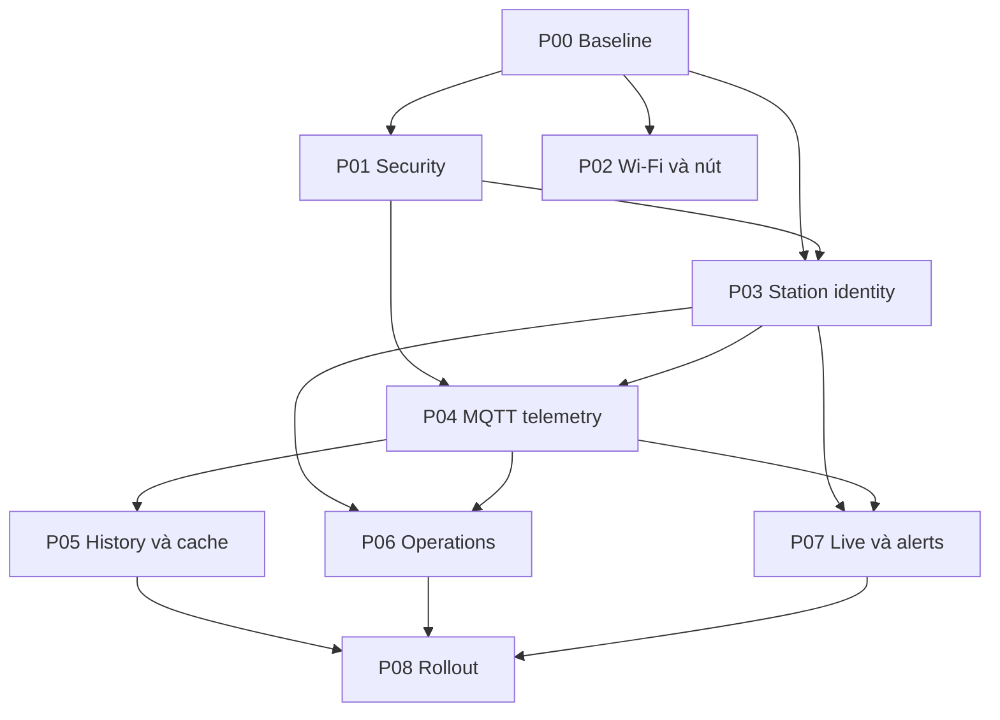

# Roadmap triển khai hệ thống IoT

Cập nhật: **26/11/2026, UTC+7**.

## Vai trò tài liệu

Đây là **index và roadmap thực thi**, không lặp lại toàn bộ khảo sát. Các quyết định, bằng chứng, contract v2 và danh mục vấn đề chi tiết được giữ nguyên tại [`SYSTEM_REVIEW_AND_ARCHITECTURE.md`](SYSTEM_REVIEW_AND_ARCHITECTURE.md). Các plan bên dưới đều đang ở trạng thái **Planned**; chưa phải xác nhận đã sửa source, áp dụng migration hay deploy.

## Các kế hoạch nhỏ

| ID | Kế hoạch | Kết quả chính | Phụ thuộc chính |
| --- | --- | --- | --- |
| P00 | [Baseline và contract](plans/00-foundation-and-contract.md) | Baseline tái lập, fixtures và môi trường staging rõ ràng | Không |
| P01 | [Security và lỗi cần chặn](plans/01-security-and-baseline-fixes.md) | API có quyền, TLS được xác minh, không giả success, secrets được kiểm soát | P00 |
| P02 | [Wi-Fi provisioning và nút](plans/02-wifi-provisioning-and-buttons.md) | Setup/đổi Wi-Fi an toàn; nút có vai trò rõ | P00; có thể song song P01 |
| P03 | [Station identity và catalogue](plans/03-station-identity-and-catalogue.md) | Không nhầm dữ liệu giữa trạm; catalogue có nguồn từ backend | P00; catalogue cần API auth của P01 |
| P04 | [MQTT telemetry v2](plans/04-mqtt-telemetry-pipeline-v2.md) | Receiver bền/idempotent trước khi firmware gửi protocol mới | P00, P01; registry của P03 trước publisher |
| P05 | [History và local-first app](plans/05-history-and-local-first-app.md) | Bucket, rain amount/rate, daily summary và cache đúng | P00, contract P04 |
| P06 | [Config và command operations](plans/06-config-and-command-operations.md) | Theo dõi pending/accepted/applied/failed xuyên BE–FW–App | P01, P03; receiver/identity của P04 |
| P07 | [Live, WebSocket và alerts](plans/07-live-alerts-and-websocket.md) | Live có quyền/TTL; state/event/FCM không phát nhầm hoặc trùng | P01, P03, P04; có thể tích hợp song song P06 khi contract tách biệt |
| P08 | [Rollout và vận hành](plans/08-rollout-and-operations.md) | Canary, đo lường, runbook và rollback | Các plan đã đạt gate liên quan |

## Thứ tự kết hợp

- Có thể chạy song song sau P00: bảo vệ API, hotfix TLS, Wi-Fi provisioning và sửa state ID trên app, miễn các PR không ghi đè cùng file.
- Có thể phát triển receiver backend và firmware transport song song, nhưng **phải deploy/kiểm thử receiver trước khi bật publisher v2 trên board**.
- Không rollout command/config mới trước khi firmware hỗ trợ đúng ACK; không coi PUBACK là trạng thái đã áp dụng.
- Mỗi plan có thể có nhiều PR nhỏ. Tách theo owner/lớp khi hữu ích, nhưng gộp release theo một outcome đầu-cuối có thể nghiệm thu.

## Cách bắt đầu

1. Hoàn thành P00 và tạo fixtures trước khi sửa protocol hoặc schema.
2. Chọn P01 làm blocker mở public; chạy P02 và phần sửa station identity của P03 song song.
3. Review từng plan theo phạm vi, dependency, tiêu chí nghiệm thu và rollback trước khi bắt đầu PR.
4. Không đặt ngày/effort cố định cho tới khi có baseline staging và board; cập nhật status trong plan con sau mỗi gate.

## Quy ước trạng thái

- **Planned:** đã mô tả, chưa bắt đầu.
- **In progress:** PR đang thực hiện; ghi rõ người phụ trách và phạm vi.
- **Blocked:** nêu dependency/bằng chứng còn thiếu.
- **Verified:** tiêu chí nghiệm thu đã chạy và có kết quả; ghi môi trường, commit và test.

Mỗi plan phải ghi rõ *In scope / Out of scope*, dependency, thứ tự triển khai, acceptance tests, rollout/rollback. Không xóa lịch sử kiến trúc khỏi tài liệu tham chiếu khi plan con được hoàn thành.
